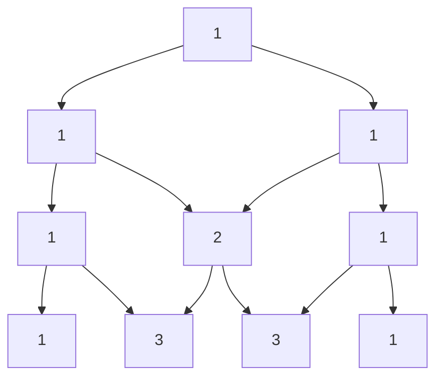
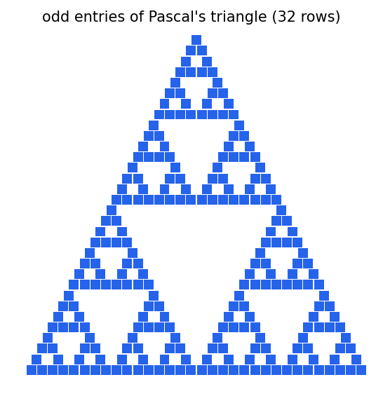

# Binomial Theorem 【6】

二项式定理

## Description

**Binomial theorem**: for any non-negative integer n,

> (a + b)ⁿ = Σₖ₌₀ⁿ C(n, k) · aⁿ⁻ᵏ · bᵏ

The coefficients C(n, k) are exactly the entries of row n of **Pascal's (Yang
Hui) triangle** (see the Introductory Level space):



Each entry is the sum of the two above it: C(n+1, k) = C(n, k−1) + C(n, k) —
which is also why C(n, k) can be computed by DP in O(n²) without any division.

**Why it's true (combinatorially)**: (a + b)ⁿ = (a+b)(a+b)…(a+b). Expanding
means choosing, from each of the n factors, either a or b; the term aⁿ⁻ᵏbᵏ
arises once per choice of which k factors contribute b — C(n, k) choices. The
theorem is counting in algebraic clothing.

**Useful corollaries:**

* a = b = 1: Σₖ C(n, k) = 2ⁿ — an n-element set has 2ⁿ subsets.
* a = 1, b = −1: Σₖ (−1)ᵏ C(n, k) = 0 (n ≥ 1) — even-sized and odd-sized
  subsets balance. This identity powers inclusion–exclusion.
* Coefficient extraction: the coefficient of xᵏ in (1 + x)ⁿ is C(n, k). To
  extract any coefficient, ask "which k picks give this monomial?"
* Approximation: (1 + x)ⁿ ≈ 1 + nx for small |x| (first two terms); adding the
  third term C(n,2)x² improves accuracy.

**In contests**: binomial expansions modulo a prime (with precomputed factorials
and inverse factorials) are everywhere — polynomial identities, expected values,
generating-function manipulations. Divisibility tricks like aⁿ ≡ bⁿ (mod a−b)
are one-line binomial expansions of ((a−b) + b)ⁿ.

## Examples

**Example 1.** (x + 2)⁴ = x⁴ + 4·2x³ + 6·4x² + 4·8x + 16 =
x⁴ + 8x³ + 24x² + 32x + 16.

**Example 2.** Coefficient of x³ in (2x + 1)⁵: C(5, 3)·(2x)³·1² = 10·8x³ → 80.

**Example 3.** Σₖ C(10, k) = 2¹⁰ = 1024; Σₖ (−1)ᵏC(10, k) = 0 →
C(10,0)+C(10,2)+… = C(10,1)+C(10,3)+… = 512.

**Example 4.** 99⁴ = (100 − 1)⁴ = 10⁸ − 4·10⁶ + 6·10⁴ − 400 + 1 = 96 059 601.

**Example 5.** Divisibility: 7 | 8ⁿ − 1 because 8ⁿ = (7+1)ⁿ = Σ C(n,k)7ᵏ —
every term except the last (k = 0, giving 1) contains a factor 7.

**Example 6 (C++).** Coefficient of xᵏ in (1 + x)ⁿ mod p:

```cpp
// = C(n, k) mod p, with precomputed factorials:
long long coef = fact[n] * invFact[k] % P * invFact[n - k] % P;
```

**Example 7.** Number of odd entries in row n of Pascal's triangle is
2^(popcount(n)) (Lucas' theorem corollary — NOI-level flavor, stated here for
intuition: e.g. n = 5 = 101₂ → 4 odd entries: 1, 5, 5… check row 5:
1 5 10 10 5 1 → 4 odd ✓).



The picture shows *why* such a clean formula can exist: C(n, k) mod 2 follows a
self-similar pattern, and the 1-bits of n count its "active" sub-triangles.

**Example 8 (walkthrough — extracting a coefficient by pure counting).** What is
the coefficient of x² in (x + 2)⁴? Expanding means: from each of the 4 factors
(x+2) pick either x or 2, then multiply your picks. To end up with x² you must
pick x from exactly 2 factors and 2 from the other 2. There are C(4, 2) = 6 ways
to choose which factors give x, and each contributes x²·2² = 4x². Total:
6·4x² = 24x² — coefficient 24, matching Example 1. Every binomial coefficient
extraction is this two-step: *which factors?* (C(n,k)) × *what constants?* (the
powers of a and b).

## Practice

1. Expand (x + 3)³ and (a − b)⁴.
   *(Answer: x³ + 9x² + 27x + 27; a⁴ − 4a³b + 6a²b² − 4ab³ + b⁴.)*
2. Find the coefficient of x⁵ in (1 + x)⁸; of x²y³ in (2x + y)⁵.
   *(Answer: 56; C(5,2)(2x)²y³ = 10·4 = 40x²y³ → 40.)*
3. Compute Σₖ k·C(n, k) for n = 4 by hand; guess and prove the general formula.
   *(Answer: n·2ⁿ⁻¹; differentiate (1+x)ⁿ at x = 1, or count "choose a
   committee with a chair" two ways.)*
4. Show 11ⁿ ≡ 1 (mod 10) using the binomial theorem on (10 + 1)ⁿ.
5. Approximate 1.02¹⁰ to two decimal places using the first three terms.
   *(Answer: 1 + 0.2 + 45·0.0004 = 1.218 → 1.22.)*
6. Show that Σₖ C(n, k)² = C(2n, n). *(Hint: coefficient of xⁿ in
   (1+x)ⁿ(1+x)ⁿ, or count n-subsets of a 2n-set split into two halves.)*
7. Compute C(50, 25) mod 998244353 with a program using factorials and inverse
   factorials. *(Let the program tell you.)*
8. (Challenge) Prove Σₖ C(m, k)·C(n, r−k) = C(m+n, r) (Vandermonde's identity)
   by comparing coefficients in (1+x)ᵐ(1+x)ⁿ = (1+x)ᵐ⁺ⁿ.
