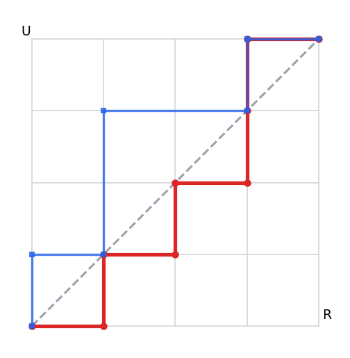

# Catalan Numbers 【7】

卡特兰（Catalan）数

## Description

The **Catalan numbers** are the sequence

> C₀ = 1, C₁ = 1, Cₙ = (4n − 2)/(n + 1) · Cₙ₋₁ = C(2n, n) / (n + 1)

First values: 1, 1, 2, 5, 14, 42, 132, 429, 1430 (C₀…C₈).

**Equivalent definitions:**

* Closed form: Cₙ = C(2n, n) − C(2n, n+1) = C(2n, n)/(n+1).
* Recurrence: Cₙ₊₁ = Σᵢ₌₀ⁿ Cᵢ · Cₙ₋ᵢ (split at a distinguished element).

**Where they appear** — the pattern to recognize in problems:

* Valid strings of n pairs of parentheses: ((())), (()()), (())(), ()(()), ()()()
  for n = 3 → C₃ = 5.
* Paths from (0,0) to (n,n) that never rise above the diagonal (**Dyck paths**):



* Number of distinct binary trees with n nodes; number of triangulations of a
  convex (n+2)-gon; stack-sortable permutations; full parenthesizations of n+1
  factors.

**Why the closed form works (reflection principle, sketch).** All monotone paths
from (0,0) to (n,n): C(2n, n). A *bad* path rises above the diagonal — reflect the
part up to its first step above the diagonal across the line y = x + 1; the
reflected paths are exactly all paths from (−1, 1) to (n, n), counted by
C(2n, n+1). Subtracting gives C(2n, n) − C(2n, n+1) = C(2n, n)/(n+1).

**Recognition trick**: whenever a count for small n goes 1, 2, 5, 14, 42 — suspect
Catalan and look for the recursive split.

## Examples

**Example 1.** C₄ = C(8, 4)/5 = 70/5 = 14.

**Example 2.** Parentheses for n = 2: (()), ()() → C₂ = 2.

**Example 3.** A stack receives the push sequence 1, 2, 3; how many pop sequences
are possible? C₃ = 5: (1,2,3), (1,3,2), (2,1,3), (2,3,1), (3,2,1). Note (3,1,2) is
impossible — after pushing 1,2,3 to pop 3 first, 2 sits above 1.

**Example 4.** Recurrence check: C₄ = C₀C₃ + C₁C₂ + C₂C₁ + C₃C₀ =
5 + 2 + 2 + 5 = 14. ✓ (Splitting a Dyck path at its first return to the axis:
the inside is a smaller Dyck path, and so is the tail.)

**Example 5 (C++).** Catalan numbers mod p by the multiplicative recurrence:

```cpp
cat[0] = 1;
for (int i = 0; i < n; i++)
    cat[i+1] = cat[i] * (4*i + 2) % P * inv(i + 2, P) % P;
```

## Practice

1. Compute C₅ and C₆ from the closed form. *(Answer: 42; 132.)*
2. List all valid parenthesizations of 3 pairs; count those of 4 pairs (should be
   5 and 14).
3. How many distinct binary trees have 3 nodes? Draw them. *(Answer: 5.)*
4. How many ways can a convex hexagon be triangulated by non-crossing diagonals?
   *(Answer: C₄ = 14.)*
5. 2n people in line for tickets: n have only a 5-coin, n have only a 10-coin; a
   ticket costs 5 and the cashier starts with no change. How many orderings never
   strand the cashier? *(Answer: Cₙ — map 5-coin → '(', 10-coin → ')'; the queue
   must stay a valid prefix.)*
6. Write a program printing C₀…C₃₀ exactly (use `long long` — where does it
   overflow?) and Cₙ mod 10⁹+7 for n up to 10⁶.
   *(Overflow: C₃₅ ≈ 3.1×10¹⁸ nears the limit; C₃₆ overflows int64.)*
7. (Challenge) Prove Cₙ = C(2n, n) − C(2n, n+1) via the reflection principle: count
   paths from (0,0) to (n,n) that cross above the diagonal by reflecting their
   first crossing.
