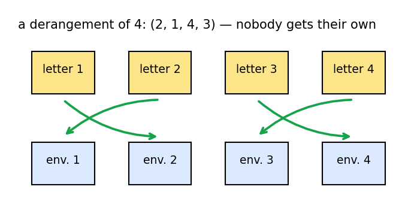
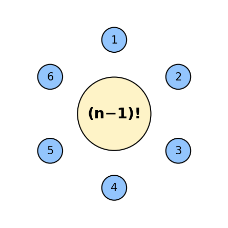

# Derangements and Circular Permutations 【6】

错排列、圆排列

## Description

### Derangements (错排列)

A **derangement** Dₙ is a permutation of {1, …, n} where **no element stays in its
own position** (π(i) ≠ i for all i). The count satisfies:

> Dₙ = (n − 1)(Dₙ₋₁ + Dₙ₋₂), with D₁ = 0, D₂ = 1

> Dₙ = n! · Σᵢ₌₀ⁿ (−1)ⁱ / i! ≈ n! / e

First values: 0, 1, 2, 9, 44, 265 (n = 1…6).



**Recurrence idea**: element 1 goes to position k (n−1 choices). If element k goes
back to position 1, the remaining n−2 elements derange freely: Dₙ₋₂ options.
Otherwise element k must avoid position 1 — exactly as if it *were* element 1 among
the n−1 remaining elements: Dₙ₋₁ options.

The series formula comes from [inclusion–exclusion](inclusion-exclusion.md) on the
properties "position i keeps its own element" — and the limit n!/e explains the
famous fact that a random permutation is a derangement with probability ≈ 1/e ≈
37%, for any large n.

### Circular permutations (圆排列)

Arranging n distinct elements **around a circle**, where rotations of each other are
considered the same:

> (n − 1)!



**Why**: n! linear arrangements, but each circular arrangement is counted n times
(once per rotation), so n!/n = (n−1)!. Equivalently: fix one person's seat to break
the rotational symmetry, then arrange the other n−1 freely. If reflections also
count as the same (e.g. a necklace that can be flipped), divide by 2: (n−1)!/2.

## Examples

**Example 1.** D₃ = 2: of the 6 permutations of {1,2,3}, only (2,3,1) and (3,1,2)
move every element.

**Example 2.** D₄ = 9: 4!·(1 − 1 + 1/2 − 1/6 + 1/24) = 24·(9/24) = 9.

**Example 3.** 4 people give gifts so nobody receives their own gift: D₄ = 9 ways.

**Example 4.** 8 people around a round table: (8−1)! = 5040 arrangements. As a
necklace (flippable): 5040/2 = 2520.

**Example 5 (C++).** Derangements by DP:

```cpp
D[1] = 0; D[2] = 1;
for (int i = 3; i <= n; i++)
    D[i] = (i - 1) * (D[i-1] + D[i-2]) % MOD;
```

**Example 6.** Verify D₅ = 44 by the formula: 5!(1/2! − 1/3! + 1/4! − 1/5!) =
120·(1/2 − 1/6 + 1/24 − 1/120) = 60 − 20 + 5 − 1 = 44. ✓

**Example 7 (walkthrough — D₄ from the recurrence, twice over).** We know
D₁ = 0, D₂ = 1. Climb: D₃ = 2·(1 + 0) = 2; D₄ = 3·(2 + 1) = 9; D₅ = 4·(9 + 2) =
44. Every step needs only the previous two values — that is why the DP code is
three lines long. And the closed form agrees:
4!·(1 − 1 + 1/2 − 1/6 + 1/24) = 24·(9/24) = 9. Two roads, same 9.

**Example 8 (walkthrough — 4 people at a round table, concretely).** Seat Alice
first — because the table rotates, her chair does not matter. Then Ben has 3
free seats, Carol 2, Dave 1: 3·2·1 = 6 = (4−1)! arrangements. Listing them by
who sits on Alice's right: ABCD, ABDC, ACBD, ACDB, ADBC, ADCB — six genuinely
different circles.

## Practice

1. Compute D₆ by the recurrence and by the n! Σ(−1)ⁱ/i! formula.
   *(Answer: 265 both ways.)*
2. A secretary puts 5 letters into 5 addressed envelopes at random. How many ways
   with every letter in a wrong envelope? What is the probability?
   *(Answer: 44; 44/120 = 11/30.)*
3. 6 children sit around a round table; how many seating arrangements?
   *(Answer: 5! = 120.)*
4. 5 distinct beads on a bracelet (flippable): how many designs?
   *(Answer: 4!/2 = 12.)*
5. n men check n hats; in how many ways can exactly n−2 get their own hat back?
   *(Hint: choose which 2 swap. Answer: C(n, 2)·D₂ = C(n, 2).)*
6. Write a program computing Dₙ mod 10⁹+7 for n up to 10⁷ in O(n).
7. (Challenge) Prove Dₙ = n·Dₙ₋₁ + (−1)ⁿ from the series formula, and use it for an
   alternative O(n) computation.
