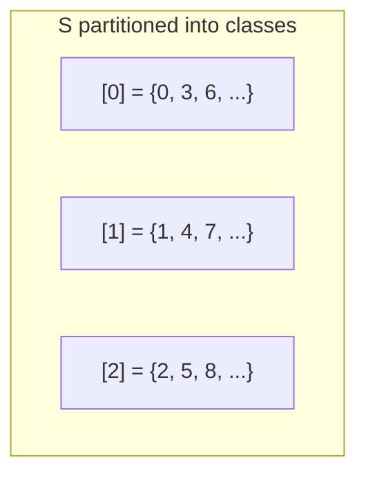

# Equivalence Relations and Equivalence Classes 【6】

等价关系与等价类

## Description

A **relation** R on a set S is a collection of ordered pairs; we write a ~ b for
(a, b) ∈ R. A relation is an **equivalence relation** if it is:

* **Reflexive (自反)**: a ~ a for all a;
* **Symmetric (对称)**: a ~ b implies b ~ a;
* **Transitive (传递)**: a ~ b and b ~ c imply a ~ c.

An equivalence relation partitions S into disjoint **equivalence classes**
(等价类): [a] = {x : x ~ a}. Every element belongs to exactly one class — the
classes form a **partition** of S.



*Congruence mod 3 partitions ℤ into three disjoint classes.*

Classic examples: congruence mod m (classes = residue classes); connectivity in a
graph (classes = connected components); "has the same birthday".

**Why you should care**: equivalence relations are the mathematical version of
"grouping by". Any time a problem says "treat these as the same", check the three
properties — if they hold, you may pick one representative per class and work only
with representatives.

**In competitive programming**, equivalence classes are maintained by the
**disjoint-set union (并查集)** data structure: `find` returns the class
representative, `unite` merges two classes — near-constant amortized time with path
compression.

## Examples

**Example 1.** Congruence mod 3 on ℤ: classes [0] = {…, −3, 0, 3, …},
[1] = {…, 1, 4, …}, [2]. Three classes partitioning ℤ.

**Example 2.** "x ~ y iff x and y have the same tens digit" on [0, 99]: reflexive,
symmetric, transitive → equivalence; classes are {0–9}, {10–19}, …, {90–99}.

**Example 3.** "a ~ b iff a − b is even" splits ℤ into evens and odds — 2 classes.
This is exactly congruence mod 2.

**Example 4.** Non-examples: "a < b" is transitive but neither reflexive nor
symmetric. "a ~ b iff |a − b| ≤ 1" on ℤ is reflexive and symmetric but not
transitive (0 ~ 1, 1 ~ 2, yet 0 ≁ 2). Each failed property kills the equivalence.

**Example 5 (C++).** DSU sketch:

```cpp
int fa[N];
int find(int x) { return fa[x] == x ? x : fa[x] = find(fa[x]); }
void unite(int x, int y) { fa[find(x)] = find(y); }
// same class?  find(x) == find(y)
```

**Example 6 (walkthrough — checking the three properties, property by
property).** Is "x ~ y iff x − y is divisible by 4" an equivalence on ℤ?
Reflexive: x − x = 0, divisible by 4 ✓. Symmetric: if 4 | (x−y) then
4 | (y−x) = −(x−y) ✓. Transitive: if x−y = 4a and y−z = 4b then
x−z = 4(a+b) ✓. Three small checks, and suddenly the whole infinite set ℤ
collapses into just 4 objects worth thinking about: [0], [1], [2], [3].

**Example 7 (walkthrough — a DSU trace).** Start: each of {1,2,3,4} alone.
unite(1,2) → {1,2},{3},{4}; unite(3,4) → {1,2},{3,4}; find(1) = find(2) → same
class, yes; find(1) = find(3)? different → no. unite(2,3) → {1,2,3,4}; now every
find returns the same representative. Four elements, three unions, and the
partition evolved exactly as the equivalence classes should.

## Practice

1. Which are equivalence relations on ℤ? (a) a ~ b iff a | b; (b) a ~ b iff
   a ≡ b (mod 5); (c) a ~ b iff a ≤ b; (d) a ~ b iff a² = b².
   *(Answer: (b) and (d) only; (a) fails symmetry, (c) fails symmetry.)*
2. List the equivalence classes of "same parity" on {1, 2, 3, 4, 5, 6}.
   *(Answer: {1, 3, 5} and {2, 4, 6}.)*
3. On the set of students, is "same age in years" an equivalence relation? "Taller
   than"? *(Answer: yes; no.)*
4. How many equivalence classes does congruence mod 7 define on ℤ? Name one
   representative of each. *(Answer: 7; 0, 1, 2, 3, 4, 5, 6.)*
5. Prove: any two equivalence classes are either equal or disjoint.
6. Write a program using DSU that reads n elements and m statements "x equivalent
   y", then answers q queries "are x and y equivalent?".
7. (Challenge) Show the number of equivalence relations on a 3-element set is 5
   (count the partitions: Bell number B₃).
