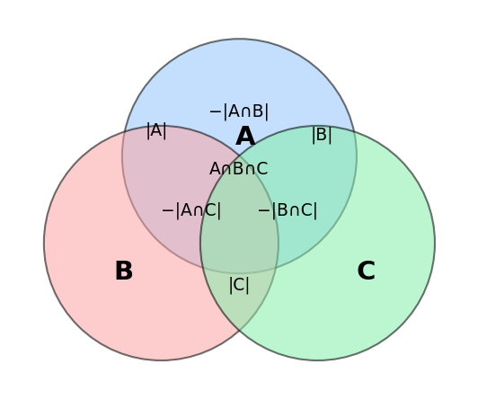

# Inclusion–Exclusion Principle 【7】

容斥原理

## Description

**Inclusion–exclusion** counts the size of a union of overlapping sets by
alternately adding and subtracting intersections. For two sets:

> |A ∪ B| = |A| + |B| − |A ∩ B|

For three sets:

> |A ∪ B ∪ C| = |A| + |B| + |C| − |A∩B| − |A∩C| − |B∩C| + |A∩B∩C|



**Why the signs alternate.** An element lying in exactly t of the sets is counted
C(t,1) times by the single sums, C(t,2) times by the pair sums, and so on — total
C(t,1) − C(t,2) + C(t,3) − … = 1 by the binomial identity (1−1)ᵗ = 0 for t ≥ 1.
So every element ends up counted **exactly once**, regardless of how many sets it
belongs to.

In general, for n sets:

> |∪ᵢ Aᵢ| = Σ|Aᵢ| − Σ|Aᵢ∩Aⱼ| + Σ|Aᵢ∩Aⱼ∩Aₖ| − … + (−1)ⁿ⁺¹ |A₁∩…∩Aₙ|

Equivalently, counting elements with **none** of the properties:

> |none| = total − Σ|Aᵢ| + Σ|Aᵢ∩Aⱼ| − …

**In contests**, inclusion–exclusion is computed by iterating over all 2ⁿ subsets
of properties and adding/subtracting according to parity — O(2ⁿ · cost). This works
when n (the number of *properties*, not elements) is small, typically ≤ 20.

## Examples

**Example 1.** [1, 100] divisible by 2, 3, or 5:
50 + 33 + 20 − 16 − 10 − 6 + 3 = 74.

**Example 2.** Euler's totient by inclusion–exclusion: n = 60 = 2²·3·5.
φ(60) = 60 − 60/2 − 60/3 − 60/5 + 60/6 + 60/10 + 60/15 − 60/30 =
60 − 30 − 20 − 12 + 10 + 6 + 4 − 2 = 16. ✓ This is where the product formula
n·∏(1 − 1/p) comes from.

**Example 3.** Derangements: Dₙ = n! Σ(−1)ⁱ/i! comes from inclusion–exclusion on
the properties "position i is fixed".

**Example 4 (C++).** Count numbers in [1, n] coprime with 30 = 2·3·5 by enumerating
subsets of prime factors:

```cpp
int primes[] = {2, 3, 5};
long long bad = 0;
for (int mask = 1; mask < (1 << 3); mask++) {
    long long prod = 1;
    int bits = __builtin_popcount(mask);
    for (int i = 0; i < 3; i++)
        if (mask >> i & 1) prod *= primes[i];
    bad += (bits % 2 ? 1 : -1) * (n / prod);
}
long long coprime = n - bad;
```

**Example 5.** Surjections from an m-set onto an n-set (property i = "value i
missed"):

> n^m − C(n,1)(n−1)^m + C(n,2)(n−2)^m − … = Σᵢ (−1)ⁱ C(n, i) (n−i)^m

**Example 6 (walkthrough — one element's ledger).** Track the number 30 through
the computation of Example 1. It is divisible by 2, 3 and 5, so it belongs to
all three sets. The formula charges it: +1 (in |A|) +1 (|B|) +1 (|C|)
−1 (A∩B, multiple of 6) −1 (A∩C, of 10) −1 (B∩C, of 15) +1 (A∩B∩C, of 30).
Net: 3 − 3 + 1 = 1 — counted exactly once, as promised. Now check 14 (only in
A): +1, nothing else — also once. The alternating signs are precisely tuned so
that every element's ledger balances to 1.

## Practice

1. [1, 200] divisible by 3 or 7. *(Answer: 66 + 28 − 9 = 85.)*
2. [1, 1000] coprime with 10. *(Answer: 1000 − 500 − 200 + 100 = 400 = φ(10)·100.)*
3. How many permutations of {1,…,5} have π(1) ≠ 1 and π(2) ≠ 2?
   *(Answer: 120 − 24 − 24 + 6 = 78.)*
4. How many solutions does x + y + z = 15 have with 0 ≤ x, y, z ≤ 6?
   *(Answer: C(17,2) − 3·C(10,2) + 3·C(3,2) = 136 − 135 + 9 = 10.)*
5. How many strings of length 4 over {A,B,C} use all three letters?
   *(Answer: 3⁴ − 3·2⁴ + 3·1⁴ = 81 − 48 + 3 = 36.)*
6. Implement the subset-enumeration inclusion–exclusion to count integers in
   [1, n] (n ≤ 10¹⁸) divisible by none of a given list of k ≤ 20 primes.
7. (Challenge) Count 5-digit numbers containing each of the digits 1, 2, 3 at least
   once. *(Hint: inclusion–exclusion over "digit i absent", mind the leading zero.
   Answer: 90000 − 3·(8·9⁴) + 3·(7·8⁴) − 6·7⁴ = 90000 − 157464 + 86016 −
   14406 = 4146.)*
