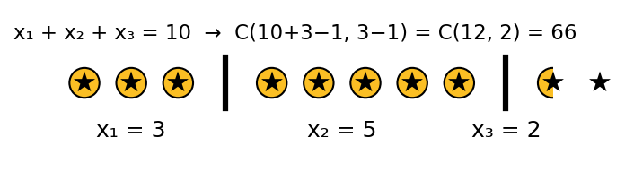

# Combinations of Multisets 【6】

多重集上的组合

## Description

**Problem**: choose m elements from k types, where each type is available in
**unlimited** supply and elements of the same type are indistinguishable. This is
the **stars and bars (隔板法)** count:

> C(m + k − 1, k − 1)



**Why**: lay the m chosen (identical) items in a row (stars) and insert k − 1 bars
to separate the types, as in the figure. Every arrangement of m stars and k − 1
bars encodes exactly one choice, and there are C(m + k − 1, k − 1) such
arrangements — choosing where the bars go among m + k − 1 positions.

Equivalently: the number of non-negative integer solutions of

> x₁ + x₂ + … + xₖ = m

is C(m + k − 1, k − 1). For **positive** solutions (every type chosen at least
once), substitute yᵢ = xᵢ − 1: the equation becomes y₁ + … + yₖ = m − k in
non-negative integers, giving C(m − 1, k − 1).

**Bounded case** (type i has at most nᵢ copies): no closed form in general — use
[inclusion–exclusion](inclusion-exclusion.md) on the violated bounds, as in
Example 4.

**Common pitfall**: stars and bars counts distributions to **distinct** recipients.
Identical recipients (partitions of an integer) are a much harder, different
problem.

## Examples

**Example 1.** Buy 6 buns from 4 kinds: C(6+4−1, 3) = C(9, 3) = 84.

**Example 2.** Number of non-negative solutions of x + y + z = 10:
C(12, 2) = 66. Positive solutions: C(9, 2) = 36.

**Example 3.** Distribute 10 identical candies to 3 children, each child getting at
least 1: C(10−1, 3−1) = C(9, 2) = 36. With no restriction: C(12, 2) = 66.

**Example 4.** Bounded: x + y + z = 8 with each variable ≤ 3. Total non-negative:
C(10, 2) = 45. Subtract cases where some variable ≥ 4 (set x′ = x − 4:
C(6, 2) = 15 each, three variables → 45). Add back double violations
(two variables ≥ 4 forces the sum ≥ 8, exactly the (4,4,0)-type: 3 cases):
45 − 45 + 3 = 3. Check by hand: (2,3,3), (3,2,3), (3,3,2) — 3. ✓

**Example 5 (C++).** Stars and bars:

```cpp
// solutions of x1+...+xk = m, xi >= 0
long long ans = C(m + k - 1, k - 1);
```

## Practice

1. How many non-negative integer solutions does x + y + z + w = 12 have?
   *(Answer: C(15, 3) = 455.)*
2. How many positive integer solutions does x + y + z = 15 have?
   *(Answer: C(14, 2) = 105.)*
3. 20 identical balls into 5 distinct boxes. No restriction? Each box non-empty?
   *(Answer: C(24, 4) = 10 626; C(19, 4) = 3876.)*
4. How many ways to choose 8 flowers from roses, tulips and lilies (unlimited
   supply)? *(Answer: C(10, 2) = 45.)*
5. Solutions of x + y + z = 20 with x ≥ 2, y ≥ 3, z ≥ 5.
   *(Hint: substitute. Answer: C(12, 2) = 66.)*
6. Solutions of x + y + z = 10 with each ≤ 4.
   *(Answer: C(12,2) − 3·C(7,2) + 3·C(2,2) = 66 − 63 + 3 = 6.)*
7. Write a program that reads m, k and prints the number of non-negative solutions
   of x₁ + … + xₖ = m modulo 10⁹+7.
8. (Challenge) Show the number of solutions of x₁ + … + xₖ ≤ m is C(m + k, k).
   *(Hint: add a slack variable.)*
