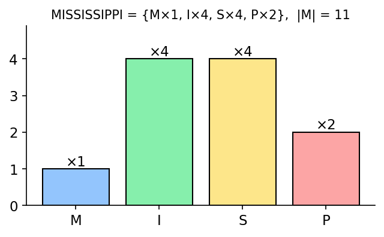

# Multisets 【6】

多重集合

## Description

A **multiset (多重集合)** is like a set, but elements may appear **multiple
times**. We write {a, a, b} with multiplicities: a×2, b×1. The **multiplicity**
of an element is the number of times it occurs; the **cardinality** of a
multiset is the sum of all multiplicities.

* Notation: {1, 1, 2} ≠ {1, 2} as multisets.
* Union/intersection for multisets: take **max** (resp. **min**) of
  multiplicities — not the sum, a common slip. (Sum of multiplicities gives the
  *multiset sum* A ⊎ B, a different operation.)
* A multiset with multiplicities n₁, n₂, …, nₖ has cardinality
  n = n₁ + … + nₖ.

**Why multisets matter in counting**: most real counting problems involve
indistinguishable copies — the word BALL has a repeated L; distributing
identical apples to children is a multiset problem. Sets are the exception in
nature, not the rule. The two following pages
([permutations](multiset-permutations.md) and
[combinations](multiset-combinations.md) of multisets) build directly on this,
and each answers one of the two fundamental questions: *arrange* the multiset
(order matters) or *choose* a sub-multiset (order doesn't).



**Counting sub-multisets**: from {a₁^n₁, …, aₖ^nₖ}, each element aᵢ can be taken
0, 1, …, nᵢ times — independently — giving ∏(nᵢ + 1) sub-multisets. Notice the
parallel with the divisor-count formula: the divisors of p₁^a₁·…·pₖ^aₖ are
exactly the sub-multisets of its prime-factor multiset.

**In programming**, multisets appear as frequency arrays `cnt[v]` or
`std::map<value, count>`; C++ even ships `std::multiset` (ordered) and
`std::unordered_multiset`. Sliding-window frequency statistics, anagram checks,
and mode-finding are all multiset computations.

## Examples

**Example 1.** The letters of MISSISSIPPI form the multiset
{M, I×4, S×4, P×2} of cardinality 11.

**Example 2.** A = {1, 1, 2, 3}, B = {1, 2, 2}: A ∪ B = {1, 1, 2, 2, 3} (max
multiplicities), A ∩ B = {1, 2} (min multiplicities).

**Example 3.** Rolling two identical dice: outcomes are multisets {a, b} with
a ≤ b — there are C(6+2−1, 2) = 21 distinct outcomes (not 36, because {2,5} and
{5,2} coincide). Probability questions with identical dice must weight outcomes
unevenly: {2,5} is twice as likely as {3,3}.

**Example 4 (C++).** Frequency array as a multiset:

```cpp
int cnt[26] = {};
for (char c : s) cnt[c - 'a']++;   // multiset of letters of s
```

**Example 5.** Number of distinct sub-multisets of {a×2, b×1}: choose 0–2
copies of a and 0–1 of b → 3 × 2 = 6 (including the empty one).

**Example 6.** Anagram check: "listen" and "silent" are anagrams iff their
letter multisets are equal — compare the two 26-entry frequency arrays in
O(26).

**Example 7 (walkthrough — anagram check by hand).** Is "debit card" an anagram
of "bad credit"? Build both frequency multisets: debit card → {d×2, e×1, b×1,
i×1, t×1, c×1, a×1, r×1}; bad credit → {b×1, a×1, d×2, c×1, r×1, e×1, i×1,
t×1}. Equal, item by item → yes, anagrams. Sorting the letters ("abcddirt"-style
fingerprint) is the same test in another costume.

**Example 8 (walkthrough — counting sub-multisets slowly).** {a×2, b×1}: a can
appear 0, 1 or 2 times (3 choices), b can appear 0 or 1 times (2 choices), and
the choices are independent — 3·2 = 6: {}, {b}, {a}, {a,b}, {a,a}, {a,a,b}.
Write them out once; the product formula ∏(nᵢ+1) will never feel like magic
again.

## Practice

1. List the multiset of prime factors of 360 with multiplicities.
   *(Answer: {2×3, 3×2, 5×1}.)*
2. How many distinct sub-multisets does {x×3, y×2, z×1} have?
   *(Answer: 4·3·2 = 24.)*
3. Given A = {1×3, 2×1} and B = {1×1, 2×4, 3×2}, compute A ∪ B and A ∩ B.
   *(Answer: {1×3, 2×4, 3×2}; {1×1, 2×1}.)*
4. How many distinct outcomes are there when rolling three identical dice?
   *(Answer: C(6+3−1, 3) = 56.)*
5. A bakery sells 4 kinds of buns. You buy 6 buns (kinds may repeat). How many
   different baskets are possible? *(Answer: C(6+4−1, 4−1) = C(9, 3) = 84 — a
   multiset combination; details on the next pages.)*
6. Two strings are "semi-anagrams" if one can be obtained from the other by
   changing at most one letter. Given frequency arrays, how would you test
   this? *(Hint: total absolute difference of the arrays must be 2.)*
7. Write a program that reads a string and prints the letter with the highest
   multiplicity and that multiplicity.
8. (Challenge) Show that the number of sub-multisets of {a₁^n₁, …, aₖ^nₖ} is
   ∏(nᵢ + 1) — and connect this with the divisor-count formula from unique
   factorization.
