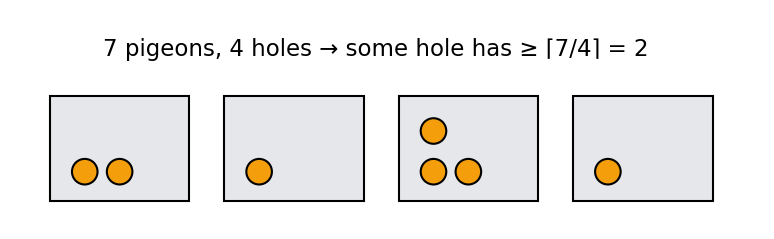

# Pigeonhole Principle 【6】

鸽巢原理

## Description

**Pigeonhole principle (drawer principle)**: if n + 1 or more pigeons are placed
into n holes, some hole contains at least two pigeons.

**Generalized form**: if N objects are placed into k boxes, some box contains at
least **⌈N/k⌉** objects.

The principle only proves *existence* — it never tells you *which* box. The art is
choosing what plays the role of pigeons and what the role of holes. A good
heuristic: the thing you want two of ("same residue", "same sum") is the hole; the
objects you are given are the pigeons.

**Typical uses in contests**: "show that two of these numbers have the same …",
existence of a repeated value, subsequence with a sum divisible by n, etc.

## Examples

**Example 1.** Among any 13 people, two share a birth month. (13 pigeons, 12
months.)

**Example 2.** Among any 367 people, two share a birthday (366 possible birthdays
including Feb 29).

**Example 3.** Any 5 points inside an equilateral triangle of side 2: two are within
distance 1. Split the triangle into 4 sub-triangles of side 1 (the holes); two
points land in the same one.

**Example 4.** Among any n + 1 integers, two have the same residue mod n — their
difference is divisible by n.

**Example 5.** Given any 10 distinct two-digit numbers, there are two disjoint
non-empty subsets with equal sums. Pigeons: the 2¹⁰ − 1 = 1023 non-empty subsets;
holes: possible sums, from 10 to 10·99 = 990. Since 1023 > 990, two subsets share a
sum; removing their common part makes them disjoint (and still non-empty and equal).

**Example 6 (classic).** Any sequence of n numbers contains a contiguous subsequence
whose sum is divisible by n: consider prefix sums s₀, s₁, …, sₙ mod n — n+1 pigeons,
n residues; either some sᵢ ≡ 0 (take the prefix itself), or two prefix sums collide
and their difference sⱼ − sᵢ is the desired segment.

**Example 7 (walkthrough — the prefix-sum trick with real numbers).** Take the
sequence 3, 1, 4, 1, 5 (n = 5). Prefix sums mod 5: s₀ = 0, s₁ = 3, s₂ = 4,
s₃ = 8 ≡ 3, s₄ = 9 ≡ 4, s₅ = 14 ≡ 4. Six pigeons, five holes — and indeed
s₂ = s₄ = 4 collide. Their difference a₃ + a₄ = 4 + 1 = 5 is divisible by 5.
No searching required: the collision *hands* you the answer.

## Practice

1. How many socks must you draw blindfolded from a drawer with 4 colors to guarantee
   a matching pair? *(Answer: 5.)*
2. Show that among any 5 integers, some 3 have a sum divisible by 3.
   *(Hint: residues mod 3; either all three residues appear — take one of each — or
   one residue appears at least ⌈5/3⌉ = … at least 3 times.)*
3. Show that among 51 points in a unit square, two are within distance √2/5.
   *(Hint: split into a 5×5 grid of cells with diagonal √2/5.)*
4. Show that some positive multiple of 2025 consists only of digits 0 and 1.
   *(Hint: consider 1, 11, 111, … mod 2025 — 2026 pigeons, 2025 holes; subtract the
   colliding pair.)*
5. Prove: at any party of 6 people, some 3 are pairwise acquainted or pairwise
   unacquainted (Ramsey R(3,3) = 6). *(Hint: fix one person; their 5 relations
   split into two types — one group has ≥ ⌈5/2⌉ = 3.)*
6. Write a program that, given n and an array of n integers, finds a contiguous
   subsequence with sum divisible by n using prefix sums mod n.
7. (Challenge) Among any 52 integers, two exist whose sum **or** difference is
   divisible by 100. *(Hint: holes = residue pairs {i, 100−i} — 51 holes.)*
