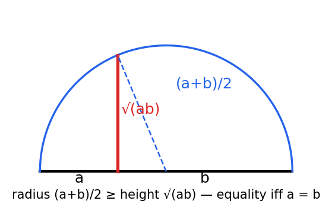

# Algebra (Senior High School) 【5】

代数（高中部分）

## Description

The senior-high algebra assumed by the syllabus covers seven blocks. You do not
need to re-derive theory here — you need *fluency*, because these tools appear
inside larger algorithmic problems (complexity analysis, expected values,
closed-form sums in DP, geometry formulas).

* **Sets and logic (集合与常用逻辑用语)**: union, intersection, complement;
  sufficient vs. necessary conditions. In plain words: "A is sufficient for B"
  means A *alone is enough* to get B (A ⇒ B); "A is necessary for B" means you
  *cannot have* B without A (B ⇒ A). Test yourself: "being a dog" is sufficient
  for "being a mammal", not necessary.
* **Functions (函数)**: domain, range, monotonicity, parity; exponential functions
  (指数函数), logarithmic functions (对数函数) and power functions (幂函数);
  transformations (shifts, stretches, reflections); zeros and the bisection
  method. In plain words: exponential grows by *multiplying* (2, 4, 8, 16…),
  logarithm is its inverse — it *counts digits/doublings*. That is why log n
  appears whenever a loop halves its range.
* **Sequences (数列)**: arithmetic aₙ = a₁ + (n−1)d, sum Sₙ = n(a₁+aₙ)/2;
  geometric aₙ = a₁qⁿ⁻¹, sum Sₙ = a₁(qⁿ−1)/(q−1) for q ≠ 1. In plain words:
  arithmetic = "add the same step each time"; geometric = "multiply by the same
  factor each time". Their sums are the backbone of complexity analysis: an
  arithmetic sum is O(n²), a geometric sum is dominated by its largest term
  (why a doubling loop does 1+2+4+…+n < 2n work total).
* **Summation techniques**: 错位相减 (shift-and-subtract, for Σ of
  arithmetic×geometric terms) and 裂项相消 (telescoping, writing each term as
  f(k) − f(k+1) so neighbours cancel).
* **Trigonometry (三角函数)**: radian measure; sin, cos, tan and their graphs;
  identities (sin²x + cos²x = 1, sum/difference, double-angle); law of sines
  a/sin A = 2R and law of cosines c² = a² + b² − 2ab·cos C. In plain words: the
  law of cosines is the Pythagorean theorem with a correction term for non-right
  angles — it converts "two sides and the angle between them" into the third
  side.
* **Inequalities (不等式)**: quadratic inequalities (solve via the parabola's
  sign); AM–GM (a + b)/2 ≥ √(ab) for a, b > 0, equality iff a = b; basic linear
  programming. AM–GM has a beautiful one-picture proof:

  The dashed radius (a+b)/2 can never be shorter than the vertical chord
  √(ab) — and they coincide exactly when the split is centered, i.e. a = b.
  AM–GM generalizes: (x₁+…+xₙ)/n ≥ (x₁…xₙ)^(1/n).
* **Complex numbers (复数)**: a + bi, arithmetic, modulus |a+bi| = √(a²+b²),
  conjugate; the complex plane. In plain words: a complex number is a 2D point
  that knows how to *rotate* — multiplying by i rotates 90° counterclockwise.
  This is the seed of FFT and of rotation formulas in geometry.
* **Derivatives (导数, basic)**: f′(x) as rate of change; derivatives of xⁿ, eˣ,
  ln x; f′ > 0 ⇒ increasing. Use derivatives to find extrema of single-variable
  cost functions — often the fastest way to optimize a closed-form answer.

**When each tool fires in contests**: loops with i doubling → geometric series;
nested loops 1..n, 1..i → arithmetic series; "minimize perimeter for fixed area"
→ AM–GM; "find x with f(x) = 0, f continuous" → bisection.

## Examples

**Example 1.** Arithmetic sequence with a₁ = 3, d = 4: a₁₀ = 3 + 9·4 = 39,
S₁₀ = 10·(3+39)/2 = 210.

**Example 2.** Geometric series: 1 + 2 + 4 + … + 2ⁿ = 2ⁿ⁺¹ − 1. This is why
binary numbers and doubling loops behave the way they do: a binary counter
incrementing from 0 to n does fewer than 2n bit flips in total.

**Example 3 (walkthrough — bisection).** Find √2 by bisecting f(x) = x² − 2 on
[1, 2]: f(1) = −1 < 0, f(2) = 2 > 0. Midpoint 1.5: f(1.5) = 0.25 > 0 → root in
[1, 1.5]. Midpoint 1.25: f(1.25) = −0.4375 < 0 → root in [1.25, 1.5]. Midpoint
1.375: f ≈ −0.109 < 0 → [1.375, 1.5]. Ten steps pin it to about 1.414… Each
step halves the interval, so n steps give 2⁻ⁿ of the original uncertainty —
exactly binary search on a continuous domain.

**Example 4.** AM–GM: for x > 0, x + 1/x ≥ 2, with equality at x = 1. A second
use: among all rectangles with perimeter 20, the square 5×5 has the largest
area (25), because (a+b)/2 = 5 ≥ √(ab) forces ab ≤ 25.

**Example 5.** Telescoping sum (裂项): Σₖ 1/(k(k+1)) = Σₖ (1/k − 1/(k+1)) =
1 − 1/(n+1) = n/(n+1). Watch the cancellation: (1 − 1/2) + (1/2 − 1/3) +
(1/3 − 1/4) + … — every −1/k kills the previous +1/k. Recognize the pattern
1/(k(k+1)) = 1/k − 1/(k+1): every partial-fraction style identity invites
telescoping.

**Example 6.** 错位相减: S = Σₖ₌₁ⁿ k·2ᵏ. Compute 2S = Σ k·2ᵏ⁺¹ and subtract:
S − 2S = Σ 2ᵏ − n·2ⁿ⁺¹ → S = (n−1)·2ⁿ⁺¹ + 2. Sanity check n = 2:
1·2 + 2·4 = 10 and (2−1)·2³ + 2 = 10. ✓

**Example 7 (walkthrough — law of cosines).** cos 60° = 1/2; a triangle with
sides b = 3, c = 4 enclosing angle A = 60° has a² = 9 + 16 − 2·3·4·(1/2) = 13,
so a = √13 ≈ 3.606. Note how setting A = 90° makes the correction term vanish:
a² = b² + c² — Pythagoras is the special case.

**Example 8.** Optimization via derivative: minimize f(x) = x + 4/x for x > 0.
f′(x) = 1 − 4/x² = 0 → x = 2, f(2) = 4. (AM–GM gives the same: x + 4/x ≥
2√4 = 4.) Two tools, one answer — a good habit is to check with both.

**Example 9.** Complex multiplication is rotation: (1 + i) has modulus √2 and
angle 45°. Squaring it: (1 + i)² = 2i — modulus 2, angle 90°. The moduli
multiply, the angles add.

## Practice

1. An arithmetic sequence has a₃ = 7 and a₇ = 19. Find a₁, d and S₁₀.
   *(Answer: d = 3, a₁ = 1, S₁₀ = 145.)*
2. Sum the series 1/2 + 1/4 + 1/8 + … + 1/2¹⁰. *(Answer: 1 − 2⁻¹⁰ = 1023/1024.)*
3. Solve x² − 5x + 6 < 0. *(Answer: 2 < x < 3.)*
4. For x, y > 0 with x + y = 10, maximize xy. *(Answer: 25 at x = y = 5, by
   AM–GM.)*
5. Compute (1 + i)(2 − i) and |3 + 4i|. *(Answer: 3 + i; 5.)*
6. Find the monotonicity intervals and extrema of f(x) = x³ − 3x.
   *(Answer: increasing on (−∞,−1), (1,∞); local max f(−1) = 2, local min
   f(1) = −2.)*
7. Compute Σₖ₌₁ⁿ k² using the identity k² = k(k+1) − k and known sums.
   *(Answer: n(n+1)(2n+1)/6.)*
8. How many bisection steps guarantee √2 to 6 decimal places, starting from an
   interval of length 1? *(Hint: need 2⁻ⁿ < 10⁻⁶. Answer: 20.)*
9. Use AM–GM on three numbers: minimize x + y + z given xyz = 8 (x, y, z > 0).
   *(Answer: x = y = z = 2, minimum 6.)*
10. (Challenge) A recurrence aₙ₊₁ = 2aₙ + 1 with a₁ = 1. Find a closed form.
    *(Hint: add 1 to both sides → geometric. Answer: aₙ = 2ⁿ − 1.)*
