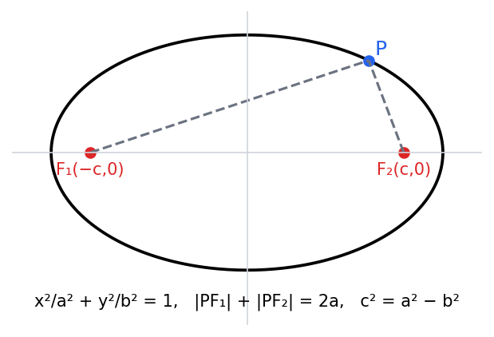

# Geometry (Senior High School) 【6】

几何（高中部分）

## Description

The senior-high geometry assumed by the syllabus covers three blocks. For
competitive programming the *analytic* tools matter most: everything reduces to
coordinates, and coordinates reduce everything to algebra.

* **Plane vectors (平面向量)**: addition, subtraction, scalar multiplication; the
  dot product a·b = |a||b|cos θ = x₁x₂ + y₁y₂; perpendicularity test a·b = 0;
  projections. The dot product is the bridge between geometry (angles) and
  algebra (a sum of products — trivially computable).
* **Solid geometry (立体几何)**: prisms, pyramids, cylinders, cones, spheres —
  surface areas and volumes (V_sphere = 4πr³/3, S_sphere = 4πr²); parallel and
  perpendicular relations between lines and planes; three-view drawings. Mostly
  needed for formula recall; rarely algorithmic.
* **Plane analytic geometry (平面解析几何)**:
  * lines: slope k = (y₂−y₁)/(x₂−x₁), point-slope and general forms, distance
    from point to line |Ax₀+By₀+C|/√(A²+B²);
  * circles: (x−a)² + (y−b)² = r², line–circle position relations (compare
    center-to-line distance with r);
  * conic sections (圆锥曲线): ellipse x²/a² + y²/b² = 1 (sum of distances to
    foci = 2a), hyperbola x²/a² − y²/b² = 1 (difference = 2a), parabola y² = 2px
    (distance to focus = distance to directrix); eccentricity e = c/a;
  * space Cartesian coordinates and the 3D distance formula.

**The ellipse, up close:**



For the ellipse, c² = a² − b² (with a ≥ b), foci at (±c, 0). The defining
property |PF₁| + |PF₂| = 2a is why an ellipse can be drawn with a string of
length 2a pinned at the foci. Eccentricity e = c/a ∈ (0, 1) measures flatness:
e → 0 approaches a circle, e → 1 degenerates to a segment.

**Pitfall — vertical lines**: slope form y = kx + b cannot express x = c. In
code, prefer the general form Ax + By + C = 0 or work with direction vectors to
avoid division by zero.

## Examples

**Example 1.** a = (3, 4), b = (1, 2): a·b = 3·1 + 4·2 = 11; cos θ =
11/(5·√5) = 11√5/25.

**Example 2.** Perpendicularity: (2, −1)·(2, 4) = 4 − 4 = 0 → the vectors are
perpendicular.

**Example 3.** Distance from point (1, 2) to line 3x + 4y − 5 = 0:
|3·1 + 4·2 − 5|/√(9+16) = 6/5.

**Example 4.** Circle (x−1)² + (y+2)² = 9 has center (1, −2), radius 3. The
line x = 4 is tangent to it (distance from center = 3 = r).

**Example 5.** Ellipse x²/25 + y²/9 = 1: a = 5, b = 3, c = √(25−9) = 4, foci
at (±4, 0), eccentricity e = c/a = 4/5. Any point P on it satisfies
|PF₁| + |PF₂| = 10.

**Example 6 (C++).** Dot product and distance, the workhorses of computational
geometry:

```cpp
double dot(double x1, double y1, double x2, double y2) {
    return x1 * x2 + y1 * y2;
}
double dist(double x1, double y1, double x2, double y2) {
    return hypot(x2 - x1, y2 - y1);
}
```

## Practice

1. a = (1, 2), b = (−3, 1). Compute a + b, 2a − b, a·b, and the angle between
   them. *(Answer: (−2, 4); (5, 3); −1; θ = arccos(−1/(√5·√10)) ≈ 98.1°.)*
2. Find the equation of the line through (1, 3) with slope −2.
   *(Answer: 2x + y − 5 = 0.)*
3. Volume and surface area of a sphere of radius 3. *(Answer: 36π; 36π.)*
4. For what k is the line y = kx + 1 tangent to the circle x² + y² = 4?
   *(Hint: distance from center to line equals r. Check: |1|/√(1+k²) = 2 has no
   real solution — the line passes through (0,1) inside the circle, so it is
   never tangent. Trick question!)*
5. Parabola y² = 8x: find the focus and directrix. *(Answer: focus (2, 0),
   directrix x = −2.)*
6. An ellipse has foci (±3, 0) and passes through (5, 0). Find its equation.
   *(Answer: c = 3, a = 5, b = 4 → x²/25 + y²/16 = 1.)*
7. Distance between A(1, 2, 3) and B(4, 6, 3) in space. *(Answer: 5.)*
8. (Challenge) Triangle with vertices A(0,0), B(4,0), C(1,3): compute its area
   via the cross-product formula
   |x_A(y_B − y_C) + x_B(y_C − y_A) + x_C(y_A − y_B)| / 2. *(Answer: 6.)*
