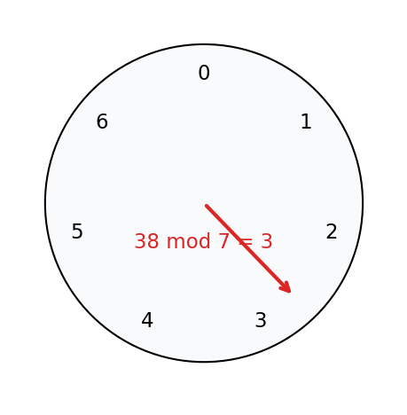

# Congruences 【5】

同余式

## Description

For a positive integer m, we write **a ≡ b (mod m)** ("a is congruent to b modulo
m") when m | (a − b), i.e. a and b leave the same remainder on division by m.



Think of mod m as a **clock with m hours**: adding m to any number brings you back
to the same position. The clock above shows 38 mod 7 = 3 — after 5 full turns plus
3 steps you land on 3.

**Congruence is an equivalence relation** and, crucially, it respects arithmetic:

* If a ≡ b and c ≡ d (mod m), then a ± c ≡ b ± d and a·c ≡ b·d (mod m).
* If a ≡ b (mod m), then aᵏ ≡ bᵏ (mod m) for any k ≥ 0.
* Cancellation: a·c ≡ b·c (mod m) implies a ≡ b (mod m / gcd(c, m)). In particular
  you may cancel c freely only when gcd(c, m) = 1.

**Why the cancellation rule has that gcd in it.** a·c ≡ b·c (mod m) means
m | c(a−b). If c shares no factor with m, all of m must divide (a−b). But if
g = gcd(c, m) > 1, the factor g can hide inside c, so only m/g is forced to divide
a−b.

**Linear congruences**: the equation a·x ≡ b (mod m) has a solution iff
gcd(a, m) | b; when solvable there are exactly gcd(a, m) solutions modulo m.
Intuition: a·x mod m only ever hits multiples of gcd(a, m), so b must be one; and
solutions repeat every m/gcd(a, m).

**Residue classes (剩余类)**: mod m the integers split into m classes
[0], [1], …, [m−1]. A **complete residue system** picks one representative of each
class; a **reduced residue system** picks one from each class coprime to m — there
are φ(m) of those (see [Euler's theorem](euler-theorem.md)).

## Examples

**Example 1.** 17 ≡ 2 (mod 5) and 23 ≡ 3 (mod 5) → 17·23 ≡ 2·3 = 6 ≡ 1 (mod 5).
Check: 17·23 = 391 = 5·78 + 1. ✓

**Example 2.** Solve 3x ≡ 1 (mod 7): gcd(3, 7) = 1 divides 1, so exactly one
solution mod 7. Testing x = 1…6: 3·5 = 15 ≡ 1, so x ≡ 5 (mod 7).
(For large moduli you would use the
[extended Euclidean algorithm](extended-euclid.md) instead of trying values.)

**Example 3.** Solve 6x ≡ 9 (mod 15): gcd(6, 15) = 3 | 9 → solvable. Divide
everything — including the modulus — by 3: 2x ≡ 3 (mod 5) → x ≡ 4 (mod 5).
Lifting back, the solutions modulo 15 are x ≡ 4, 9, 14 — exactly 3 = gcd(6, 15)
of them.

**Example 4 (pitfall).** Careless cancellation fails: 2·1 ≡ 2·4 (mod 6), i.e.
2 ≡ 8 (mod 6), but 1 ≢ 4 (mod 6). Cancelling 2 is invalid because gcd(2, 6) = 2 ≠
1; the correct conclusion is 1 ≡ 4 (mod 3).

**Example 5 (C++).** Brute-force solver for a·x ≡ b (mod m), fine for small m:

```cpp
for (long long x = 0; x < m; x++)
    if (a * x % m == b % m) cout << x << " ";
```

## Practice

1. Which are true? 100 ≡ 1 (mod 9); 7⁵ ≡ 2 (mod 5); −3 ≡ 4 (mod 7).
   *(Answer: true; 7 ≡ 2, 2⁵ = 32 ≡ 2 → true; true.)*
2. Solve: 5x ≡ 3 (mod 8); 4x ≡ 2 (mod 6); 4x ≡ 3 (mod 6).
   *(Answer: x ≡ 7; x ≡ 2, 5; no solution since gcd(4,6) = 2 ∤ 3.)*
3. Find the remainder of 3¹⁰⁰ on division by 7.
   *(Hint: powers of 3 mod 7 cycle 3, 2, 6, 4, 5, 1 with period 6.
   Answer: 3¹⁰⁰ ≡ 3⁴ ≡ 4.)*
4. Show n² ≡ 0 or 1 (mod 4) for every integer n. Use it to prove no integer of the
   form 4k+3 is a sum of two squares.
5. How many solutions does 12x ≡ 8 (mod 20) have? Find them all.
   *(Answer: gcd = 4 | 8 → 4 solutions: x ≡ 4, 9, 14, 19.)*
6. Write a program that solves a·x ≡ b (mod m) by trying x = 0…m−1, reporting all
   solutions or "no solution".
7. (Challenge) Prove: a number is divisible by 11 iff the alternating sum of its
   decimal digits is. *(Hint: 10 ≡ −1 (mod 11).)*
