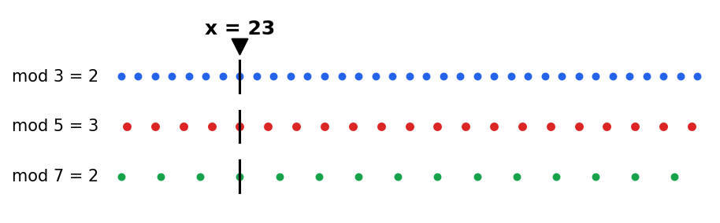

# Chinese Remainder Theorem 【7】

中国剩余定理

## Description

**Chinese remainder theorem (CRT)**: if m₁, m₂, …, mₖ are **pairwise coprime**
positive integers, then the system

> x ≡ a₁ (mod m₁),   x ≡ a₂ (mod m₂),   …,   x ≡ aₖ (mod mₖ)

has a **unique solution modulo M = m₁·m₂·…·mₖ**.

**Intuition on the number line.** Each congruence x ≡ aᵢ (mod mᵢ) picks out an
arithmetic progression — a row of evenly spaced dots. Pairwise coprime moduli force
the rows to keep re-aligning, and they all coincide exactly once per period M:



**Construction**: let Mᵢ = M / mᵢ and tᵢ = Mᵢ⁻¹ (mod mᵢ) (exists because
gcd(Mᵢ, mᵢ) = 1 — this is where coprimality is used!). Then:

> x ≡ Σᵢ aᵢ · Mᵢ · tᵢ (mod M)

**Why the formula works.** Mᵢ contains every modulus except mᵢ, so Mᵢ ≡ 0 (mod mⱼ)
for all j ≠ i — the term aᵢMᵢtᵢ is invisible to all other congruences. And modulo
mᵢ itself, Mᵢ·tᵢ ≡ 1, so the term delivers exactly aᵢ. Each term is a "switch" that
turns on only for its own modulus.

**Why it matters in practice**: work modulo several small coprime moduli (fitting in
machine words) instead of one huge modulus, and reconstruct the answer mod M at the
end. It also explains the ring decomposition ℤ/Mℤ ≅ ℤ/m₁ℤ × … × ℤ/mₖℤ.

**Non-coprime moduli**: the system is solvable iff aᵢ ≡ aⱼ (mod gcd(mᵢ, mⱼ)) for
all pairs; merge two congruences at a time with
[exGCD](extended-euclid.md).

## Examples

**Example 1 (classic, 《孙子算经》).** x ≡ 2 (mod 3), x ≡ 3 (mod 5),
x ≡ 2 (mod 7). Here M = 105, M₁ = 35, M₂ = 21, M₃ = 15;
t₁ = 35⁻¹ mod 3 = 2, t₂ = 21⁻¹ mod 5 = 1, t₃ = 15⁻¹ mod 7 = 1.

> x ≡ 2·35·2 + 3·21·1 + 2·15·1 = 140 + 63 + 30 = 233 ≡ 23 (mod 105)

Check: 23 mod 3 = 2, mod 5 = 3, mod 7 = 2. ✓

**Example 2.** Solve x ≡ 1 (mod 4), x ≡ 2 (mod 9). M = 36, M₁ = 9, t₁ = 9⁻¹ mod 4 =
1; M₂ = 4, t₂ = 4⁻¹ mod 9 = 7 (4·7 = 28 ≡ 1). x ≡ 1·9·1 + 2·4·7 = 9 + 56 = 65 ≡
29 (mod 36). Check: 29 mod 4 = 1, 29 mod 9 = 2. ✓

**Example 3 (C++).** CRT for two coprime moduli:

```cpp
// solve x ≡ a1 (mod m1), x ≡ a2 (mod m2), gcd(m1, m2) = 1
long long x1, y1;
exgcd(m1, m2, x1, y1);                    // m1·x1 + m2·y1 = 1
long long x = (a1 + (a2 - a1) % m2 * x1 % m2 * m1) % (m1 * m2);
x = (x + m1 * m2) % (m1 * m2);
```

**Example 4.** Garner's algorithm restores x from residues one modulus at a time
without big-int arithmetic — the standard tool when M overflows 64 bits.

**Example 5 (walkthrough — merging non-coprime congruences).** Solve
x ≡ 1 (mod 4), x ≡ 3 (mod 6). Consistency check first: gcd(4, 6) = 2, and
1 ≡ 3 (mod 2) ✓ — solutions exist. From the first congruence write x = 1 + 4t
and substitute into the second: 1 + 4t ≡ 3 (mod 6) → 4t ≡ 2 (mod 6). Divide
everything by gcd(4, 6) = 2: 2t ≡ 1 (mod 3), so t ≡ 2 (mod 3). Then
x = 1 + 4·2 = 9, and all solutions are x ≡ 9 (mod lcm(4, 6)), i.e. mod 12. The
merge recipe never changes: substitute → divide by the gcd → solve → glue the
moduli with lcm.

## Practice

1. Solve x ≡ 1 (mod 3), x ≡ 2 (mod 5). *(Answer: x ≡ 7 (mod 15).)*
2. Solve x ≡ 2 (mod 5), x ≡ 3 (mod 7), x ≡ 1 (mod 8).
   *(Answer: M = 280; M₁ = 56, t₁ = 56⁻¹ mod 5 = 1; M₂ = 40, t₂ = 40⁻¹ mod 7 =
   5⁻¹ mod 7 = 3; M₃ = 35, t₃ = 35⁻¹ mod 8 = 3⁻¹ mod 8 = 3.
   x ≡ 2·56·1 + 3·40·3 + 1·35·3 = 112 + 360 + 105 = 577 ≡ 17 (mod 280).
   Check: 17 mod 5 = 2, 17 mod 7 = 3, 17 mod 8 = 1. ✓)*
3. Find the smallest positive x with x ≡ 4 (mod 6), x ≡ 3 (mod 7).
   *(gcd(6, 7) = 1, so CRT applies. Answer: x = 10; solutions are x ≡ 10 (mod 42).)*
4. Is x ≡ 1 (mod 4), x ≡ 3 (mod 6) solvable? *(gcd(4, 6) = 2 and 1 ≡ 3 (mod 2),
   so yes. Candidates x ≡ 3 (mod 6) are 3, 9, 15, …; x = 9 satisfies x ≡ 1 (mod 4).
   Answer: x ≡ 9 (mod 12).)*
5. Implement CRT for k pairwise-coprime congruences and test on Examples 1–2.
6. (Challenge) Show CRT for two moduli directly: set x = a₁ + m₁·t, substitute into
   the second congruence and solve for t using the inverse of m₁ mod m₂.
