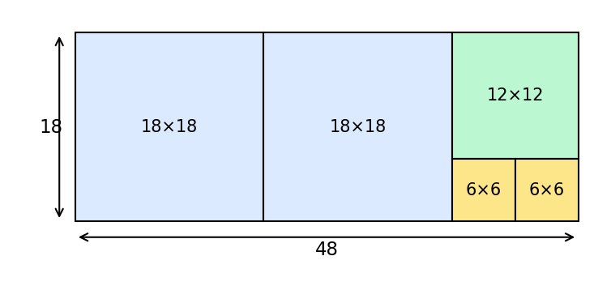

# Extended Euclidean Algorithm 【7】

扩展欧几里得算法

## Description

The **extended Euclidean algorithm (exGCD)** computes, together with
g = gcd(a, b), integers x and y satisfying Bézout's identity:

> a·x + b·y = g

**Geometric intuition — the Euclidean algorithm as tiling.** Fitting the largest
possible squares into an a × b rectangle mirrors the division steps exactly:



Each "fill with squares, keep the remainder" step is one division. The side of the
smallest square that exactly tiles the whole rectangle is gcd(48, 18) = 6. exGCD
adds bookkeeping on top: it remembers *how* each remainder was formed so it can
reconstruct the coefficients at the end.

**How it works.** The plain Euclidean step is a = b·q + r. Recursively solving
b·x′ + r·y′ = g and substituting r = a − b·q gives:

> g = b·x′ + (a − b·q)·y′ = a·y′ + b·(x′ − q·y′)

so x = y′, y = x′ − q·y′. Base case: gcd(a, 0) = a with x = 1, y = 0.

**Applications:**

* **Modular inverse**: if gcd(a, m) = 1, then a·x + m·y = 1 → a⁻¹ ≡ x (mod m).
  This is the inverse method that works for **any** modulus, not just primes.
* **Linear Diophantine equations**: a·x + b·y = c is solvable iff gcd(a, b) | c;
  from one solution (x₀, y₀) all solutions are x = x₀ + (b/g)t,
  y = y₀ − (a/g)t for t ∈ ℤ.
* Building block of the general [Chinese remainder theorem](crt.md) for non-coprime
  moduli.

## Examples

**Example 1.** a = 252, b = 105 by hand — divide first, then back-substitute:

```
252 = 105·2 + 42      21 = 105 − 42·2
105 =  42·2 + 21  →        = 105 − (252 − 105·2)·2
 42 =  21·2 +  0           = 252·(−2) + 105·5
```

So gcd = 21, x = −2, y = 5. Check: −504 + 525 = 21. ✓

**Example 2.** Inverse of 11 mod 26: exGCD gives 11·(−7) + 26·3 = 1, so
11⁻¹ ≡ −7 ≡ 19 (mod 26). Check: 11·19 = 209 = 26·8 + 1. ✓
(Pitfall: the raw x from exGCD can be negative — always normalize with
`(x % m + m) % m`.)

**Example 3 (C++).** Implementation:

```cpp
long long exgcd(long long a, long long b, long long &x, long long &y) {
    if (b == 0) { x = 1; y = 0; return a; }
    long long x1, y1;
    long long g = exgcd(b, a % b, x1, y1);
    x = y1;
    y = x1 - (a / b) * y1;
    return g;
}
// modular inverse: exgcd(a, m, x, y); inv = (x % m + m) % m;
```

**Example 4.** Solve 12x + 18y = 30: g = 6 | 30, so solvable. Divide by 6:
2x + 3y = 5. One solution: x = 1, y = 1. General: x = 1 + 3t, y = 1 − 2t.

## Practice

1. Run exGCD by hand on (1071, 462): find g and a Bézout pair.
   *(Answer: g = 21; 1071·(−3) + 462·7 = 21.)*
2. Find 17⁻¹ mod 43 using exGCD. *(Answer: 43 = 17·2 + 9; 17 = 9·1 + 8;
   9 = 8·1 + 1. Back-substitute: 1 = 9 − 8 = 2·9 − 17 = 2·(43 − 2·17) − 17 =
   2·43 − 5·17, so 17⁻¹ ≡ −5 ≡ 38 (mod 43). Check: 17·38 = 646 = 43·15 + 1. ✓)*
3. Solve 15x + 25y = 100 in integers; find the solution with smallest positive x.
   *(Answer: divide by 5: 3x + 5y = 20; one solution (5, 1); general
   x = 5 + 5t, y = 1 − 3t; smallest positive x is 5, giving y = 1.)*
4. A rooster costs 5 coins, a hen 3 coins, three chicks 1 coin. Buy 100 fowls for
   100 coins: solve 5x + 3y + z/3 = 100 with x + y + z = 100 in non-negative
   integers. *(Answer: eliminating z gives 7x + 4y = 100 →
   (x, y, z) ∈ {(0, 25, 75), (4, 18, 78), (8, 11, 81), (12, 4, 84)}.)*
5. Implement exGCD; then solve a·x ≡ b (mod m) for arbitrary (a, m), printing all
   solutions modulo m or reporting none.
6. (Challenge) Show the exGCD coefficients satisfy |x| ≤ b/g and |y| ≤ a/g for
   a, b > 0.
