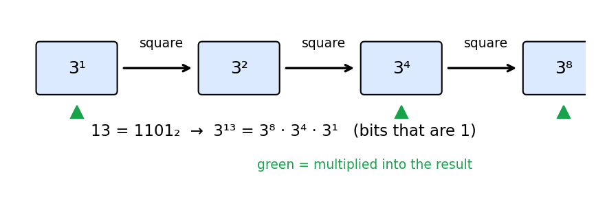
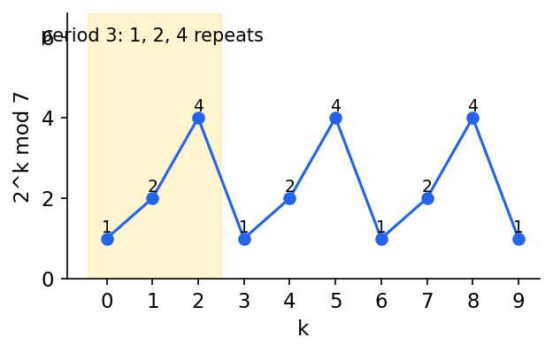

# Fermat's Little Theorem 【7】

费马小定理

## Description

**Fermat's little theorem**: if p is prime and p ∤ a, then

> a^(p−1) ≡ 1 (mod p)

Equivalent form valid for **all** a: aᵖ ≡ a (mod p).

It is [Euler's theorem](euler-theorem.md) specialized to prime moduli, since
φ(p) = p − 1.

**Why the exponent is p − 1.** Modulo a prime, the non-zero residues
{1, 2, …, p−1} form a multiplicative group: every element has an inverse, and
multiplication by a coprime a just permutes them. Multiplying the whole set
together before and after the permutation gives a^(p−1)·P ≡ P (mod p), and P
cancels.

**Main uses:**

* **Modular inverse** (see the [dedicated page](modular-inverse.md)):
  a⁻¹ ≡ a^(p−2) (mod p) when p is prime and p ∤ a — computed by fast
  exponentiation in O(log p).
* **Exponent reduction**: aᵏ mod p = a^(k mod (p−1)) mod p when p ∤ a.
* **Primality testing**: if a^(n−1) ≢ 1 (mod n) for some a, then n is composite
  (the basis of the Fermat primality test; beware Carmichael numbers like 561,
  which fool it).

**Fast exponentiation (快速幂)** is the enabling tool: compute aᵏ mod m in
O(log k) by squaring. k = 13 = 1101₂ means a¹³ = a⁸·a⁴·a¹ — walk the bits of k,
squaring a at each step and multiplying into the result when the bit is 1.



## Examples

**Example 1.** 2⁶ = 64 ≡ 1 (mod 7). Also 3⁶ = 729 = 7·104 + 1 ≡ 1 (mod 7). ✓

**Example 2.** Compute 2¹⁰⁰ mod 11: 2¹⁰ ≡ 1 (mod 11), so 2¹⁰⁰ = (2¹⁰)¹⁰ ≡ 1.

**Example 2b.** Powers mod a prime always cycle — here is 2ᵏ mod 7, period 3:



Fermat's little theorem explains the repetition: since 2⁶ ≡ 1 (mod 7), the
sequence must repeat with a period dividing 6; here the actual period is 3.

**Example 3.** Inverse of 3 mod 7: 3⁵ = 243 = 7·34 + 5 ≡ 5 (mod 7). Check:
3·5 = 15 ≡ 1. ✓

**Example 4 (C++).** Fast exponentiation:

```cpp
long long qpow(long long a, long long k, long long m) {
    long long r = 1 % m;
    a %= m;
    while (k > 0) {
        if (k & 1) r = r * a % m;   // take this bit of k
        a = a * a % m;              // a becomes a^(2^i)
        k >>= 1;
    }
    return r;
}
// inverse mod prime p: qpow(a, p - 2, p)
```

**Example 5.** 561 = 3 × 11 × 17 is composite, yet a⁵⁶⁰ ≡ 1 (mod 561) for every a
coprime to 561 — a Carmichael number; Fermat's test alone cannot detect it.
(Why: 560 is a multiple of 3−1, 11−1 and 17−1, so the congruence holds modulo
each prime factor, and CRT assembles it modulo 561.)

**Example 6 (walkthrough — tracing qpow(3, 13, 7)).**

```
k = 13 (bit 1): r = 1·3 = 3;        a = 3²  ≡ 2 (mod 7);  k = 6
k = 6  (bit 0): r unchanged;        a = 2²  = 4;            k = 3
k = 3  (bit 1): r = 3·4 = 12 ≡ 5;   a = 4²  ≡ 2;            k = 1
k = 1  (bit 1): r = 5·2 = 10 ≡ 3;   done → 3¹³ ≡ 3 (mod 7)
```

Only 4 squarings and 3 multiplications for an exponent of 13 — for k = 10¹⁸ it
would take about 60 of each. Check with Fermat: 13 = 12 + 1, so
3¹³ ≡ 3¹ = 3 (mod 7). ✓

## Practice

1. Verify Fermat's little theorem for a = 4, p = 5. *(4⁴ = 256 ≡ 1 mod 5. ✓)*
2. Compute 5²⁰²⁵ mod 13. *(Hint: 5¹² ≡ 1; 2025 mod 12 = 9; 5⁹ mod 13. Answer: 5.)*
3. Find 7⁻¹ mod 11 using a^(p−2). *(Answer: 7⁹ mod 11 = 8; check 7·8 = 56 ≡ 1.)*
4. Compute the last digit of 2²⁰²⁵ via mod 10 cycles, then via mod 5 + Fermat and
   parity. *(Answer: 2.)*
5. Show 341 = 11 × 31 is a Fermat pseudoprime to base 2 (i.e. 2³⁴⁰ ≡ 1 mod 341)
   yet composite.
6. Implement `qpow` and verify (a·b) mod m equals qpow results for random cases;
   then compute 2^(10⁹) mod 1000000007. *(Answer: 140625001.)*
7. (Challenge) Prove aᵖ ≡ a (mod p) for every integer a by induction on a,
   expanding (a + 1)ᵖ with the binomial theorem and noting p | C(p, k) for
   0 < k < p.
