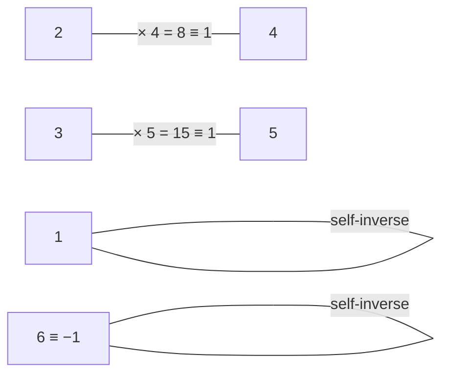

# Wilson's Theorem 【7】

威尔逊定理

## Description

**Wilson's theorem**: an integer p > 1 is prime if and only if

> (p − 1)! ≡ −1 (mod p)

**Why it works (pairing argument):** modulo a prime p, every nonzero residue a has
a unique [inverse](modular-inverse.md) a⁻¹, and a ≡ a⁻¹ (mod p) only when a² ≡ 1,
i.e. a ≡ 1 or a ≡ p−1 (because p | a²−1 = (a−1)(a+1) forces p | a−1 or p | a+1).
So in the product 1·2·…·(p−1), all factors except 1 and p−1 pair off into inverse
pairs whose product is 1, leaving (p−1)! ≡ p−1 ≡ −1 (mod p).



*Inverse pairs modulo 7: everything except 1 and 6 cancels in pairs.*

**Converse direction**: if n is composite, (n−1)! ≡ 0 (mod n) except for n = 4,
where 3! = 6 ≡ 2 (mod 4).

**Practical role**: Wilson's theorem is mainly a *theoretical* tool — computing
(n−1)! is far too slow for primality testing. It shines in proofs and in problems
about factorials modulo primes, especially products over ranges where most factors
cancel via inverses.

## Examples

**Example 1.** p = 5: 4! = 24 ≡ −1 (mod 5). ✓ p = 7: 6! = 720 = 7·102 + 6 ≡ −1. ✓

**Example 2.** n = 6 composite: 5! = 120 ≡ 0 (mod 6) ≠ −1, correctly detecting
compositeness.

**Example 3.** The pairing for p = 7: inverses are 2↔4 (2·4 = 8 ≡ 1), 3↔5
(3·5 = 15 ≡ 1), leaving 1 and 6 self-inverse: 6! ≡ 1·(2·4)·(3·5)·6 ≡ 6 ≡ −1. ✓

**Example 4.** Compute 16! mod 17 quickly: by Wilson, 16! ≡ −1 (mod 17). Then
15! ≡ 16!·16⁻¹ ≡ (−1)·(−1) = 1 (mod 17), since 16 ≡ −1.

**Example 5 (C++).** Direct check for small n:

```cpp
long long f = 1;
for (int i = 2; i < n; i++) f = f * i % n;
bool prime = (f == n - 1);   // Wilson — for demonstration only, O(n)
```

## Practice

1. Verify Wilson's theorem for p = 11 by computing 10! mod 11.
   *(Answer: 10! = 3628800 = 11·329891 − 1 ≡ −1. ✓)*
2. Compute 12! mod 13 and then 11! mod 13 using the inverse trick from Example 4.
   *(Answer: 12! ≡ −1 ≡ 12; 12⁻¹ mod 13 = 12 since 12·12 = 144 ≡ 1, so
   11! ≡ (−1)·12 ≡ 1 (mod 13).)*
3. Show that for prime p > 2, (p−2)! ≡ 1 (mod p).
   *(Hint: multiply (p−1)! ≡ p−1 by (p−1)⁻¹ ≡ −1.)*
4. For composite n > 4, prove (n−1)! ≡ 0 (mod n). *(Hint: n = ab with 1 < a < b < n
   both appear in the product; treat n = q² separately using q and 2q.)*
5. Write a program that, given prime p ≤ 10⁵ and k, computes (p−k)! mod p without
   multiplying all p terms — use Wilson plus modular inverses.
6. (Challenge) Let p = 4k + 1 be prime. Using Wilson, show that
   ((2k)!)² ≡ −1 (mod p), i.e. −1 is a quadratic residue mod p.
