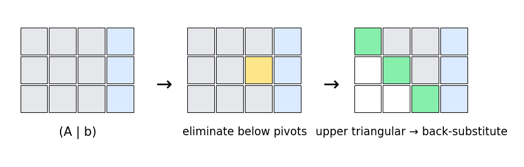

# Gaussian Elimination 【7】

高斯消元法

## Description

**Gaussian elimination (高斯消元法)** solves a system of n linear equations in n
unknowns A·x = b by applying
[elementary row transformations](elementary-transformations.md) to the augmented
matrix (A | b) until A becomes upper triangular, then reading off the solution
by **back-substitution (回代)**.



**Algorithm:**

1. **Forward elimination**: for each column i = 1…n, pick a **pivot (主元)** row
   with non-zero entry in column i (swap it into row i — **partial pivoting
   (选主元)** picks the largest absolute value for numerical stability), then
   eliminate column i from all rows below: Rⱼ ← Rⱼ − (aⱼᵢ/aᵢᵢ)·Rᵢ.
2. **Back-substitution**: xₙ = bₙ/aₙₙ, then xᵢ = (bᵢ − Σⱼ>ᵢ aᵢⱼxⱼ) / aᵢᵢ,
   working upward.

**Complexity**: O(n³) time, O(n²) memory — practical to n ≈ 500.

**Reading the outcome** — after elimination, count pivots:

* n pivots → **unique solution**;
* a row [0 0 … 0 | c] with c ≠ 0 → **no solution** (contradiction);
* fewer than n pivots and no contradiction → **infinitely many solutions** (free
  variables).

**Why partial pivoting?** Dividing by a tiny pivot amplifies rounding error
catastrophically: with floating point, a pivot of 10⁻¹² turns small input errors
into garbage. Swapping in the largest-magnitude entry keeps the multipliers
≤ 1 and the errors bounded. With exact arithmetic (fractions, modular) this
concern disappears — any non-zero pivot works.

**Contest variants**:

* over the **reals** (doubles) — standard;
* over **GF(2)** (异或方程组 — XOR elimination): addition is XOR, every pivot is
  1, and bitset packing gives O(n³/64) — the core of **linear basis (线性基)**
  techniques for max-XOR problems;
* **modulo a prime**: division becomes multiplication by the modular inverse —
  see the Elementary Number Theory chapter.

## Examples

**Example 1.** Solve:

```
2x +  y = 5
 x + 3y = 5
```

Augmented matrix:

```
[2 1 | 5]
[1 3 | 5]  → R₂ ← R₂ − ½R₁ → [2   1  |  5 ]
                              [0  2.5| 2.5]
```

Back-substitution: y = 1, then x = (5 − 1)/2 = 2. Check: 2·2 + 1 = 5 ✓,
2 + 3 = 5 ✓.

**Example 2.** No solution: x + y = 1, 2x + 2y = 3 → second row reduces to
0 = 1 → inconsistent.

**Example 3.** Infinitely many: x + y = 2, 2x + 2y = 4 → rows become
identical → one free variable: solutions (t, 2 − t) for any t.

**Example 4 (C++).** Core loop (double version):

```cpp
for (int col = 0; col < n; col++) {
    int piv = col;
    for (int r = col + 1; r < n; r++)
        if (fabs(a[r][col]) > fabs(a[piv][col])) piv = r;
    swap(a[piv], a[col]);
    for (int r = col + 1; r < n; r++) {
        double f = a[r][col] / a[col][col];
        for (int c = col; c <= n; c++) a[r][c] -= f * a[col][c];
    }
}
// back-substitution omitted: x[i] = (a[i][n] - Σ a[i][j]*x[j]) / a[i][i]
```

**Example 5.** GF(2) elimination: replace subtraction/division by XOR — the
basis of linear-basis (线性基) techniques for max-XOR problems.

**Example 6 (walkthrough — what the computer "sees", step by step).** Solve with
n = 3:

```
x + y + z = 6
x + 2y + 3z = 14
x + 4y + 9z = 36
```

Column 1: pivot row 1. R₂ ← R₂ − R₁ gives [0, 1, 2 | 8]; R₃ ← R₃ − R₁ gives
[0, 3, 8 | 30]. Column 2: pivot row 2 (entry 1). R₃ ← R₃ − 3R₂ gives
[0, 0, 2 | 6]. Upper triangular! Back-substitute: z = 3, then y = 8 − 2·3 = 2,
then x = 6 − 2 − 3 = 1. Check: 1 + 2 + 3 = 6 ✓, 1 + 4 + 9 = 14 ✓,
1 + 8 + 27 = 36 ✓. Three columns, three pivots — hence a unique solution.

## Practice

1. Solve by elimination: x + y = 3, x − y = 1. *(Answer: x = 2, y = 1.)*
2. Solve: x + 2y + 3z = 14, 2x + y + z = 7, x + y + 2z = 9.
   *(Answer: x = 1, y = 2, z = 3.)*
3. Determine the outcome: x + y = 2, x + y = 3; and x + y = 2, 2x + 2y = 4.
   *(Answer: no solution; infinitely many, y = 2 − x.)*
4. Why is partial pivoting important with floating point? *(Answer: dividing by
   a tiny pivot amplifies rounding errors; the largest-magnitude pivot controls
   them.)*
5. Implement Gaussian elimination for n ≤ 100 with doubles, printing the unique
   solution or reporting none/infinite.
6. Solve a system modulo prime p = 7 by elimination using modular inverses:
   x + y ≡ 2, 2x + 3y ≡ 1 (mod 7). *(Answer: eliminate R₂ − 2R₁:
   y ≡ 1 − 4 = −3 ≡ 4; x ≡ 2 − 4 = −2 ≡ 5. Check: 5 + 4 = 9 ≡ 2 ✓;
   10 + 12 = 22 ≡ 1 ✓.)*
7. What changes if we eliminate *above* the pivots too (Gauss–Jordan)?
   *(Answer: the matrix becomes diagonal — no back-substitution needed, at the
   same O(n³) cost; this is how (A|I) → (I|A⁻¹) inverts matrices.)*
8. (Challenge) Lights Out / switch problems: model a 3×3 light grid as a GF(2)
   system and solve it with XOR elimination.
