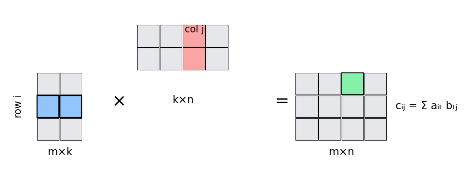

# Matrix Operations 【6】

矩阵的运算：加法、减法、乘法与转置

## Description

* **Addition/subtraction**: same-shape matrices, componentwise:
  (A ± B)ᵢⱼ = aᵢⱼ ± bᵢⱼ.
* **Scalar multiplication**: (cA)ᵢⱼ = c·aᵢⱼ.
* **Multiplication**: for A of shape m×k and B of shape k×n, the product
  C = A·B of shape m×n has

  > cᵢⱼ = Σₜ aᵢₜ · bₜⱼ

  — row i of A dotted with column j of B. The inner dimensions must match
  (k = k); the result takes the outer dimensions (m × n). **Not commutative**:
  in general AB ≠ BA — geometrically, "rotate then scale" ≠ "scale then
  rotate". It is associative: (AB)C = A(BC).
* **Transpose (转置)**: (Aᵀ)ᵢⱼ = aⱼᵢ — reflection across the main diagonal.
  Rules: (Aᵀ)ᵀ = A, (A + B)ᵀ = Aᵀ + Bᵀ, and **(AB)ᵀ = BᵀAᵀ** — note the order
  reversal, the most-misapplied identity in this chapter.



**Composition view**: A·B is the matrix of the composed map "first B, then A".
Matrix multiplication is function composition written as arithmetic — which is
why it must be associative (composition is) and need not be commutative.

**Cost**: naive m×k times k×n multiplication is O(mkn); for n×n matrices O(n³).
Strassen-type methods exist but are rarely needed at this level. **Associativity
matters for speed**: A(BC) with B, C vectors costs O(n²), while (AB)C costs
O(n³) — parenthesize from the cheap side!

**Star application — matrix exponentiation (矩阵快速幂)**: a linear recurrence
Fₙ₊₁ = aFₙ + bFₙ₋₁ rewrites as a matrix power; combined with fast
exponentiation it computes Fₙ in O(log n) matrix multiplications — the standard
tool whenever a linear recurrence must be evaluated at n up to 10¹⁸.

## Examples

**Example 1.** [[1,2],[3,4]] + [[5,6],[7,8]] = [[6,8],[10,12]].

**Example 2.** [[1,2],[3,4]] · [[5,6],[7,8]] =
[[1·5+2·7, 1·6+2·8], [3·5+4·7, 3·6+4·8]] = [[19, 22], [43, 50]].
Reverse order: [[5,6],[7,8]]·[[1,2],[3,4]] = [[23, 34], [31, 46]] — different!

**Example 3.** Fibonacci by matrix power:

```
[ F(n+1) ]   [1 1] ⁿ   [ F(1) ]
[ F(n)   ] = [1 0]   · [ F(0) ]
```

**Example 4 (C++).** 2×2 matrix multiplication and fast power for Fibonacci:

```cpp
using Mat = array<array<long long, 2>, 2>;
Mat mul(Mat A, Mat B, long long P) {
    Mat C{};
    for (int i = 0; i < 2; i++)
        for (int j = 0; j < 2; j++)
            for (int t = 0; t < 2; t++)
                C[i][j] = (C[i][j] + A[i][t] * B[t][j]) % P;
    return C;
}
// matrix fast power: same binary exponentiation as qpow, with mul()
```

F₁₀ in O(log 10) matrix multiplications — versus O(n) iteration.

**Example 5.** (AB)ᵀ check: with A = [[1,2],[3,4]], B as above:
(AB)ᵀ = [[19,43],[22,50]] = BᵀAᵀ = [[5,7],[6,8]]·[[1,3],[2,4]] ✓.

**Example 6 (walkthrough — one entry of one product, the honest way).** Compute
c₁₂ of [[1,2],[3,4]]·[[5,6],[7,8]] with your finger: put it on row 1 of A —
[1, 2] — and slide it down column 2 of B — [6, 8]. Multiply as you go: 1·6 = 6,
2·8 = 16; add: 22. That is all a matrix product ever is, repeated m×n times. The
row and column *must* have the same length — that is why the inner dimensions
have to match.

## Practice

1. Compute [[2,0],[1,3]] · [[1,1],[0,2]] and the product in the reverse order.
   *(Answer: [[2,2],[1,7]]; [[3,3],[2,6]].)*
2. Let A = [[1,2,3]] (1×3), B = [[4],[5],[6]] (3×1). Compute AB and BA —
   shapes? *(Answer: AB = [32] (1×1); BA is 3×3 = [[4,8,12],[5,10,15],
   [6,12,18]]. Same numbers, totally different shapes.)*
3. Verify (A + B)ᵀ = Aᵀ + Bᵀ on 2×2 examples of your choice.
4. Compute the 5th Fibonacci number via the matrix power of Example 3 by hand
   (F₁ = 1, F₂ = 1). *(Answer: F₅ = 5.)*
5. If A is m×k and B is p×n, when does AB exist? When do both AB and BA exist?
   *(Answer: k = p; k = p and m = n.)*
6. Matrices X(2×3), Y(3×4), Z(4×1): compare the cost of (XY)Z vs X(YZ).
   *(Answer: 2·3·4 + 2·4·1 = 32 vs 3·4·1 + 2·3·1 = 18 — associativity is free
   speed.)*
7. Write a program that computes the n-th Fibonacci number mod 10⁹+7 by matrix
   fast power for n up to 10¹⁸.
8. (Challenge) The number of walks of length L between all vertex pairs of a
   graph equals the entries of A^L (A = adjacency matrix). Write a program
   computing the number of length-L walks from s to t mod 998244353 in
   O(n³ log L).
