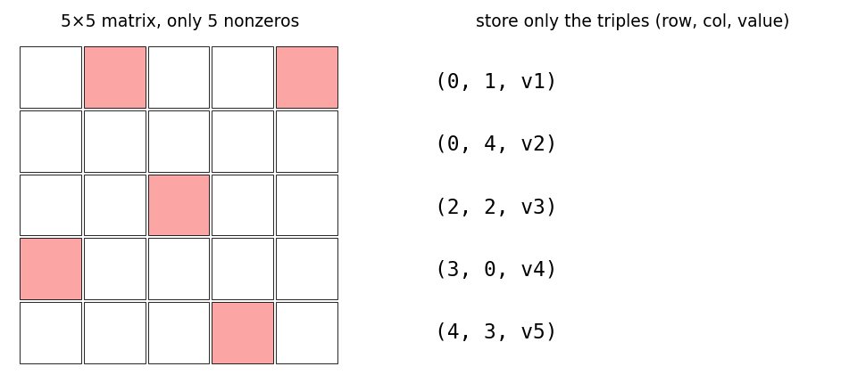

# Special Matrices 【6】

特殊矩阵的概念：单位阵、三角阵、对称阵和稀疏矩阵

## Description

* **Identity matrix (单位阵)** I: square, aᵢᵢ = 1, all other entries 0. It is
  the multiplicative unit: A·I = I·A = A — the matrix analog of the number 1.
  As a linear map, it does nothing: every vector stays put.
* **Triangular matrix (三角阵)**: **upper triangular** has aᵢⱼ = 0 for i > j
  (all zeros below the diagonal); **lower triangular** has zeros above.
  Products and inverses of triangular matrices stay triangular; the determinant
  is the product of the diagonal entries.
* **Symmetric matrix (对称阵)**: Aᵀ = A, i.e. aᵢⱼ = aⱼᵢ — reflection across the
  main diagonal changes nothing. Only n(n+1)/2 entries need storing. Adjacency
  matrices of *undirected* graphs are symmetric.
* **Sparse matrix (稀疏矩阵)**: most entries are zero. Store only the non-zeros:
  triples (row, col, value) — the **coordinate list (COO)** — or, in graph
  language, adjacency lists.



**Why triangular matrices are the goal, not the starting point**:
[Gaussian elimination](gaussian-elimination.md) *ends* with an upper triangular
matrix, and that is precisely the point — a triangular system is trivially
solvable by back-substitution in O(n²). Triangular form is where equations
become decoupled enough to read off answers.

**Why sparsity rules contests**: an n-vertex graph with m edges has an adjacency
matrix costing O(n²) memory, but adjacency lists cost O(n + m). Real contest
graphs are sparse (m ≪ n²), so lists win decisively; conversely, dense algebraic
tasks (walk counting via A^L) use the matrix directly. Choosing the
representation *is* the algorithmic decision.

## Examples

**Example 1.** I₃ = [[1,0,0],[0,1,0],[0,0,1]]; check [[1,2],[3,4]]·I₂ =
[[1,2],[3,4]].

**Example 2.** Upper triangular: [[2, 5, 1], [0, 3, 4], [0, 0, 7]] —
determinant 2·3·7 = 42 (product of the diagonal).

**Example 3.** Symmetric: [[1, 7, 3], [7, 2, 5], [3, 5, 0]]. The adjacency
matrix of an undirected graph is always symmetric: edge i–j appears at both
(i, j) and (j, i).

**Example 4 (C++).** Sparse storage as triples and as adjacency lists:

```cpp
struct Entry { int r, c; double v; };      // COO triple
vector<Entry> sparse = {{0, 1, 2.5}, {3, 3, -1.0}};

vector<vector<pair<int,int>>> g(n);        // adjacency list: (neighbor, weight)
g[u].push_back({v, w});
```

**Example 5.** The matrices appearing in Gaussian elimination end up upper
triangular — that is exactly the point of elimination: back-substitution on a
triangular system costs only O(n²).

**Example 6.** Matrix fast power starts from the identity: `R = I` is the
neutral element in `R = R * A^k` loops — forgetting this initialization is a
classic bug.

**Example 7 (walkthrough — multiplying triangular matrices stays triangular).**
Take U = [[1, 2], [0, 3]] and V = [[2, 1], [0, 1]], both upper triangular. Then
U·V = [[1·2+2·0, 1·1+2·1], [0·2+3·0, 0·1+3·1]] = [[2, 3], [0, 3]] — upper
triangular again, and the diagonal (2, 3) is the entrywise product of the
diagonals. Zeros below the diagonal can never "leak upwards" through
multiplication — that is why elimination's triangular result is stable and why
determinants of triangular matrices are free.

## Practice

1. Which of these are symmetric/triangular? [[1,2],[2,3]]; [[1,2],[0,3]];
   [[1,0],[0,1]]. *(Answer: symmetric; upper triangular; both (and identity).)*
2. Is the product of two upper triangular 3×3 matrices upper triangular?
   Multiply two small examples and conjecture. *(Answer: yes.)*
3. A graph has 10⁵ vertices and 3×10⁵ edges. Adjacency matrix vs adjacency
   list — how much memory does each need (4-byte entries)? *(Answer: ≈ 4×10¹⁰
   bytes vs ≈ 2×3×10⁵×8 ≈ 4.8 MB.)*
4. How many entries must be stored for a symmetric n×n matrix? For n = 1000 vs
   the full 10⁶? *(Answer: n(n+1)/2 = 500 500.)*
5. What is the product of two diagonal n×n matrices? *(Answer: diagonal, with
   entries multiplied pointwise — diagonal matrices are just n independent
   scalars.)*
6. Write a program that reads a sparse matrix as (r, c, v) triples and computes
   A·x for a dense vector x without ever building the full matrix.
7. (Challenge) Show that a matrix that is both upper and lower triangular is
   diagonal, and that diagonal matrices commute with each other.
