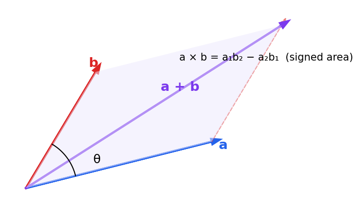

# Vector Operations 【6】

向量的运算

## Description

For vectors a = (a₁, …, aₙ), b = (b₁, …, bₙ) and a scalar λ:

* **Addition/subtraction (加减)**: componentwise, (a ± b)ᵢ = aᵢ ± bᵢ —
  geometrically, the parallelogram (or tip-to-tail) rule.
* **Scalar multiplication (数乘)**: (λa)ᵢ = λ·aᵢ — stretches the vector by |λ|,
  flipping direction when λ < 0.
* **Dot product (数量积/点积)**: a·b = Σ aᵢbᵢ = |a||b|cos θ. Two definitions, one
  quantity: the algebraic form is computable in O(n); the geometric form reveals
  the angle.
* **Norm (模)**: |a| = √(a·a) = √(Σ aᵢ²) — the vector's length.
* **Cross product (叉积, 2D scalar form)**: a × b = a₁b₂ − a₂b₁ — the *signed*
  area of the parallelogram spanned by a and b; the sign encodes orientation
  (positive ⇔ b is counterclockwise from a).



**Key relations:**

* a ⊥ b ⇔ a·b = 0. (No square roots needed — the perpendicularity test is
  exact in integer arithmetic!)
* cos θ = a·b / (|a||b|).
* a ∥ b ⇔ a × b = 0 (2D).
* |a × b| = |a||b|·sin θ — parallelogram area; triangle area is half of it.

**Why the sign of the cross product matters**: walking from A to B, a point C is
on your *left* iff (B − A) × (C − A) > 0. This single primitive — the
**orientation test** — drives convex hulls (Graham scan, monotone chain),
segment intersection, and polygon containment. It is exact in integer
arithmetic, so it avoids all floating-point pitfalls when coordinates are
integers (watch overflow: products of coordinates up to 10⁹ need 64-bit).

**In computational geometry**, dot and cross products are the atoms: orientation
tests, polygon area via the **shoelace formula** ½|Σ pᵢ × pᵢ₊₁|, point-to-line
distance, convex hulls.

## Examples

**Example 1.** a = (1, 2, 3), b = (4, 0, −1): a + b = (5, 2, 2),
a·b = 4 + 0 − 3 = 1, |a| = √14.

**Example 2.** Perpendicularity: (3, 4)·(−4, 3) = −12 + 12 = 0 → perpendicular.

**Example 3.** Signed area of triangle with vertices (0,0), (4,0), (1,3):
½ |(4, 0) × (1, 3)| = ½ |4·3 − 0·1| = 6.

**Example 4.** Orientation: is (0,0) → (2,1) → (1,3) a left turn?
(2,1) × ((1,3)−(2,1)) = (2,1) × (−1,2) = 2·2 − 1·(−1) = 5 > 0 →
counterclockwise.

**Example 5.** Projection: the component of a = (3, 4) along b = (1, 0) is
a·b/|b| = 3 — the shadow length when light shines perpendicular to b.

**Example 6 (C++).** The geometry toolkit:

```cpp
double dot(double x1, double y1, double x2, double y2) {
    return x1 * x2 + y1 * y2;
}
double cross(double x1, double y1, double x2, double y2) {
    return x1 * y2 - y1 * x2;
}
```

## Practice

1. a = (2, −1, 3), b = (1, 4, 0). Compute a + b, 3a − 2b, a·b, |a|, |b|.
   *(Answer: (3, 3, 3); (4, −11, 9); −2; √14; √17.)*
2. Find the angle between (1, 1) and (0, 1). *(Answer: cos θ = 1/√2 → 45°.)*
3. Find λ such that (λ, 2) ⊥ (3, −1). *(Answer: 3λ − 2 = 0 → λ = 2/3.)*
4. Area of the parallelogram spanned by (3, 1) and (2, 5). *(Answer: |2·5 −
   1·2| = 13.)*
5. Area of the polygon (0,0), (2,0), (2,2), (0,2) by the shoelace formula.
   *(Answer: 4.)*
6. Points A(0,0), B(3,0), C(2,2): is C to the left of the directed line AB?
   *(Answer: (3,0) × (2,2) = 6 > 0 → yes.)*
7. Segments (0,0)–(4,4) and (0,4)–(4,0): do they intersect? Use two orientation
   tests. *(Answer: yes — each segment's endpoints lie on opposite sides of the
   other line.)*
8. Write a program that reads a convex polygon's n vertices in order and prints
   its area using the shoelace formula ½ |Σ (xᵢyᵢ₊₁ − xᵢ₊₁yᵢ)|.
9. (Challenge) Prove a·b = |a||b|cos θ implies the Cauchy–Schwarz inequality
   |a·b| ≤ |a||b|.
