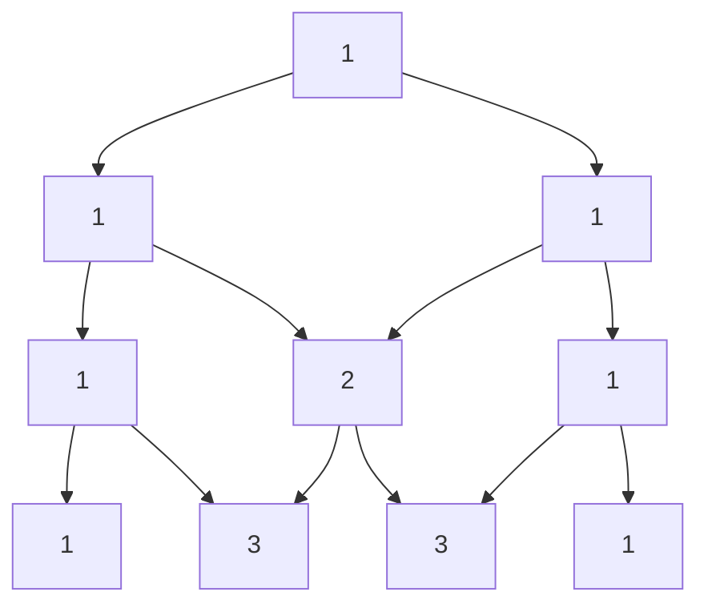

# 二项式定理 【6】

Binomial Theorem

## 讲解

**二项式定理**：对任意非负整数 n，

> (a + b)ⁿ = Σₖ₌₀ⁿ C(n, k) · aⁿ⁻ᵏ · bᵏ

系数 C(n, k) 恰好是**杨辉三角（Pascal 三角）**第 n 行的各项（见入门级）：



每一项等于肩上两项之和：C(n+1, k) = C(n, k−1) + C(n, k)——这也是为什么 C(n, k) 可以
用 O(n²) 的递推（DP）算出来，完全不用除法。

**为什么成立（组合解释）**：(a + b)ⁿ = (a+b)(a+b)…(a+b)。展开就是从 n 个因子里各选
a 或 b；项 aⁿ⁻ᵏbᵏ 每出现一次，对应选出 k 个因子贡献 b 的一种方式——共 C(n, k) 种。
这个定理就是披着代数外衣的计数。

**常用推论：**

* a = b = 1：Σₖ C(n, k) = 2ⁿ——n 元集合有 2ⁿ 个子集。
* a = 1, b = −1：Σₖ (−1)ᵏ C(n, k) = 0（n ≥ 1）——奇偶大小的子集一样多。这个恒等式
  是容斥原理的发动机。
* 提取系数：(1 + x)ⁿ 中 xᵏ 的系数是 C(n, k)。提取任意系数就问："选哪些 k 能得到这个
  单项式？"
* 近似：|x| 很小时 (1 + x)ⁿ ≈ 1 + nx（前两项）；再加第三项 C(n,2)x² 更准。

**竞赛中**：模质数的二项式展开（配合预处理阶乘与阶乘逆元）无处不在——多项式恒等式、
期望、生成函数操作。像 aⁿ ≡ bⁿ (mod a−b) 这样的整除技巧，就是把 ((a−b) + b)ⁿ 展开
一行的事。

## 例题

**例 1.** (x + 2)⁴ = x⁴ + 4·2x³ + 6·4x² + 4·8x + 16 =
x⁴ + 8x³ + 24x² + 32x + 16。

**例 2.** (2x + 1)⁵ 中 x³ 的系数：C(5, 3)·(2x)³·1² = 10·8x³ → 80。

**例 3.** Σₖ C(10, k) = 2¹⁰ = 1024；Σₖ (−1)ᵏC(10, k) = 0 →
C(10,0)+C(10,2)+… = C(10,1)+C(10,3)+… = 512。

**例 4.** 99⁴ = (100 − 1)⁴ = 10⁸ − 4·10⁶ + 6·10⁴ − 400 + 1 = 96 059 601。

**例 5.** 整除性：7 | 8ⁿ − 1，因为 8ⁿ = (7+1)ⁿ = Σ C(n,k)7ᵏ——除最后一项（k = 0，
等于 1）外每项都含因子 7。

**例 6（C++）.** (1 + x)ⁿ 中 xᵏ 的系数模 p：

```cpp
// = C(n, k) mod p，预处理阶乘后：
long long coef = fact[n] * invFact[k] % P * invFact[n - k] % P;
```

**例 7.** 杨辉三角第 n 行中奇数的个数是 2^(popcount(n))（Lucas 定理的推论——NOI 级
内容，这里只为培养直觉：n = 5 = 101₂ → 4 个奇数：验证第 5 行 1 5 10 10 5 1 →
4 个奇数 ✓）。

## 练习

1. 展开 (x + 3)³ 和 (a − b)⁴。
   *（答案：x³ + 9x² + 27x + 27；a⁴ − 4a³b + 6a²b² − 4ab³ + b⁴。）*
2. 求 (1 + x)⁸ 中 x⁵ 的系数；(2x + y)⁵ 中 x²y³ 的系数。
   *（答案：56；C(5,2)(2x)²y³ = 10·4 = 40x²y³ → 40。）*
3. 手算 n = 4 时 Σₖ k·C(n, k)；猜想并证明一般公式。
   *（答案：n·2ⁿ⁻¹；对 (1+x)ⁿ 在 x = 1 处求导，或"选委员会并指定主席"算两次。）*
4. 用二项式定理展开 (10 + 1)ⁿ，证明 11ⁿ ≡ 1 (mod 10)。
5. 用前三项把 1.02¹⁰ 近似到两位小数。*（答案：1 + 0.2 + 45·0.0004 = 1.218 →
   1.22。）*
6. 证明 Σₖ C(n, k)² = C(2n, n)。*（提示：(1+x)ⁿ(1+x)ⁿ 中 xⁿ 的系数；或把 2n 元集合
   劈成两半数 n 元子集。）*
7. 写程序用阶乘与阶乘逆元计算 C(50, 25) mod 998244353。*（让程序告诉你答案。）*
8.（挑战）比较 (1+x)ᵐ(1+x)ⁿ = (1+x)ᵐ⁺ⁿ 的系数，证明范德蒙德恒等式
   Σₖ C(m, k)·C(n, r−k) = C(m+n, r)。
