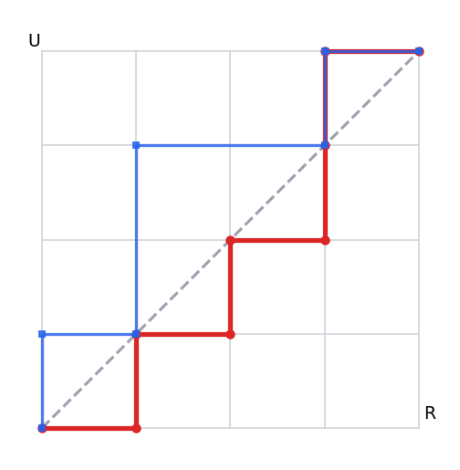

# 卡特兰（Catalan）数 【7】

Catalan Numbers

## 讲解

**卡特兰数**是数列

> C₀ = 1, C₁ = 1, Cₙ = (4n − 2)/(n + 1) · Cₙ₋₁ = C(2n, n) / (n + 1)

前几个值：1, 1, 2, 5, 14, 42, 132, 429, 1430（C₀…C₈）。

**等价定义：**

* 封闭形式：Cₙ = C(2n, n) − C(2n, n+1) = C(2n, n)/(n+1)。
* 递推：Cₙ₊₁ = Σᵢ₌₀ⁿ Cᵢ · Cₙ₋ᵢ（在某个特殊元素处分割）。

**它们出现在哪里**——题目里要认出的模式：

* n 对括号的合法串：n = 3 时有 ((())), (()()), (())(), ()(()), ()()() → C₃ = 5。
* 从 (0,0) 到 (n,n) 且永不越过对角线的路径（**Dyck 路径**）：



* n 个节点的不同二叉树个数；凸 (n+2) 边形的三角剖分数；栈可排序排列数；
  n+1 个因子的加括号方案数。


上面的树和括号串实际上是化了妆的同一批对象：从左到右读一棵树，每个"（子树）"就变
成一个"(…)"对。正是这样的双射，让同一个数列统治了这么多问题。

**封闭形式为什么成立（反射原理，梗概）。** 从 (0,0) 到 (n,n) 的所有单调路径共
C(2n, n) 条。*坏*路径会升到对角线上方——把从起点到首次越线的部分关于直线
y = x + 1 反射，得到的路径恰好是全部从 (−1, 1) 到 (n, n) 的路径，共
C(2n, n+1) 条。相减即得 C(2n, n) − C(2n, n+1) = C(2n, n)/(n+1)。

**识别窍门**：只要小 n 的计数是 1, 2, 5, 14, 42——就该怀疑卡特兰数，去寻找递归分割。

## 例题

**例 1.** C₄ = C(8, 4)/5 = 70/5 = 14。

**例 2.** n = 2 的括号串：(()), ()() → C₂ = 2。

**例 3.** 栈依次压入 1, 2, 3，可能的出栈序列有多少种？C₃ = 5：
(1,2,3), (1,3,2), (2,1,3), (2,3,1), (3,2,1)。注意 (3,1,2) 不可能——压入 1,2,3 后
要先弹出 3，此时 2 压在 1 上面。

**例 4.** 递推验证：C₄ = C₀C₃ + C₁C₂ + C₂C₁ + C₃C₀ = 5 + 2 + 2 + 5 = 14。✓
（在 Dyck 路径首次回到轴的位置分割：内部是较小的 Dyck 路径，尾部也是。）

**例 5（C++）.** 用乘法递推求卡特兰数模 p：

```cpp
cat[0] = 1;
for (int i = 0; i < n; i++)
    cat[i+1] = cat[i] * (4*i + 2) % P * inv(i + 2, P) % P;
```

**例 6（慢动作——用递推一项一项算出 C₅）.** 在半长为 5 的 Dyck 路径首次回到轴的位
置切开：内部是规模为 i 的 Dyck 路径，尾部是规模为 4 − i 的。对切点求和：

> C₅ = C₀C₄ + C₁C₃ + C₂C₂ + C₃C₁ + C₄C₀ = 14 + 5 + 4 + 5 + 14 = 42

每一项数的是首次回轴点固定的那些路径——互不相交的情形，所以相加。"在一个特殊位置
分割、两边相乘"这个模式，就是卡特兰式递推的指纹。

## 练习

1. 用封闭形式计算 C₅ 和 C₆。*（答案：42；132。）*
2. 列出 3 对括号的全部合法串；数出 4 对的个数（应分别为 5 和 14）。
3. 3 个节点的不同二叉树有多少棵？画出来。*（答案：5。）*
4. 凸六边形被不相交对角线三角剖分，有多少种方案？*（答案：C₄ = 14。）*
5. 2n 人排队买票：n 人只有 5 元，n 人只有 10 元；票价 5 元，售票员开始没有零钱。
   多少种排队顺序不会让售票员找不开钱？*（答案：Cₙ——把 5 元看成 '('，10 元看成
   ')'；队列的每个前缀必须合法。）*
6. 写程序精确输出 C₀…C₃₀（用 `long long`——到哪里溢出？），并计算 Cₙ mod 10⁹+7
   （n ≤ 10⁶）。*（溢出：C₃₅ ≈ 3.1×10¹⁸ 已逼近上限；C₃₆ 溢出 int64。）*
7.（挑战）用反射原理证明 Cₙ = C(2n, n) − C(2n, n+1)：把首次越过对角线的部分反射，
   由此计数从 (0,0) 到 (n,n) 越线的路径。
