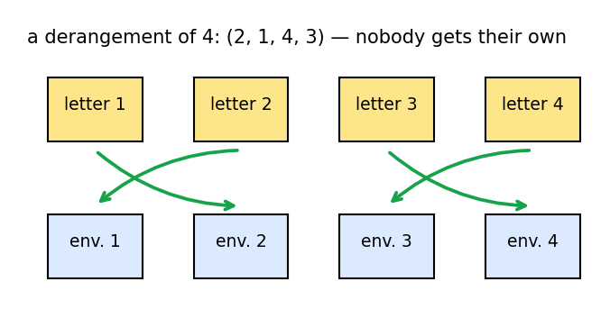
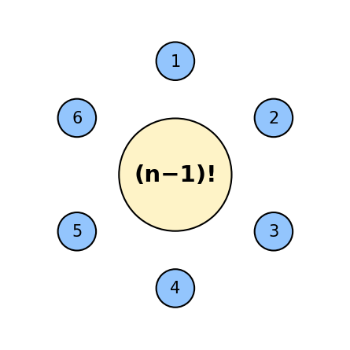

# 错排列、圆排列 【6】

Derangements and Circular Permutations

## 讲解

### 错排列

**错排列** Dₙ 是 {1, …, n} 的排列中**没有元素留在原位**的排列（对所有 i，
π(i) ≠ i）。其个数满足：

> Dₙ = (n − 1)(Dₙ₋₁ + Dₙ₋₂)，D₁ = 0，D₂ = 1

> Dₙ = n! · Σᵢ₌₀ⁿ (−1)ⁱ / i! ≈ n! / e

前几个值：0, 1, 2, 9, 44, 265（n = 1…6）。



**递推思路**：元素 1 放到位置 k（n−1 种选择）。若元素 k 放回位置 1，剩下 n−2 个元素
自由错排：Dₙ₋₂ 种。否则元素 k 必须避开位置 1——这等价于把元素 k 当成"元素 1"和其余
n−1 个元素一起错排：Dₙ₋₁ 种。

级数公式来自对性质"位置 i 保持原元素"的[容斥](inclusion-exclusion.md)——而极限
n!/e 解释了这个著名事实：随机排列是错排的概率约为 1/e ≈ 37%，对任意大的 n 都成立。

### 圆排列

把 n 个不同元素**围成一圈**，旋转后相同的视为同一种：

> (n − 1)!



**为什么**：n! 种线排列中，每种圆排列被数了 n 次（每次旋转一次），所以 n!/n =
(n−1)!。等价地：固定一个人的座位打破旋转对称，其余 n−1 人任意排。若翻转也算相同
（如可以翻面的项链），再除以 2：(n−1)!/2。

## 例题

**例 1.** D₃ = 2：{1,2,3} 的 6 个排列中，只有 (2,3,1) 和 (3,1,2) 让每个元素都
离开原位。

**例 2.** D₄ = 9：4!·(1 − 1 + 1/2 − 1/6 + 1/24) = 24·(9/24) = 9。

**例 3.** 4 个人互赠礼物，每人不拿到自己的：D₄ = 9 种。

**例 4.** 8 人围圆桌：(8−1)! = 5040 种。作为项链（可翻面）：5040/2 = 2520。

**例 5（C++）.** 递推求错排数：

```cpp
D[1] = 0; D[2] = 1;
for (int i = 3; i <= n; i++)
    D[i] = (i - 1) * (D[i-1] + D[i-2]) % MOD;
```

**例 6.** 用公式验证 D₅ = 44：5!(1/2! − 1/3! + 1/4! − 1/5!) =
120·(1/2 − 1/6 + 1/24 − 1/120) = 60 − 20 + 5 − 1 = 44。✓

**例 7（慢动作——用递推爬出 D₄）.** 已知 D₁ = 0，D₂ = 1。往上爬：D₃ = 2·(1 + 0) =
2；D₄ = 3·(2 + 1) = 9；D₅ = 4·(9 + 2) = 44。每一步只需要前两个值——这就是 DP 代码
只有三行的原因。封闭形式也一致：4!·(1 − 1 + 1/2 − 1/6 + 1/24) = 24·(9/24) = 9。
两条路，同一个 9。

**例 8（慢动作——4 个人围圆桌，具体到人）.** 先让 Alice 坐下——因为桌子可以旋转，
她坐哪把椅子无所谓。然后 Ben 有 3 个空位可选，Carol 有 2 个，Dave 有 1 个：
3·2·1 = 6 = (4−1)! 种。按"谁坐在 Alice 右手边"列出：ABCD, ABDC, ACBD, ACDB, ADBC,
ADCB——六个真正不同的圆圈。

## 练习

1. 分别用递推和 n! Σ(−1)ⁱ/i! 公式计算 D₆。*（答案：两种方法都是 265。）*
2. 秘书把 5 封信随机装进 5 个写好地址的信封。每封信都装错有多少种？概率是多少？
   *（答案：44；44/120 = 11/30。）*
3. 6 个孩子围圆桌坐，有多少种坐法？*（答案：5! = 120。）*
4. 5 颗不同的珠子串成手链（可翻面）：多少种花样？*（答案：4!/2 = 12。）*
5. n 个人取 n 顶帽子，恰好 n−2 人拿到自己帽子的方案数？
   *（提示：选哪 2 个人交换。答案：C(n, 2)·D₂ = C(n, 2)。）*
6. 写程序：O(n) 计算 Dₙ mod 10⁹+7，n ≤ 10⁷。
7.（挑战）由级数公式证明 Dₙ = n·Dₙ₋₁ + (−1)ⁿ，并据此给出另一种 O(n) 算法。
