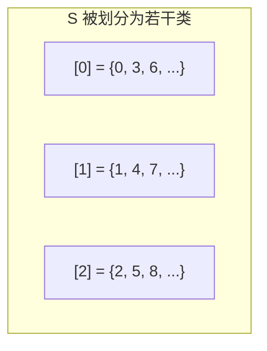

# 等价关系与等价类 【6】

Equivalence Relations and Equivalence Classes

## 讲解

集合 S 上的一个**关系** R 是有序对的集合；把 (a, b) ∈ R 记作 a ~ b。满足以下三条的
关系称为**等价关系**：

* **自反**：对所有 a，a ~ a；
* **对称**：a ~ b 蕴含 b ~ a；
* **传递**：a ~ b 且 b ~ c 蕴含 a ~ c。

等价关系把 S 划分成互不相交的**等价类**：[a] = {x : x ~ a}。每个元素恰好属于一个
类——这些类构成 S 的一个**划分**。



*模 3 同余把 ℤ 划分成三个不相交的类。*

经典例子：模 m 同余（类 = 剩余类）；图的连通性（类 = 连通分量）；"生日相同"。

**为什么值得关心**：等价关系就是数学版的"按……分组"。每当题目说"把这些看作相同
的"，就检查这三条性质——若成立，就可以每类只取一个代表元，只对代表元工作。

**竞赛中**，等价类由**并查集**维护：`find` 返回类的代表元，`unite` 合并两个类——
配合路径压缩后均摊接近常数时间。

## 例题

**例 1.** ℤ 上的模 3 同余：类为 [0] = {…, −3, 0, 3, …}、[1] = {…, 1, 4, …}、[2]。
三个类把 ℤ 划分。

**例 2.** [0, 99] 上"x ~ y 当且仅当十位数字相同"：自反、对称、传递 → 等价关系；
等价类是 {0–9}, {10–19}, …, {90–99}。

**例 3.** "a ~ b 当且仅当 a − b 为偶数"把 ℤ 分成偶数和奇数——2 个类。这正是模 2
同余。

**例 4.** 反例："a < b" 传递但不自反也不对称。"|a − b| ≤ 1"（ℤ 上）自反、对称但
不传递（0 ~ 1，1 ~ 2，但 0 ≁ 2）。每条失败的性质都杀死等价关系。

**例 5（C++）.** 并查集骨架：

```cpp
int fa[N];
int find(int x) { return fa[x] == x ? x : fa[x] = find(fa[x]); }
void unite(int x, int y) { fa[find(x)] = find(y); }
// 同类？  find(x) == find(y)
```

**例 6（慢动作——逐条性质检查）.** "x ~ y 当且仅当 x − y 被 4 整除"是 ℤ 上的等价关
系吗？自反：x − x = 0 被 4 整除 ✓。对称：若 4 | (x−y)，则 4 | (y−x) = −(x−y) ✓。
传递：若 x−y = 4a 且 y−z = 4b，则 x−z = 4(a+b) ✓。三个小检查做完，整个无穷集合 ℤ
突然坍缩成只值得思考的 4 个对象：[0], [1], [2], [3]。

**例 7（慢动作——一次并查集轨迹）.** 初始：{1,2,3,4} 各自独立。unite(1,2) →
{1,2},{3},{4}；unite(3,4) → {1,2},{3,4}；find(1) = find(2) → 同类，是；find(1) 与
find(3)？不同 → 否。unite(2,3) → {1,2,3,4}；此后每个 find 都返回同一个代表元。四
个元素、三次合并，划分的演化与等价类完全一致。

## 练习

1. ℤ 上哪些是等价关系？(a) a ~ b 当且仅当 a | b；(b) a ~ b 当且仅当
   a ≡ b (mod 5)；(c) a ~ b 当且仅当 a ≤ b；(d) a ~ b 当且仅当 a² = b²。
   *（答案：只有 (b) 和 (d)；(a) 不满足对称，(c) 不满足对称。）*
2. 列出 {1, 2, 3, 4, 5, 6} 上"奇偶性相同"的等价类。
   *（答案：{1, 3, 5} 和 {2, 4, 6}。）*
3. 在学生集合上，"年龄（周岁）相同"是等价关系吗？"比……高"呢？
   *（答案：是；不是。）*
4. 模 7 同余在 ℤ 上定义了多少个等价类？给每类一个代表。
   *（答案：7；0, 1, 2, 3, 4, 5, 6。）*
5. 证明：任意两个等价类要么相等，要么不相交。
6. 写程序：用并查集读入 n 个元素和 m 条"x 与 y 等价"的陈述，再回答 q 个询问
   "x 与 y 等价吗？"。
7.（挑战）证明 3 元集合上恰有 5 个等价关系（数划分：Bell 数 B₃）。
