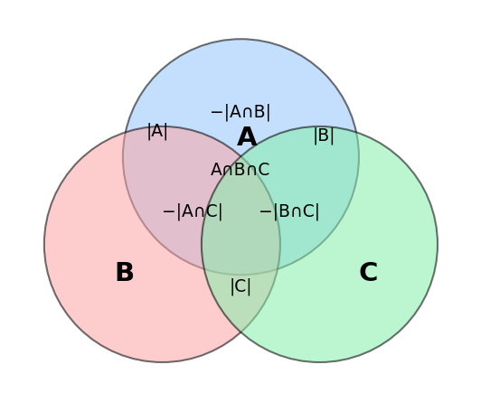

# 容斥原理 【7】

Inclusion–Exclusion Principle

## 讲解

**容斥原理**通过交替加减交集来计数相互重叠的集合的并集大小。两个集合：

> |A ∪ B| = |A| + |B| − |A ∩ B|

三个集合：

> |A ∪ B ∪ C| = |A| + |B| + |C| − |A∩B| − |A∩C| − |B∩C| + |A∩B∩C|



**为什么正负交替。** 恰好属于 t 个集合的元素，在单集合求和中被计 C(t,1) 次，在两两
交集中被计 C(t,2) 次，依此类推——总计 C(t,1) − C(t,2) + C(t,3) − … = 1，由二项式恒
等式 (1−1)ᵗ = 0（t ≥ 1）可得。所以每个元素最终被**恰好计一次**，无论它属于多少个
集合。

一般地，n 个集合：

> |∪ᵢ Aᵢ| = Σ|Aᵢ| − Σ|Aᵢ∩Aⱼ| + Σ|Aᵢ∩Aⱼ∩Aₖ| − … + (−1)ⁿ⁺¹ |A₁∩…∩Aₙ|

等价地，计数**一条性质都不满足**的元素：

> |全都不满足| = 总数 − Σ|Aᵢ| + Σ|Aᵢ∩Aⱼ| − …

**竞赛中**，容斥通过枚举性质的所有 2ⁿ 个子集并按奇偶性加减来实现——
O(2ⁿ · 单次代价)。这要求 n（*性质*的个数，不是元素个数）很小，一般 ≤ 20。

## 例题

**例 1.** [1, 100] 中能被 2、3 或 5 整除的数：
50 + 33 + 20 − 16 − 10 − 6 + 3 = 74。

**例 2.** 用容斥求欧拉函数：n = 60 = 2²·3·5。
φ(60) = 60 − 60/2 − 60/3 − 60/5 + 60/6 + 60/10 + 60/15 − 60/30 =
60 − 30 − 20 − 12 + 10 + 6 + 4 − 2 = 16。✓ 这正是乘积公式 n·∏(1 − 1/p) 的来源。

**例 3.** 错排列：Dₙ = n! Σ(−1)ⁱ/i! 来自对性质"位置 i 不动"的容斥。

**例 4（C++）.** 枚举质因子子集，统计 [1, n] 中与 30 = 2·3·5 互素的整数个数：

```cpp
int primes[] = {2, 3, 5};
long long bad = 0;
for (int mask = 1; mask < (1 << 3); mask++) {
    long long prod = 1;
    int bits = __builtin_popcount(mask);
    for (int i = 0; i < 3; i++)
        if (mask >> i & 1) prod *= primes[i];
    bad += (bits % 2 ? 1 : -1) * (n / prod);
}
long long coprime = n - bad;
```

**例 5.** 从 m 元集到 n 元集的满射个数（性质 i = "值 i 没取到"）：

> n^m − C(n,1)(n−1)^m + C(n,2)(n−2)^m − … = Σᵢ (−1)ⁱ C(n, i) (n−i)^m

**例 6（慢动作——一个元素的账本）.** 跟踪数字 30 在例 1 的计算中如何被计数。它能被
2、3、5 整除，所以同时属于三个集合。公式向它收取：+1（在 |A| 里）+1（|B|）+1（|C|）
−1（A∩B，6 的倍数）−1（A∩C，10 的倍数）−1（B∩C，15 的倍数）+1（A∩B∩C，30 的倍
数）。净值：3 − 3 + 1 = 1——恰好被计一次，正如承诺。再看 14（只在 A 中）：+1，别的
什么都没有——也是一次。正负交替的符号被精确调校到让*每个*元素的账本都平衡为 1。

## 练习

1. [1, 200] 中能被 3 或 7 整除的数。*（答案：66 + 28 − 9 = 85。）*
2. [1, 1000] 中与 10 互素的数。*（答案：1000 − 500 − 200 + 100 = 400 =
   φ(10)·100。）*
3. {1,…,5} 的排列中有多少满足 π(1) ≠ 1 且 π(2) ≠ 2？
   *（答案：120 − 24 − 24 + 6 = 78。）*
4. x + y + z = 15 且 0 ≤ x, y, z ≤ 6 的解数？
   *（答案：C(17,2) − 3·C(10,2) + 3·C(3,2) = 136 − 135 + 9 = 10。）*
5. 字母表 {A,B,C} 上长度为 4 且三个字母都出现的串有多少个？
   *（答案：3⁴ − 3·2⁴ + 3·1⁴ = 81 − 48 + 3 = 36。）*
6. 实现子集枚举的容斥：统计 [1, n]（n ≤ 10¹⁸）中不被给定 k ≤ 20 个质数中任何一个
   整除的整数个数。
7.（挑战）统计包含数字 1、2、3 每个至少一次的五位数个数。*（提示：对"数字 i 缺席"
   容斥，注意首位不能为 0。答案：90000 − 3·(8·9⁴) + 3·(7·8⁴) − 6·7⁴ = 90000 −
   157464 + 86016 − 14406 = 4146。）*
