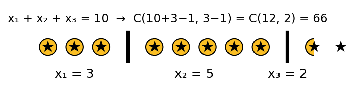

# 多重集上的组合 【6】

Combinations of Multisets

## 讲解

**问题**：从 k 种类型中选取 m 个元素，每种类型**无限供应**，同类型元素不可区分。答案
就是**隔板法**计数：

> C(m + k − 1, k − 1)



**为什么**：把 m 个选出的（相同的）物品排成一行（星星），插入 k − 1 块隔板来分隔
各种类型，如图所示。m 颗星和 k − 1 块板的每种排列恰好对应一种选取方案，共
C(m + k − 1, k − 1) 种——即在 m + k − 1 个位置中选择隔板的位置。

等价表述：非负整数解

> x₁ + x₂ + … + xₖ = m

的个数是 C(m + k − 1, k − 1)。若要求**正整数**解（每种类型至少选一个），令
yᵢ = xᵢ − 1，方程化为非负整数的 y₁ + … + yₖ = m − k，答案为 C(m − 1, k − 1)。

**有界情形**（类型 i 最多取 nᵢ 个）：一般没有封闭公式——对越界的变量用
[容斥原理](inclusion-exclusion.md)，如例 4。

**常见误区**：隔板法计算的是分给**可区分**对象的方案数。对象不可区分时（整数拆分）
是困难得多的另一个问题。

## 例题

**例 1.** 从 4 种包子中买 6 个：C(6+4−1, 3) = C(9, 3) = 84。

**例 2.** x + y + z = 10 的非负整数解个数：C(12, 2) = 66。正整数解：C(9, 2) = 36。

**例 3.** 把 10 颗相同的糖分给 3 个孩子，每人至少 1 颗：C(10−1, 3−1) = C(9, 2) =
36。不加限制：C(12, 2) = 66。

**例 4.** 有界情形：x + y + z = 8 且每个变量 ≤ 3。非负总数：C(10, 2) = 45。减去某
变量 ≥ 4 的情形（令 x′ = x − 4：各 C(6, 2) = 15，三个变量共 45）。加回双重越界
（两变量 ≥ 4 迫使和 ≥ 8，恰为 (4,4,0) 型：3 种）：45 − 45 + 3 = 3。手工验证：
(2,3,3), (3,2,3), (3,3,2)——3 种。✓

**例 5（C++）.** 隔板法：

```cpp
// x1+...+xk = m, xi >= 0 的解数
long long ans = C(m + k - 1, k - 1);
```

## 练习

1. x + y + z + w = 12 有多少非负整数解？*（答案：C(15, 3) = 455。）*
2. x + y + z = 15 有多少正整数解？*（答案：C(14, 2) = 105。）*
3. 20 个相同的球放进 5 个不同的盒子。不加限制？每盒非空？
   *（答案：C(24, 4) = 10 626；C(19, 4) = 3876。）*
4. 从玫瑰、郁金香、百合中（无限供应）选 8 枝花，有多少种选法？
   *（答案：C(10, 2) = 45。）*
5. x + y + z = 20 且 x ≥ 2, y ≥ 3, z ≥ 5 的解数。*（提示：换元。答案：C(12, 2) =
   66。）*
6. x + y + z = 10 且每个 ≤ 4 的解数。
   *（答案：C(12,2) − 3·C(7,2) + 3·C(2,2) = 66 − 63 + 3 = 6。）*
7. 写程序：读入 m, k，输出 x₁ + … + xₖ = m 的非负整数解个数，模 10⁹+7。
8.（挑战）证明 x₁ + … + xₖ ≤ m 的解数为 C(m + k, k)。*（提示：加一个松弛变量。）*
