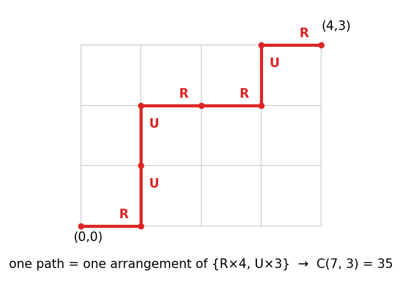

# 多重集上的排列 【6】

Permutations of Multisets

## 讲解

**问题**：把多重集合的 n 个元素排成一行，同类型元素不可区分。若类型 i 的重数为 nᵢ
且 n = n₁ + … + nₖ，则不同排列数为**多项式系数**：

> n! / (n₁! · n₂! · … · nₖ!)

**为什么成立——两种证法，两种思维习惯：**

* *除法论证*：从 n! 种不同元素排列出发。同类型的 nᵢ 个相同副本之间互换（nᵢ! 种）不
  改变可见的排列，每个等价类恰有 n₁!·n₂!·…·nₖ! 个成员——所以除掉。"先按有标号的
  数，再除掉对称性"是组合中最可复用的技巧之一。
* *顺序放置*：先给类型 1 选位置（C(n, n₁) 种），再在剩余位置中给类型 2 选
  （C(n−n₁, n₂) 种），依此类推。乘积逐项约分后得到同一公式——亲手验证一次约分，
  这个公式就永远属于你了。

**格路视角**：从 (0,0) 到 (p, q) 只走右/上单位步的路径，就是 {R×p, U×q} 的排列——
故共 C(p+q, p) 条。许多网格问题是化了妆的多重集排列；加上限制（如"不许越过对角
线"）就直接通向[卡特兰数](catalan.md)。



**易错点**：这个公式针对*给定*多重集合的排列。"能组成多少个多重集合"或"把相同物品
分进盒子"是*不同*的问题——见[多重集上的组合](multiset-combinations.md)。

## 例题

**例 1.** BALL 的排列数：4!/2! = 12。

**例 2.** MISSISSIPPI 的排列数：11!/(1!·4!·4!·2!) = 39916800/1152 = 34 650。

**例 3.** 从 (0,0) 到 (4,3) 只走右/上单位步的路径数？每条路径是 {R×4, U×3} 的排列：
7!/(4!·3!) = 35 = C(7, 3)。

**例 4.** 把 10 颗相同的糖果……——小心：相同物品排成*一行*只有在类型即位置时才是
多重集排列。把相同糖果分给不同的孩子，见
[多重集上的组合](multiset-combinations.md)。

**例 5.** 用减法求不相邻：{A×3, B×2} 中两个 B *不*相邻的排列数 = 总数 −（B 相邻）
= 5!/(3!·2!) − 4!/3! = 10 − 4 = 6。（把相邻的 BB 看作一个块。）

**例 6（C++）.** 安全地计算 11!/(4!·4!·2!)——能边算边约就绝不先算 11!；组合数链
让中间量保持很小：

```cpp
long long r = 1;
int n = 11;
// 依次给 I、S、P 选位置
auto C = [](int n, int m) {
    long long r = 1;
    for (int i = 1; i <= m; i++) r = r * (n - m + i) / i;
    return r;
};
r = C(11, 4) * C(7, 4) * C(3, 2);   // 330 * 35 * 3 = 34650
```

**例 7（慢动作——显微镜下的 BALL）.** 先给两个 L 贴上标签：B, A, L₁, L₂ 是 4 个不
同对象，有 4! = 24 种排列。每个无标签排列——比如 L B L A——恰好由 2 个带标签排列
产生（L₁ B L₂ A 和 L₂ B L₁ A），因为交换两个 L 看不出任何区别。所以 24 个带标签排
列两两配成 24/2 = 12 个外观相同的类：答案是 4!/2! = 12。每当你"除掉对称性"时，真
正做的就是这种配对。

## 练习

1. 数下列单词的不同排列：LEVEL；BANANA；ABRACADABRA。
   *（答案：5!/(2!·2!) = 30；6!/(3!·2!) = 60；11!/(5!·2!·2!) = 83 160。）*
2. 恰含六个 1 的 10 位二进制串有多少个？*（答案：C(10, 6) = 210。）*
3. 书架上有 4 本相同的数学书、3 本相同的小说、2 本相同的漫画。多少种不同摆法？
   *（答案：9!/(4!·3!·2!) = 1260。）*
4. 从 (0,0) 到 (6,6) 的路径数？经过 (2,2) 的呢？
   *（答案：C(12,6) = 924；C(4,2)·C(8,4) = 6·70 = 420。）*
5. SUCCESS 的字母排列中，两个 C 不相邻的有多少种？*（提示：总数减相邻；总数 =
   7!/(3!·2!) = 420；把 CC 当一个块：6!/3! = 120。答案：300。）*
6. 写程序：读入字符串（长度 ≤ 20），输出其不同排列数——注意 n > 20 时溢出。
7. {a×2, b×2, c×1} 的排列中，c 位于两个 a 之间（不必相邻）的有多少种？
   *（提示：在 5!/(2!·2!) = 30 种排列中，a, c, a′ 的相对顺序均匀分布于 3!/2! = 3
   种模式……答案：10。）*
8.（挑战）{a×2, b×2, c×2} 的排列中，没有两个相同字母相邻的有多少种：用容斥。
   *（答案：30。）*
