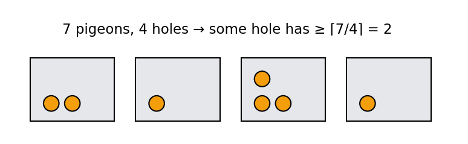

# 鸽巢原理 【6】

Pigeonhole Principle

## 讲解

**鸽巢原理（抽屉原理）**：把 n + 1 只或更多鸽子放进 n 个巢里，必有某个巢里至少有两
只鸽子。

**加强形式**：把 N 个物体放进 k 个盒子，必有某个盒子至少有 **⌈N/k⌉** 个物体。

这个原理只证明*存在性*——它从不告诉你*哪个*盒子。技巧全在于选什么当鸽子、什么当
巢。好用的启发：你想要两个相同的东西（"同余"、"同和"）就是巢；题目给你的对象就是
鸽子。

**竞赛中的典型用途**："证明这些数中有两个满足……"、重复值的存在性、存在和能被 n
整除的子序列，等等。

## 例题

**例 1.** 任意 13 个人中，必有两人同月出生。（13 只鸽子，12 个月份。）

**例 2.** 任意 367 个人中，必有两人生日相同（算上 2 月 29 日共 366 种生日）。

**例 3.** 边长为 2 的等边三角形内任取 5 个点：必有两点距离不超过 1。把三角形分成
4 个边长为 1 的小三角形（巢）；必有两点落入同一个。

**例 4.** 任意 n + 1 个整数中，必有两个模 n 同余——它们的差被 n 整除。

**例 5.** 任给 10 个不同的两位数，存在两个不相交的非空子集和相等。鸽子：
2¹⁰ − 1 = 1023 个非空子集；巢：可能的和，从 10 到 10·99 = 990。因 1023 > 990，
两个子集和相等；去掉公共部分后仍非空、不相交且和相等。

**例 6（经典）.** 任意 n 个数中必存在连续子段，其和被 n 整除：考虑前缀和
s₀, s₁, …, sₙ 模 n——n+1 只鸽子，n 个剩余类；要么某个 sᵢ ≡ 0（取该前缀），要么两个
前缀和同余，其差 sⱼ − sᵢ 就是所求子段。

**例 7（慢动作——前缀和技巧代入真数字）.** 取序列 3, 1, 4, 1, 5（n = 5）。前缀和模
5：s₀ = 0，s₁ = 3，s₂ = 4，s₃ = 8 ≡ 3，s₄ = 9 ≡ 4，s₅ = 14 ≡ 4。6 只鸽子、5 个巢
——果然 s₂ = s₄ = 4 相撞。它们的差 a₃ + a₄ = 4 + 1 = 5 被 5 整除。完全不需要搜
索：碰撞*直接*把答案递到你手上。

## 练习

1. 抽屉里有 4 种颜色的袜子，蒙眼至少摸几只才能保证凑成一双？*（答案：5。）*
2. 证明：任意 5 个整数中，必有某 3 个的和被 3 整除。
   *（提示：模 3 的余数；要么三种余数都出现——各取一个——要么某种余数出现至少
   ⌈5/3⌉ = …至少 3 次。）*
3. 证明：单位正方形内 51 个点中，必有两点距离不超过 √2/5。
   *（提示：分成 5×5 的网格，每格对角线长 √2/5。）*
4. 证明：2025 的某个正倍数只由数字 0 和 1 组成。
   *（提示：考虑 1, 11, 111, … 模 2025——2026 只鸽子，2025 个巢；相碰的一对相减。）*
5. 证明：任何 6 人的聚会上，必有 3 人两两相识或两两不相识（Ramsey 数
   R(3,3) = 6）。*（提示：固定一人；其 5 个关系分两类——某类至少有 ⌈5/2⌉ = 3 人。）*
6. 写程序：给定 n 和 n 个整数的数组，用模 n 前缀和找出和被 n 整除的连续子段。
7.（挑战）任意 52 个整数中，必有两个数，其和**或**差被 100 整除。
   *（提示：巢 = 剩余对 {i, 100−i}，共 51 个。）*
