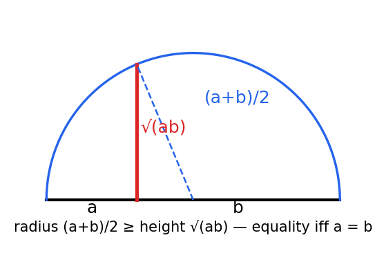

# 代数（高中部分） 【5】

Algebra (Senior High School)

## 讲解

大纲假定的高中代数覆盖七个板块。这里不需要重新推导理论——需要的是*熟练度*，因为这些
工具会嵌在更大的算法题里出现（复杂度分析、期望、DP 中求和的封闭形式、几何公式）。

* **集合与常用逻辑用语**：并、交、补；充分条件与必要条件。用大白话说："A 是 B 的充分
  条件"指有 A *就足够了*（A ⇒ B）；"A 是 B 的必要条件"指没有 A *就不可能有* B
  （B ⇒ A）。自测一下："是狗"是"是哺乳动物"的充分条件，但不是必要条件。
* **函数**：定义域、值域、单调性、奇偶性；指数函数、对数函数与幂函数；图像变换（平移、
  伸缩、对称）；零点与二分法。用大白话说：指数函数靠*乘*增长（2, 4, 8, 16…），对数
  是它的逆运算——它*数的是位数/翻倍次数*。这就是为什么每当循环把区间减半时，复杂度里
  就冒出 log n。
* **数列**：等差 aₙ = a₁ + (n−1)d，求和 Sₙ = n(a₁+aₙ)/2；等比 aₙ = a₁qⁿ⁻¹，
  q ≠ 1 时求和 Sₙ = a₁(qⁿ−1)/(q−1)。用大白话说：等差 = "每次加同样的步长"；等比 =
  "每次乘同样的因子"。它们的求和是复杂度分析的骨架：等差求和是 O(n²)，等比求和被
  最大项主导（这正是倍增循环总工作量 1+2+4+…+n < 2n、快速幂是 O(log n) 的原因）。
* **求和技巧**：错位相减（用于等差×等比的 Σ）与裂项相消（把每一项写成
  f(k) − f(k+1)，让相邻项互相抵消）。
* **三角函数**：弧度制；正弦、余弦、正切及其图像；恒等式（sin²x + cos²x = 1、和差与
  二倍角公式）；正弦定理 a/sin A = 2R 与余弦定理 c² = a² + b² − 2ab·cos C。用大白话
  说：余弦定理就是带修正项的勾股定理——它把"两边及其夹角"换算成第三边。
* **不等式**：一元二次不等式（借助抛物线符号求解）；基本不等式 (a + b)/2 ≥ √(ab)
  （a, b > 0，等号当且仅当 a = b）；线性规划初步。AM–GM 有一个一张图的漂亮证明：

  虚线半径 (a+b)/2 永远不会短于竖直弦 √(ab)——两者恰好在分点居中（即 a = b）时重合。
  AM–GM 可推广：(x₁+…+xₙ)/n ≥ (x₁…xₙ)^(1/n)。
* **复数**：a + bi、四则运算、模 |a+bi| = √(a²+b²)、共轭；复平面。用大白话说：复数是
  一个*会旋转*的二维点——乘以 i 就是逆时针转 90°。这是 FFT 和几何旋转公式的种子。
* **导数（基本）**：f′(x) 即变化率；xⁿ、eˣ、ln x 的导数；f′ > 0 ⇒ 递增。用导数求
  单变量代价函数的最值——这常常是优化封闭形式答案的最快途径。

**竞赛中何时用哪件工具**：循环变量翻倍 → 等比级数；双重循环 1..n、1..i → 等差级数；
"面积固定求周长最小" → AM–GM；"f 连续，求 x 使 f(x) = 0" → 二分法。

## 例题

**例 1.** 等差数列 a₁ = 3, d = 4：a₁₀ = 3 + 9·4 = 39，S₁₀ = 10·(3+39)/2 = 210。

**例 2.** 等比级数：1 + 2 + 4 + … + 2ⁿ = 2ⁿ⁺¹ − 1。这正是二进制与倍增循环行为背后的
原因：二进制计数器从 0 数到 n，总翻转次数不到 2n。

**例 3（慢动作——二分法）.** 用二分在 [1, 2] 上求 f(x) = x² − 2 的零点（即 √2）：
f(1) = −1 < 0，f(2) = 2 > 0。中点 1.5：f(1.5) = 0.25 > 0 → 根在 [1, 1.5]。中点
1.25：f(1.25) = −0.4375 < 0 → 根在 [1.25, 1.5]。中点 1.375：f ≈ −0.109 < 0 →
[1.375, 1.5]。十步左右就把它钉在 1.414… 附近。每步把区间减半，n 步后不确定性只剩
原来的 2⁻ⁿ——这正是连续域上的二分查找。

**例 4.** AM–GM：x > 0 时 x + 1/x ≥ 2，等号在 x = 1 取得。第二个用法：周长为 20 的
所有矩形中，5×5 的正方形面积最大（25），因为 (a+b)/2 = 5 ≥ √(ab) 迫使 ab ≤ 25。

**例 5.** 裂项相消：Σₖ 1/(k(k+1)) = Σₖ (1/k − 1/(k+1)) = 1 − 1/(n+1) = n/(n+1)。
观察抵消过程：(1 − 1/2) + (1/2 − 1/3) + (1/3 − 1/4) + …——每个 −1/k 都吃掉前一项的
+1/k。认出 1/(k(k+1)) = 1/k − 1/(k+1) 这个模式：每个部分分式型恒等式都在邀请你裂项。

**例 6.** 错位相减：S = Σₖ₌₁ⁿ k·2ᵏ。算 2S = Σ k·2ᵏ⁺¹ 再相减：
S − 2S = Σ 2ᵏ − n·2ⁿ⁺¹ → S = (n−1)·2ⁿ⁺¹ + 2。用 n = 2 做健全性检查：
1·2 + 2·4 = 10，而 (2−1)·2³ + 2 = 10。✓

**例 7（慢动作——余弦定理）.** cos 60° = 1/2；边 b = 3, c = 4、夹角 A = 60° 的三角
形有 a² = 9 + 16 − 2·3·4·(1/2) = 13，即 a = √13 ≈ 3.606。注意令 A = 90° 时修正项消
失：a² = b² + c²——勾股定理只是特例。

**例 8.** 用导数优化：x > 0 时最小化 f(x) = x + 4/x。f′(x) = 1 − 4/x² = 0 → x = 2，
f(2) = 4。（AM–GM 给出同样结果：x + 4/x ≥ 2√4 = 4。）两件工具，一个答案——好习惯
是两个都试一遍互相验证。

**例 9.** 复数乘法就是旋转：1 + i 的模是 √2，辐角 45°。平方它：(1 + i)² = 2i——模
2，辐角 90°。模长相乘，辐角相加。

## 练习

1. 等差数列中 a₃ = 7，a₇ = 19。求 a₁、d 和 S₁₀。
   *（答案：d = 3，a₁ = 1，S₁₀ = 145。）*
2. 求和 1/2 + 1/4 + 1/8 + … + 1/2¹⁰。*（答案：1 − 2⁻¹⁰ = 1023/1024。）*
3. 解不等式 x² − 5x + 6 < 0。*（答案：2 < x < 3。）*
4. x, y > 0 且 x + y = 10，求 xy 的最大值。*（答案：25，在 x = y = 5 取得，AM–GM。）*
5. 计算 (1 + i)(2 − i) 和 |3 + 4i|。*（答案：3 + i；5。）*
6. 求 f(x) = x³ − 3x 的单调区间与极值。*（答案：在 (−∞,−1)、(1,∞) 上递增；极大值
   f(−1) = 2，极小值 f(1) = −2。）*
7. 用恒等式 k² = k(k+1) − k 与已知求和公式计算 Σₖ₌₁ⁿ k²。
   *（答案：n(n+1)(2n+1)/6。）*
8. 从长度 1 的区间出发，二分多少步能保证 √2 精确到小数点后 6 位？
   *（提示：需要 2⁻ⁿ < 10⁻⁶。答案：20。）*
9. 对三个数用 AM–GM：xyz = 8（x, y, z > 0）时最小化 x + y + z。
   *（答案：x = y = z = 2，最小值 6。）*
10.（挑战）递推 aₙ₊₁ = 2aₙ + 1，a₁ = 1。求通项。
    *（提示：两边加 1 → 等比。答案：aₙ = 2ⁿ − 1。）*
