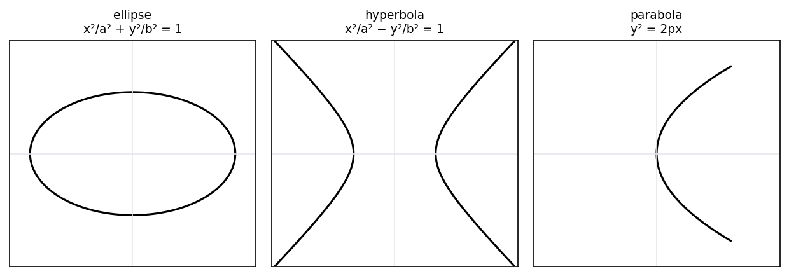
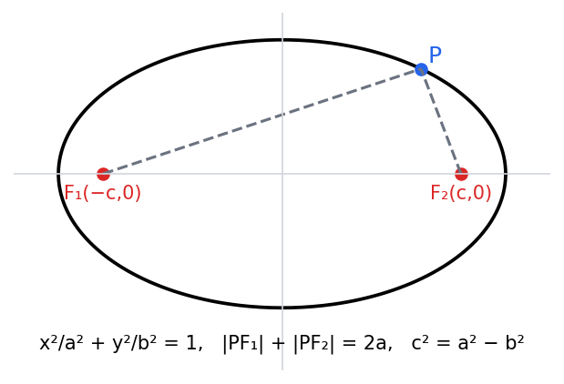

# 几何（高中部分） 【6】

Geometry (Senior High School)

## 讲解

大纲假定的高中几何覆盖三个板块。对竞赛来说*解析*工具最重要：一切都归结为坐标，而坐
标把一切都归结为代数。

* **平面向量**：加、减、数乘；数量积 a·b = |a||b|cos θ = x₁x₂ + y₁y₂；垂直判定
  a·b = 0；投影。用大白话说：数量积衡量*两个向量方向有多一致*——锐角为正，直角为零，
  钝角为负。它是几何（角度）与代数（乘积之和——极易计算）之间的桥梁。
* **立体几何**：棱柱、棱锥、圆柱、圆锥、球——表面积与体积（V球 = 4πr³/3，
  S球 = 4πr²）；线面平行与垂直关系；三视图。主要需要记住公式，很少涉及算法。
* **平面解析几何**：
  * 直线：斜率 k = (y₂−y₁)/(x₂−x₁)，点斜式与一般式，点到直线距离
    |Ax₀+By₀+C|/√(A²+B²)；
  * 圆：(x−a)² + (y−b)² = r²，直线与圆的位置关系（比较圆心到直线距离与 r）；
  * 圆锥曲线：椭圆 x²/a² + y²/b² = 1（到两焦点距离之和 = 2a），双曲线
    x²/a² − y²/b² = 1（距离之差 = 2a），抛物线 y² = 2px（到焦点距离 = 到准线距离）；
    离心率 e = c/a；
  * 空间直角坐标系与三维距离公式。

**三种圆锥曲线一览：**



三者都是平面截圆锥得到的截线（"圆锥曲线"由此得名），并共享离心率框架：e < 1 椭圆，
e = 1 抛物线，e > 1 双曲线。

**细看椭圆：**



椭圆中 c² = a² − b²（a ≥ b），焦点在 (±c, 0)。定义性质 |PF₁| + |PF₂| = 2a 意味着可以
用一根长 2a 的绳子钉在两个焦点上画出椭圆。离心率 e = c/a ∈ (0, 1) 衡量扁平程度：
e → 0 趋近圆，e → 1 退化成线段。

**易错点——竖直直线**：斜截式 y = kx + b 无法表示 x = c。写代码时优先用一般式
Ax + By + C = 0 或方向向量，避免除零。

## 例题

**例 1.** a = (3, 4)，b = (1, 2)：a·b = 3·1 + 4·2 = 11；cos θ = 11/(5·√5) =
11√5/25。

**例 2.** 垂直判定：(2, −1)·(2, 4) = 4 − 4 = 0 → 垂直。

**例 3（慢动作——点到直线距离）.** 求点 (1, 2) 到直线 3x + 4y − 5 = 0 的距离：把点
代入直线方程左边，|3·1 + 4·2 − 5| = 6；除以 √(A²+B²) = 5；答案 6/5。分子衡量这个点
对直线方程"错得有多离谱"；分母用法向量的长度把它归一化。

**例 4.** 圆 (x−1)² + (y+2)² = 9 的圆心为 (1, −2)，半径 3。直线 x = 4 与它相切
（圆心到直线距离 = 3 = r）。距离 < r 意味着两个交点；> r 意味着相离。

**例 5.** 椭圆 x²/25 + y²/9 = 1：a = 5，b = 3，c = √(25−9) = 4，焦点 (±4, 0)，
离心率 e = c/a = 4/5。其上任意点 P 满足 |PF₁| + |PF₂| = 10。

**例 6（慢动作——2a 去哪儿了？）.** 在这个椭圆上检验上顶点 P = (0, 3)：
|PF₁| = √(16+9) = 5，|PF₂| = 5，和为 10 = 2a ✓。再检验右顶点 (5, 0)：9 + 1 = 10 ✓。
距离和恒定的性质在*每个*点都成立——顶点只是最好验证的地方。

**例 7（C++）.** 数量积与距离——计算几何的两匹驮马：

```cpp
double dot(double x1, double y1, double x2, double y2) {
    return x1 * x2 + y1 * y2;
}
double dist(double x1, double y1, double x2, double y2) {
    return hypot(x2 - x1, y2 - y1);
}
```

## 练习

1. a = (1, 2)，b = (−3, 1)。计算 a + b、2a − b、a·b 及夹角。
   *（答案：(−2, 4)；(5, 3)；−1；θ = arccos(−1/(√5·√10)) ≈ 98.1°。）*
2. 求过点 (1, 3) 且斜率为 −2 的直线方程。*（答案：2x + y − 5 = 0。）*
3. 半径为 3 的球的体积与表面积。*（答案：36π；36π。）*
4. k 为何值时直线 y = kx + 1 与圆 x² + y² = 4 相切？*（提示：圆心到直线距离等于 r。
   检验：|1|/√(1+k²) = 2 无实数解——直线过圆内点 (0,1)，永不相切。陷阱题！）*
5. 抛物线 y² = 8x：求焦点与准线。*（答案：焦点 (2, 0)，准线 x = −2。）*
6. 椭圆焦点为 (±3, 0) 且过点 (5, 0)，求其方程。
   *（答案：c = 3，a = 5，b = 4 → x²/25 + y²/16 = 1。）*
7. 双曲线中 a = 2, b = 3，求 c 与离心率。
   *（提示：双曲线中 c² = a² + b²。答案：c = √13，e = √13/2 > 1。）*
8. 空间中 A(1, 2, 3) 与 B(4, 6, 3) 的距离。*（答案：5。）*
9. (1, 2) 与 (4, −1) 的夹角是锐角还是钝角？不许开方。
   *（答案：点积 = 2 > 0 → 锐角。）*
10.（挑战）顶点 A(0,0), B(4,0), C(1,3) 的三角形：用叉积公式
    |x_A(y_B − y_C) + x_B(y_C − y_A) + x_C(y_A − y_B)| / 2 求面积。*（答案：6。）*
