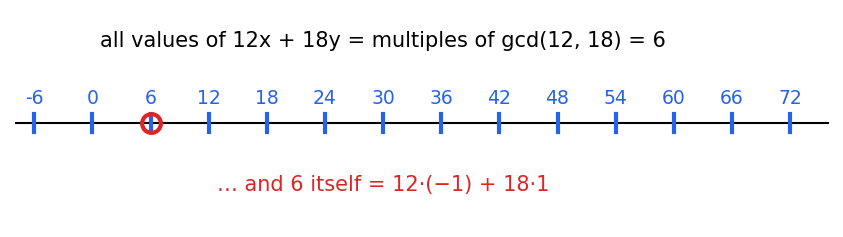

# 裴蜀定理 【7】

Bézout's Identity

## 讲解

**裴蜀定理**：对任意整数 a, b（不全为零），存在整数 x, y 使得

> a·x + b·y = gcd(a, b)

而且 gcd(a, b) 是能表示成 a·x + b·y（x, y 为整数）的**最小正整数**。

**为什么最小正组合一定是 gcd。** 每个组合 a·x + b·y 都能被 gcd(a, b) 整除，因为 gcd
同时整除两项——所以（除非为 0）没有组合能比 gcd(a, b) 更小。反过来，把辗转相除过程
倒着走一遍，就说明 gcd(a, b) 本身*确实*是一个组合——这正是
[扩展欧几里得算法](extended-euclid.md)所计算的东西。

在数轴上看：组合 12x + 18y 恰好落在 6 的倍数上，间隔均匀，永远够不到中间的数。
gcd 就是你能够到的集合的*间隔宽度*——而裴蜀定理保证这个间隔宽度本身也能取到。

**直接推论：**

* a, b 互素 ⇔ 存在 x, y 使 a·x + b·y = 1。
* 线性不定方程 a·x + b·y = c 有整数解，当且仅当 gcd(a, b) | c。
* 集合 {a·x + b·y : x, y ∈ ℤ} 恰好是 gcd(a, b) 的全体倍数。
* 模逆元的存在性：a⁻¹ mod m 存在 ⇔ gcd(a, m) = 1，因为 a·x ≡ 1 (mod m) 与
  a·x + m·y = 1 是同一回事。

## 例题

**例 1.** a = 252, b = 105, gcd = 21。一组裴蜀系数：252·(−2) + 105·5 =
−504 + 525 = 21。即 x = −2, y = 5。

**例 2.** 35 与 12 互素：35·(−1) + 12·3 = 1（x = −1, y = 3）。

**例 3.** 6x + 9y = 20 有整数解吗？gcd(6, 9) = 3 ∤ 20 → 没有。
那 6x + 9y = 21 呢？3 | 21 → 有：除以 3 得 2x + 3y = 7，一个解 x = 2, y = 1。✓

**例 4.** Frobenius 硬币问题（两种面额）：用 3 和 5 的硬币，任何 ≥ 8 的金额都能
支付；7 不行。裴蜀定理保证 gcd(3,5) = 1 的所有足够大的倍数都能用*非负*组合表示——
但对较小的值它什么也不能说，只能手工检查。

**例 5.** 倒水问题：有 4 升和 9 升的两个水壶，能量出恰好 6 升吗？
因 gcd(4, 9) = 1 | 6，可以。把组合 9·2 − 4·3 = 6 读作操作步骤：9 升壶灌满两次，
往 4 升壶里倒（倒满就倒掉）三次。

**例 6（慢动作——4 升与 9 升水壶，一步步来）.** 裴蜀定理给出 9·2 − 4·3 = 6。把算
术翻译成动作：灌满 9 升壶（累计进水：9）；往 4 升壶里倒，满了就倒掉（9 − 4 剩 5；
倒掉 4 升壶；把 5 升倒进去）；再灌满 9 升壶（累计：18）；把 4 升壶补满（还需要 3
升，大壶里剩 6）。此时 9 升壶里恰好是 6 升。每一组裴蜀系数都是一份食谱：正系数是
灌水次数，负系数是倒水次数。

## 练习

1. 求整数 x, y 使 30x + 21y = 3。*（答案：x = −2, y = 3，因为 −60 + 63 = 3。）*
2. 哪些方程有整数解？14x + 35y = 7；14x + 35y = 10；8x + 18y = 2。
   *（答案：有；没有（7 ∤ 10）；有（2 | 2）。）*
3. 求 11x + 7y = 1 的一个解，再描述所有解。
   *（答案：x = 2, y = −3；通解 x = 2 + 7t, y = −3 − 11t。）*
4. 用裴蜀定理证明相邻整数互素。*（(n+1)·1 + n·(−1) = 1。）*
5. 两个水壶分别容量 12 升和 17 升。能量出 1 升吗？2 升呢？给出策略。
   *（答案：能，gcd = 1：17·5 − 12·7 = 1；把量 1 升的流程重复两遍即得 2 升。）*
6. 123x + 45y（x, y 为整数）能取到的最小正值是多少？
   *（答案：gcd(123, 45) = 3。）*
7.（挑战）从辗转相除法出发，对 (252, 105) 把各步除法倒推回去，证明裴蜀定理。
