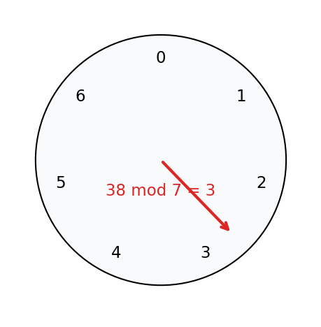

# 同余式 【5】

Congruences

## 讲解

对正整数 m，当 m | (a − b)（即 a 和 b 除以 m 余数相同）时，记 **a ≡ b (mod m)**，
读作"a 与 b 模 m 同余"。



把模 m 想象成一只**有 m 个小时的钟**：给任何数加上 m 都回到同一位置。上图展示了
38 mod 7 = 3——转满 5 圈再走 3 步，落在 3 上。

用大白话说：同余只保留重要的东西——余数——扔掉转了多少整圈。钟面上看起来一样的
两个时刻，在模运算的全部意义上就是"同一个"。

**同余是一种等价关系**，更关键的是它与运算相容：

* 若 a ≡ b 且 c ≡ d (mod m)，则 a ± c ≡ b ± d，a·c ≡ b·d (mod m)。
* 若 a ≡ b (mod m)，则对任意 k ≥ 0 有 aᵏ ≡ bᵏ (mod m)。
* 消去律：a·c ≡ b·c (mod m) 蕴含 a ≡ b (mod m / gcd(c, m))。特别地，只有当
  gcd(c, m) = 1 时才能随意消去 c。

**为什么消去律里有 gcd。** a·c ≡ b·c (mod m) 表示 m | c(a−b)。若 c 与 m 没有公因子，
则 m 必须整个整除 (a−b)；但若 g = gcd(c, m) > 1，因子 g 可以"藏"在 c 里，所以只有
m/g 被迫整除 a−b。

**一次同余方程**：方程 a·x ≡ b (mod m) 有解当且仅当 gcd(a, m) | b；有解时恰有
gcd(a, m) 个模 m 的解。直观理解：a·x mod m 只能取到 gcd(a, m) 的倍数，所以 b 必须
是其中之一；而解每隔 m/gcd(a, m) 重复一次。

**剩余类**：模 m 把全体整数分成 m 个类 [0], [1], …, [m−1]。**完全剩余系**从每类中各取
一个代表；**简化剩余系**从每个与 m 互素的类中取一个代表——共有 φ(m) 个（见
[欧拉定理](euler-theorem.md)）。

## 例题

**例 1.** 17 ≡ 2 (mod 5) 且 23 ≡ 3 (mod 5) → 17·23 ≡ 2·3 = 6 ≡ 1 (mod 5)。
验证：17·23 = 391 = 5·78 + 1。✓

**例 2.** 解 3x ≡ 1 (mod 7)：gcd(3, 7) = 1 整除 1，故模 7 恰有一解。试 x = 1…6：
3·5 = 15 ≡ 1，所以 x ≡ 5 (mod 7)。（模数很大时应改用
[扩展欧几里得算法](extended-euclid.md)，而不是逐个试。）

**例 3.** 解 6x ≡ 9 (mod 15)：gcd(6, 15) = 3 | 9，可解。把所有项——包括模数——除以 3：
2x ≡ 3 (mod 5) → x ≡ 4 (mod 5)。升回原模数，模 15 的解为 x ≡ 4, 9, 14——恰好
3 = gcd(6, 15) 个。

**例 4（易错点）.** 随意消去会出错：2·1 ≡ 2·4 (mod 6)，即 2 ≡ 8 (mod 6)，但
1 ≢ 4 (mod 6)。消去 2 不合法，因为 gcd(2, 6) = 2 ≠ 1；正确结论是 1 ≡ 4 (mod 3)。

**例 5（C++）.** 暴力求解 a·x ≡ b (mod m)，m 较小时适用：

```cpp
for (long long x = 0; x < m; x++)
    if (a * x % m == b % m) cout << x << " ";
```

**例 6（慢动作——为什么"被 9 整除看数字和"成立）.** 10 ≡ 1 (mod 9)，所以对任意 k
都有 10ᵏ ≡ 1 (mod 9)。于是
4572 = 4·10³ + 5·10² + 7·10 + 2 ≡ 4 + 5 + 7 + 2 = 18 ≡ 0 (mod 9)：一个数被 9 整除
当且仅当数字和被 9 整除。每条"数字法则"背后都是一个同余式——11 的法则用的是
10 ≡ −1 (mod 11)。

**例 7（慢动作——找循环求 2¹⁰⁰ mod 7）.** 先算小幂，观察重复：2, 4, 1, 2, 4, 1, …
——周期 3（后面的[定理](fermat-little-theorem.md)会解释周期为什么一定存在、能有多长）。
因 100 = 3·33 + 1，故 2¹⁰⁰ ≡ 2¹ = 2 (mod 7)。动手找小循环永远值得先花一分钟，
再动用重武器。

## 练习

1. 判断真假：100 ≡ 1 (mod 9)；7⁵ ≡ 2 (mod 5)；−3 ≡ 4 (mod 7)。
   *（答案：真；7 ≡ 2，2⁵ = 32 ≡ 2 → 真；真。）*
2. 解方程：5x ≡ 3 (mod 8)；4x ≡ 2 (mod 6)；4x ≡ 3 (mod 6)。
   *（答案：x ≡ 7；x ≡ 2, 5；无解，因 gcd(4,6) = 2 ∤ 3。）*
3. 求 3¹⁰⁰ 除以 7 的余数。
   *（提示：3 的幂模 7 循环为 3, 2, 6, 4, 5, 1，周期 6。答案：3¹⁰⁰ ≡ 3⁴ ≡ 4。）*
4. 证明：对任意整数 n，n² ≡ 0 或 1 (mod 4)。用它证明任何 4k+3 型整数都不能表示为
   两个平方数之和。
5. 12x ≡ 8 (mod 20) 有多少个解？全部求出。
   *（答案：gcd = 4 | 8 → 4 个解：x ≡ 4, 9, 14, 19。）*
6. 写程序：用试 x = 0…m−1 的方法解 a·x ≡ b (mod m)，输出所有解或"无解"。
7.（挑战）证明：一个数能被 11 整除，当且仅当其十进制各位数字的交错和能被 11 整除。
   *（提示：10 ≡ −1 (mod 11)。）*
