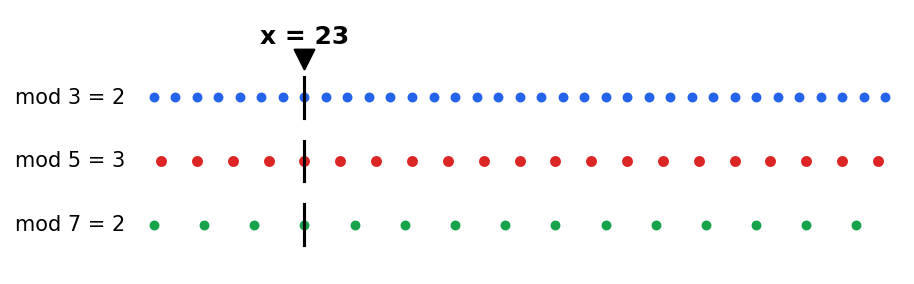

# 中国剩余定理 【7】

Chinese Remainder Theorem

## 讲解

**中国剩余定理（CRT）**：若 m₁, m₂, …, mₖ 是**两两互素**的正整数，则同余方程组

> x ≡ a₁ (mod m₁),   x ≡ a₂ (mod m₂),   …,   x ≡ aₖ (mod mₖ)

在模 M = m₁·m₂·…·mₖ 意义下有**唯一解**。

**数轴上的直观。** 每个同余式 x ≡ aᵢ (mod mᵢ) 挑出一条等差数列——一排等距的点。两两
互素的模数迫使这些点列不断重新对齐，并且每个周期 M 内恰好重合一次：



**构造**：令 Mᵢ = M / mᵢ，tᵢ = Mᵢ⁻¹ (mod mᵢ)（逆元存在是因为 gcd(Mᵢ, mᵢ) = 1——
互素性正用在这里！）。则：

> x ≡ Σᵢ aᵢ · Mᵢ · tᵢ (mod M)

**公式为什么成立。** Mᵢ 含有除 mᵢ 以外的所有模数，所以对所有 j ≠ i 有
Mᵢ ≡ 0 (mod mⱼ)——项 aᵢMᵢtᵢ 对其他同余式完全隐形。而在模 mᵢ 下 Mᵢ·tᵢ ≡ 1，这一项
恰好贡献 aᵢ。每一项都是一个只对自己的模数"打开"的开关。

**实际意义**：分别在几个能装进机器字的小模数下计算，最后用 CRT 把答案合成到模 M。
它也解释了环分解 ℤ/Mℤ ≅ ℤ/m₁ℤ × … × ℤ/mₖℤ。

**非互素模数**：方程组有解当且仅当对所有 i, j 有 aᵢ ≡ aⱼ (mod gcd(mᵢ, mⱼ))；
用 [exGCD](extended-euclid.md) 每次合并两个同余式。

## 例题

**例 1（经典，《孙子算经》）.** x ≡ 2 (mod 3)，x ≡ 3 (mod 5)，x ≡ 2 (mod 7)。
这里 M = 105，M₁ = 35，M₂ = 21，M₃ = 15；
t₁ = 35⁻¹ mod 3 = 2，t₂ = 21⁻¹ mod 5 = 1，t₃ = 15⁻¹ mod 7 = 1。

> x ≡ 2·35·2 + 3·21·1 + 2·15·1 = 140 + 63 + 30 = 233 ≡ 23 (mod 105)

验证：23 mod 3 = 2，mod 5 = 3，mod 7 = 2。✓

**例 2.** 解 x ≡ 1 (mod 4)，x ≡ 2 (mod 9)。M = 36，M₁ = 9，t₁ = 9⁻¹ mod 4 = 1；
M₂ = 4，t₂ = 4⁻¹ mod 9 = 7（4·7 = 28 ≡ 1）。x ≡ 1·9·1 + 2·4·7 = 9 + 56 = 65 ≡
29 (mod 36)。验证：29 mod 4 = 1，29 mod 9 = 2。✓

**例 3（C++）.** 两个互素模数的 CRT：

```cpp
// 解 x ≡ a1 (mod m1), x ≡ a2 (mod m2), gcd(m1, m2) = 1
long long x1, y1;
exgcd(m1, m2, x1, y1);                    // m1·x1 + m2·y1 = 1
long long x = (a1 + (a2 - a1) % m2 * x1 % m2 * m1) % (m1 * m2);
x = (x + m1 * m2) % (m1 * m2);
```

**例 4.** Garner 算法一次只用一个模数逐步恢复 x，不需要大整数运算——当 M 超出
64 位时的标准工具。

**例 5（慢动作——合并不互素的同余式）.** 解 x ≡ 1 (mod 4)，x ≡ 3 (mod 6)。先做相容
性检查：gcd(4, 6) = 2，且 1 ≡ 3 (mod 2) ✓——解存在。由第一式写 x = 1 + 4t，代入第
二式：1 + 4t ≡ 3 (mod 6) → 4t ≡ 2 (mod 6)。各项除以 gcd(4, 6) = 2：2t ≡ 1 (mod 3)，
得 t ≡ 2 (mod 3)。于是 x = 1 + 4·2 = 9，全部解为 x ≡ 9 (mod lcm(4, 6))，即模 12。
合并的配方永远不变：代入 → 除以 gcd → 求解 → 用 lcm 粘合模数。

## 练习

1. 解 x ≡ 1 (mod 3)，x ≡ 2 (mod 5)。*（答案：x ≡ 7 (mod 15)。）*
2. 解 x ≡ 2 (mod 5)，x ≡ 3 (mod 7)，x ≡ 1 (mod 8)。
   *（答案：M = 280；M₁ = 56，t₁ = 56⁻¹ mod 5 = 1；M₂ = 40，t₂ = 40⁻¹ mod 7 =
   5⁻¹ mod 7 = 3；M₃ = 35，t₃ = 35⁻¹ mod 8 = 3⁻¹ mod 8 = 3。
   x ≡ 2·56·1 + 3·40·3 + 1·35·3 = 112 + 360 + 105 = 577 ≡ 17 (mod 280)。
   验证：17 mod 5 = 2，17 mod 7 = 3，17 mod 8 = 1。✓）*
3. 求满足 x ≡ 4 (mod 6)、x ≡ 3 (mod 7) 的最小正整数 x。
   *（gcd(6, 7) = 1，CRT 适用。答案：x = 10；所有解为 x ≡ 10 (mod 42)。）*
4. x ≡ 1 (mod 4)，x ≡ 3 (mod 6) 有解吗？*（gcd(4, 6) = 2 且 1 ≡ 3 (mod 2)，有解。
   候选 x ≡ 3 (mod 6)：3, 9, 15, …；x = 9 满足 x ≡ 1 (mod 4)。
   答案：x ≡ 9 (mod 12)。）*
5. 实现 k 个两两互素同余式的 CRT，并用例 1–2 测试。
6.（挑战）直接证明两个模数的 CRT：设 x = a₁ + m₁·t，代入第二个同余式，用 m₁ 模 m₂
   的逆元解出 t。
