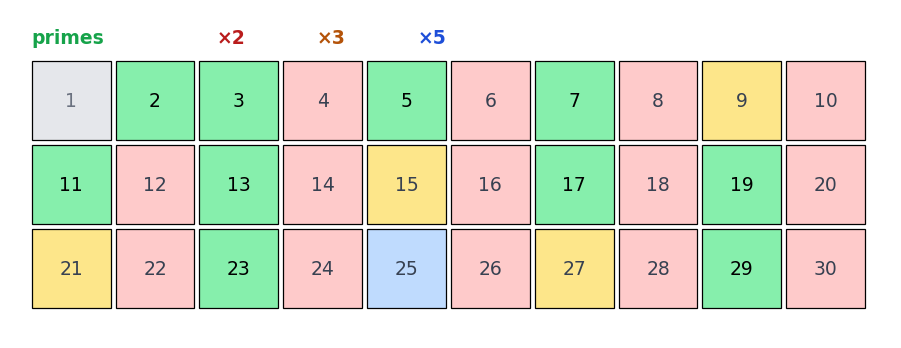

# 欧拉定理和欧拉函数 【7】

Euler's Theorem and Totient Function

## 讲解

**欧拉函数** φ(n) 统计区间 [1, n] 中与 n 互素的整数个数。



**由质因数分解** n = p₁^a₁ · … · pₖ^aₖ 计算：

> φ(n) = n · ∏ᵢ (1 − 1/pᵢ) = n · (p₁−1)/p₁ · … · (pₖ−1)/pₖ

**公式从何而来。** 在 1…n 中，有 1/p₁ 比例的数是 p₁ 的倍数，所以剩下 (1 − 1/p₁)
通过这道过滤；对每个不同的质因子依次过滤，存活比例相乘即可。只有*不同的*质因子起
作用——指数 aᵢ 除了体现在 n 本身中之外不可见。

特例：p 为质数时 φ(p) = p − 1；φ(pᵏ) = pᵏ − pᵏ⁻¹；且 φ 是**积性函数**：
gcd(a, b) = 1 时 φ(ab) = φ(a)φ(b)。

**欧拉定理**：若 gcd(a, n) = 1，则

> a^φ(n) ≡ 1 (mod n)

**证明思路。** 与 n 互素的 φ(n) 个剩余类构成简化剩余系。把它们每个都乘以 a（a 与 n
互素）只是把这组剩余重新排列，所以它们的总乘积不变：a^φ(n) · P ≡ P (mod n)，而 P 与
n 互素可以消去。

推论：当 gcd(a, n) = 1 时计算 aᵏ mod n，可以把指数对 φ(n) 取模：
aᵏ ≡ a^(k mod φ(n)) (mod n)。**易错点**：这要求 gcd(a, n) = 1——不成立时怎么办见例 4。

**批量计算所有 i ≤ n 的 φ(i)** 可以嵌在线性筛中做到 O(n)，用两条规则：
p | i 时 φ(i·p) = φ(i)·p，否则 φ(i·p) = φ(i)·(p−1)。

## 例题

**例 1.** φ(12)：[1,12] 中与 12 互素的是 1, 5, 7, 11 → φ(12) = 4。
公式验证：12 = 2²·3，φ(12) = 12·(1/2)·(2/3) = 4。✓

**例 2.** φ(36) = 36·(1/2)·(2/3) = 12。φ(100) = 100·(1/2)·(4/5) = 40。

**例 3.** 欧拉定理，a = 5, n = 12：5⁴ = 625 = 12·52 + 1 ≡ 1 (mod 12)。✓

**例 4.** 求 7²⁰²⁴ 的末两位：gcd(7, 100) = 1 且 φ(100) = 40，所以
7⁴⁰ ≡ 1 (mod 100)；2024 mod 40 = 24；而 7⁴ = 2401 ≡ 01 (mod 100)，故
7²⁴ = (7⁴)⁶ ≡ 1——末两位是 01。

**例 5（C++）.** 试除法 O(√n) 计算 φ(n)：

```cpp
long long phi(long long n) {
    long long r = n;
    for (long long p = 2; p * p <= n; p++)
        if (n % p == 0) {
            while (n % p == 0) n /= p;
            r = r / p * (p - 1);   // 安全地乘上 (1 - 1/p)
        }
    if (n > 1) r = r / n * (n - 1);
    return r;
}
```

**例 6（C++）.** 线性筛中计算所有 φ(i)，i ≤ n：

```cpp
phi[1] = 1;
for (int i = 2; i <= n; i++) {
    if (!vis[i]) { primes.push_back(i); phi[i] = i - 1; }
    for (int p : primes) {
        if ((long long)i * p > n) break;
        vis[i * p] = true;
        if (i % p == 0) { phi[i * p] = phi[i] * p; break; }
        phi[i * p] = phi[i] * (p - 1);
    }
}
```

## 练习

1. 计算 φ(17)、φ(24)、φ(72)、φ(1000)。*（答案：16；8；24；400。）*
2. 对 a = 2, n = 15 直接计算验证欧拉定理。
   *（φ(15) = 8；2⁸ = 256 = 15·17 + 1。✓）*
3. 求 3⁹⁹⁹ 的个位数字。*（提示：φ(10) = 4；999 mod 4 = 3。答案：7。）*
4. 求 2²⁰²⁵ 的末两位。*（注意：gcd(2, 100) ≠ 1，欧拉定理不能直接用——从 n ≥ 2 起算
   2ⁿ mod 100 的循环：周期 20。答案：32。）*
5. 对 n = 12 列举验证 Σ_{d | n} φ(d) = n。
   *（φ(1)+φ(2)+φ(3)+φ(4)+φ(6)+φ(12) = 1+1+2+2+2+4 = 12。）*
6. 写两个程序：一个计算单个 n ≤ 10¹² 的 φ(n)，另一个用线性筛计算
   φ(1)…φ(10⁷)；比较运行时间。
7.（挑战）分数 a/n（1 ≤ a ≤ n）中有多少个是既约分数？这说明了 φ 的什么？
   *（答案：按定义恰为 φ(n)。）*
