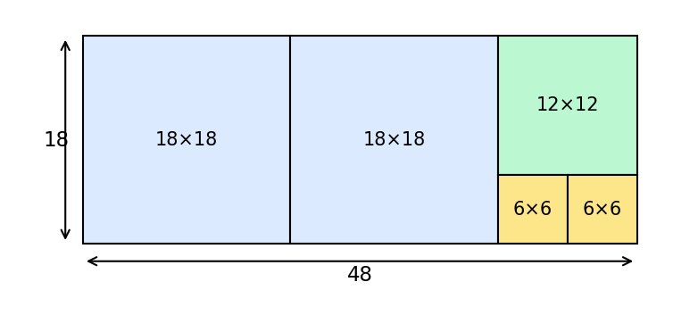

# 扩展欧几里得算法 【7】

Extended Euclidean Algorithm

## 讲解

**扩展欧几里得算法（exGCD）** 在计算 g = gcd(a, b) 的同时，求出满足裴蜀等式的整数
x、y：

> a·x + b·y = g

**几何直观——把辗转相除看作铺砖。** 往 a × b 的矩形里填入尽可能大的正方形，恰好对应
每一步除法：



每一次"铺满正方形、留下余量"就是一次带余除法。恰好铺满整个矩形的最小正方形的边长
就是 gcd(48, 18) = 6。exGCD 在此之上多了一本账：它记住每个余数*是怎样*凑出来的，
以便最后倒推出系数。

**工作原理。** 普通的辗转相除一步是 a = b·q + r。递归地解出 b·x′ + r·y′ = g，代入
r = a − b·q 得：

> g = b·x′ + (a − b·q)·y′ = a·y′ + b·(x′ − q·y′)

所以 x = y′，y = x′ − q·y′。边界：gcd(a, 0) = a，取 x = 1, y = 0。

**应用：**

* **模逆元**：若 gcd(a, m) = 1，则 a·x + m·y = 1 → a⁻¹ ≡ x (mod m)。这是对**任意**
  模数都适用的逆元求法，不限于质数。
* **线性不定方程**：a·x + b·y = c 有整数解当且仅当 gcd(a, b) | c；由一个特解
  (x₀, y₀) 可得全部解 x = x₀ + (b/g)t，y = y₀ − (a/g)t，t ∈ ℤ。
* 是非互素模数下一般[中国剩余定理](crt.md)的基石。

## 例题

**例 1.** 手算 a = 252, b = 105——先做除法，再回代：

```
252 = 105·2 + 42      21 = 105 − 42·2
105 =  42·2 + 21  →        = 105 − (252 − 105·2)·2
 42 =  21·2 +  0           = 252·(−2) + 105·5
```

所以 gcd = 21，x = −2，y = 5。验证：−504 + 525 = 21。✓

**例 2.** 求 11 模 26 的逆元：exGCD 给出 11·(−7) + 26·3 = 1，所以
11⁻¹ ≡ −7 ≡ 19 (mod 26)。验证：11·19 = 209 = 26·8 + 1。✓
（易错点：exGCD 直接给出的 x 可能是负数——务必用 `(x % m + m) % m` 规范化。）

**例 3（C++）.** 实现：

```cpp
long long exgcd(long long a, long long b, long long &x, long long &y) {
    if (b == 0) { x = 1; y = 0; return a; }
    long long x1, y1;
    long long g = exgcd(b, a % b, x1, y1);
    x = y1;
    y = x1 - (a / b) * y1;
    return g;
}
// 模逆元：exgcd(a, m, x, y); inv = (x % m + m) % m;
```

**例 4.** 解 12x + 18y = 30：g = 6 | 30，可解。除以 6：2x + 3y = 5。一个特解
x = 1, y = 1。通解：x = 1 + 3t，y = 1 − 2t。

## 练习

1. 手算 (1071, 462) 的 exGCD：求 g 和一组裴蜀系数。
   *（答案：g = 21；1071·(−3) + 462·7 = 21。）*
2. 用 exGCD 求 17⁻¹ mod 43。*（答案：43 = 17·2 + 9；17 = 9·1 + 8；9 = 8·1 + 1。
   回代：1 = 9 − 8 = 2·9 − 17 = 2·(43 − 2·17) − 17 = 2·43 − 5·17，所以
   17⁻¹ ≡ −5 ≡ 38 (mod 43)。验证：17·38 = 646 = 43·15 + 1。✓）*
3. 求 15x + 25y = 100 的整数解；找出 x 最小的正数解。
   *（答案：除以 5：3x + 5y = 20；一个特解 (5, 1)；通解 x = 5 + 5t, y = 1 − 3t；
   最小正 x 为 5，对应 y = 1。）*
4. 百钱买百鸡：公鸡 5 钱一只，母鸡 3 钱一只，小鸡 1 钱三只。用 100 钱买 100 只鸡，
   求非负整数解：5x + 3y + z/3 = 100 且 x + y + z = 100。
   *（答案：消去 z 得 7x + 4y = 100 →
   (x, y, z) ∈ {(0, 25, 75), (4, 18, 78), (8, 11, 81), (12, 4, 84)}。）*
5. 实现 exGCD；然后对任意 (a, m) 解 a·x ≡ b (mod m)，输出模 m 的所有解或报告无解。
6.（挑战）证明：对 a, b > 0，exGCD 给出的系数满足 |x| ≤ b/g 且 |y| ≤ a/g。
