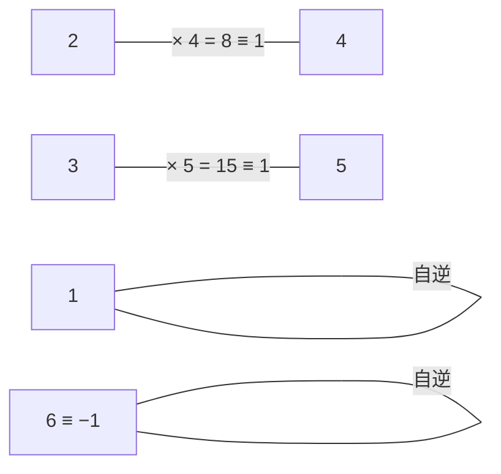

# 威尔逊定理 【7】

Wilson's Theorem

## 讲解

**威尔逊定理**：整数 p > 1 是质数，当且仅当

> (p − 1)! ≡ −1 (mod p)

**为什么成立（配对论证）：** 模质数 p 时，每个非零剩余 a 都有唯一的
[逆元](modular-inverse.md) a⁻¹，而 a ≡ a⁻¹ (mod p) 仅当 a² ≡ 1，即 a ≡ 1 或
a ≡ p−1（因为 p | a²−1 = (a−1)(a+1) 迫使 p | a−1 或 p | a+1）。于是在乘积
1·2·…·(p−1) 中，除 1 和 p−1 外的所有因子两两配成乘积为 1 的逆元对，剩下
(p−1)! ≡ p−1 ≡ −1 (mod p)。



*模 7 的逆元配对：除 1 和 6 之外全部两两抵消。*

**反向**：若 n 是合数，则 (n−1)! ≡ 0 (mod n)，唯一例外 n = 4：3! = 6 ≡ 2 (mod 4)。

**实际地位**：威尔逊定理主要是*理论*工具——计算 (n−1)! 用于素性测试实在太慢。它在
证明题和阶乘模质数的题目中大显身手，尤其是大部分因子能通过逆元相互抵消的区间乘积
问题。

## 例题

**例 1.** p = 5：4! = 24 ≡ −1 (mod 5)。✓ p = 7：6! = 720 = 7·102 + 6 ≡ −1。✓

**例 2.** n = 6 为合数：5! = 120 ≡ 0 (mod 6) ≠ −1，正确地识别出合数。

**例 3.** p = 7 的配对：逆元对为 2↔4（2·4 = 8 ≡ 1）、3↔5（3·5 = 15 ≡ 1），
剩下 1 和 6 自逆：6! ≡ 1·(2·4)·(3·5)·6 ≡ 6 ≡ −1。✓

**例 4.** 快速计算 16! mod 17：由威尔逊定理 16! ≡ −1 (mod 17)。于是
15! ≡ 16!·16⁻¹ ≡ (−1)·(−1) = 1 (mod 17)，因为 16 ≡ −1。

**例 5（C++）.** 小 n 的直接验证：

```cpp
long long f = 1;
for (int i = 2; i < n; i++) f = f * i % n;
bool prime = (f == n - 1);   // 威尔逊定理——仅作演示，O(n)
```

**例 6（慢动作——纯靠配对算 10! mod 11）.** 把因子 2…9 配成逆元对：2·6 = 12 ≡ 1，
3·4 = 12 ≡ 1，5·9 = 45 ≡ 1，7·8 = 56 ≡ 1 (mod 11)。只有 1 和 10 没配上，而
10 ≡ −1，所以 10! ≡ 1·1·1·1·1·10 ≡ −1 (mod 11)。注意我们根本没有算
10! = 3628800——配对*本身*就是计算。威尔逊定理的全部内容就藏在这一行算术里。

## 练习

1. 计算 10! mod 11，对 p = 11 验证威尔逊定理。
   *（答案：10! = 3628800 = 11·329891 − 1 ≡ −1。✓）*
2. 计算 12! mod 13，再用例 4 的逆元技巧求 11! mod 13。
   *（答案：12! ≡ −1 ≡ 12；12⁻¹ mod 13 = 12（因 12·12 = 144 ≡ 1），所以
   11! ≡ (−1)·12 ≡ 1 (mod 13)。）*
3. 证明：对质数 p > 2，(p−2)! ≡ 1 (mod p)。
   *（提示：把 (p−1)! ≡ p−1 两边乘 (p−1)⁻¹ ≡ −1。）*
4. 证明：对合数 n > 4，(n−1)! ≡ 0 (mod n)。*（提示：n = ab（1 < a < b < n）时
   a、b 都出现在乘积里；n = q² 的情形用 q 和 2q 单独处理。）*
5. 写程序：给定质数 p ≤ 10⁵ 和 k，用威尔逊定理加模逆元计算 (p−k)! mod p，
   不要把 p 个数全乘一遍。
6.（挑战）设质数 p = 4k + 1。用威尔逊定理证明 ((2k)!)² ≡ −1 (mod p)，即 −1 是
   模 p 的二次剩余。
