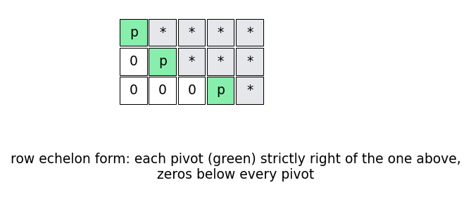

# 矩阵的初等变换 【6】

Elementary Matrix Transformations

## 讲解

矩阵的**初等行变换**有三种：

1. **交换**两行：Rᵢ ↔ Rⱼ；
2. 用非零常数**缩放**某行：Rᵢ ← c·Rᵢ（c ≠ 0）；
3. 把一行的倍数**加到另一行上**：Rᵢ ← Rᵢ + c·Rⱼ。

也有对应的**初等列变换**。初等变换是[高斯消元法](gaussian-elimination.md)的引擎。

**为什么恰好是这三种？** 因为每种都对应线性方程组的合法操作：交换两个方程不改变什
么；方程两边乘 c ≠ 0 保持等价；把一个方程的倍数加到另一个方程上保持所有解（也不产
生新解）。一句话：**对增广矩阵 (A|b) 做行变换，永远不会改变 A·x = b 的解集**。

**关键性质：**

* 它们都**可逆**——每种变换的逆还是同类变换（交换自逆；乘 c 由乘 1/c 抵消；加
  c·Rⱼ 由加 −c·Rⱼ 抵消）。
* 它们保持线性方程组的解集。
* 它们保持矩阵的**秩**——独立方程的真实个数。
* 每个行变换等于左乘一个**初等矩阵**（对单位阵做同样操作所得的矩阵）。所以整个消元
  过程 secretly 就是一次大矩阵乘法 Eₖ…E₂E₁·A。

矩阵经行变换化到"每行的首个非零元（**主元**）严格位于上一行主元右侧"的形状，称为
**行阶梯形**；若主元全为 1 且主元上方全为 0，则称**行最简形**。



## 例题

**例 1.** 对 [[1, 2], [3, 4]] 做 R₁ ↔ R₂ → [[3, 4], [1, 2]]。

**例 2.** 把 A = [[2, 4], [1, 3]] 化为行阶梯形：

```
R₁ ← R₁/2:   [1  2]
             [1  3]
R₂ ← R₂−R₁:  [1  2]
             [0  1]   ← 行阶梯形
```

**例 3.** 继续化为最简形：R₁ ← R₁ − 2R₂ → [[1, 0], [0, 1]] = I。矩阵可逆；消元揭示
了这一点。

**例 4.** 变换 R₂ ← R₂ + 3R₁（3 阶）的初等矩阵是 [[1,0,0],[3,1,0],[0,0,1]]；用它
左乘 A 就执行了这次行变换。

**例 5.** 用初等变换求 A⁻¹：对双宽矩阵 (A | I) 做行变换化为 (I | B)；把 A 变成 I 的
那些操作同时把 I 变成 B = A⁻¹。这是手算逆矩阵的标准方法，也证明了"可逆 ⇔ 可化为
I"。

**例 6（慢动作——一次消元，慢慢讲）.** 解 x + 2y = 5 与 3x + y = 5。增广矩阵
[[1, 2 | 5], [3, 1 | 5]]。第 1 行的主元是第 1 列的 1；第 2 行在它下方有个 3，是主元
的 3 倍，于是 R₂ ← R₂ − 3R₁ 把它消掉：[3−3·1, 1−3·2 | 5−3·5] = [0, −5 | −10]。矩阵
已是上三角——正向阶段*到此结束*。回代：y = (−10)/(−5) = 2，然后 x = 5 − 2·2 = 1。
验证：1 + 4 = 5 ✓，3 + 2 = 5 ✓。再大的消元都是这个循环的重复：选主元 → 消掉下方的
列 → 右移一格。

## 练习

1. 从 [[1, 2], [3, 7]] 出发，用一次行倍加把 (2,1) 位置的元素消成 0。
   *（答案：R₂ ← R₂ − 3R₁ → [[1,2],[0,1]]。）*
2. 写出执行 R₃ ← R₃ − 2R₁ 的 3×3 初等矩阵。
   *（答案：[[1,0,0],[0,1,0],[−2,0,1]]。）*
3. 把 [[1, 1, 2], [2, 3, 5], [1, 2, 3]] 化为行阶梯形。
   *（答案：R₂−2R₁、R₃−R₁ → 行为 [1,1,2]、[0,1,0]、[0,1,1]；再 R₃−R₂ →
   [0,0,1]。结果：[[1,1,2],[0,1,0],[0,0,1]]。）*
4. 变换 Rᵢ ← c·Rᵢ 的逆是什么？*（答案：Rᵢ ← Rᵢ/c。）*
5. 证明：若 A 有两行相同，一次行倍加就能造出零行——故秩 < n 且（方阵时）det A = 0。
6. 对 A = [[1, 2], [3, 4]] 化 (A | I) 求 A⁻¹。
   *（答案：[[−2, 1], [3/2, −1/2]]。）*
7.（挑战）证明：交换两行可以只用缩放和行倍加表示。*（提示：Rᵢ ← Rᵢ+Rⱼ，
   Rⱼ ← Rᵢ−Rⱼ，Rᵢ ← Rᵢ−Rⱼ 得到带符号的交换——最后再用 −1 缩放修正。）*
