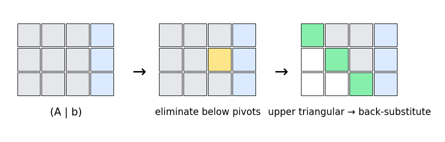

# 高斯消元法 【7】

Gaussian Elimination

## 讲解

**高斯消元法**解 n 元 n 方程的线性方程组 A·x = b：对增广矩阵 (A | b) 做
[初等行变换](elementary-transformations.md)直到 A 变成上三角，然后**回代**读出解。



**算法：**

1. **正向消元**：对每一列 i = 1…n，选一个在该列非零的**主元**行（交换到第 i 行——
   **选主元**时取绝对值最大者以保证数值稳定），然后把第 i 列从下面所有行中消去：
   Rⱼ ← Rⱼ − (aⱼᵢ/aᵢᵢ)·Rᵢ。
2. **回代**：xₙ = bₙ/aₙₙ，然后自下而上 xᵢ = (bᵢ − Σⱼ>ᵢ aᵢⱼxⱼ) / aᵢᵢ。

**复杂度**：O(n³) 时间，O(n²) 空间——n ≈ 500 以内实用。

**消元后读结果**——数主元个数：

* n 个主元 → **唯一解**；
* 出现 [0 0 … 0 | c]（c ≠ 0）的行 → **无解**（矛盾）；
* 主元少于 n 且无矛盾 → **无穷多解**（存在自由变量）。

**为什么要选主元？** 除以过小的主元会灾难性地放大舍入误差：浮点下 10⁻¹² 量级的主元
会把输入的微小误差变成垃圾。换入绝对值最大的元素使乘子 ≤ 1，误差可控。而在精确算
术（分数、模运算）下这个问题不存在——任何非零主元都行。

**竞赛变体**：

* **实数**（double）——标准版；
* **GF(2)**（异或方程组）：加法即异或，主元恒为 1，配合 bitset 压位可达
  O(n³/64)——是求解最大异或值等问题的**线性基**技术的核心；
* **模质数**：除法变成乘模逆元——见初等数论一章。

## 例题

**例 1.** 解方程组：

```
2x +  y = 5
 x + 3y = 5
```

增广矩阵：

```
[2 1 | 5]
[1 3 | 5]  → R₂ ← R₂ − ½R₁ → [2   1  |  5 ]
                              [0  2.5| 2.5]
```

回代：y = 1，然后 x = (5 − 1)/2 = 2。验证：2·2 + 1 = 5 ✓，2 + 3 = 5 ✓。

**例 2.** 无解：x + y = 1，2x + 2y = 3 → 第二行化简为 0 = 1 → 矛盾。

**例 3.** 无穷多解：x + y = 2，2x + 2y = 4 → 两行变得相同 → 一个自由变量：
解为 (t, 2 − t)，t 任意。

**例 4（C++）.** 核心循环（double 版）：

```cpp
for (int col = 0; col < n; col++) {
    int piv = col;
    for (int r = col + 1; r < n; r++)
        if (fabs(a[r][col]) > fabs(a[piv][col])) piv = r;
    swap(a[piv], a[col]);
    for (int r = col + 1; r < n; r++) {
        double f = a[r][col] / a[col][col];
        for (int c = col; c <= n; c++) a[r][c] -= f * a[col][c];
    }
}
// 回代略：x[i] = (a[i][n] - Σ a[i][j]*x[j]) / a[i][i]
```

**例 5.** GF(2) 消元：把减法和除法换成异或——是线性基技术解最大异或问题的基础。

**例 6（慢动作——计算机"眼中"的每一步，n = 3）.**

```
x + y + z = 6
x + 2y + 3z = 14
x + 4y + 9z = 36
```

第 1 列：主元第 1 行。R₂ ← R₂ − R₁ 得 [0, 1, 2 | 8]；R₃ ← R₃ − R₁ 得
[0, 3, 8 | 30]。第 2 列：主元第 2 行（元素 1）。R₃ ← R₃ − 3R₂ 得 [0, 0, 2 | 6]。上
三角！回代：z = 3，然后 y = 8 − 2·3 = 2，然后 x = 6 − 2 − 3 = 1。验证：
1 + 2 + 3 = 6 ✓，1 + 4 + 9 = 14 ✓，1 + 8 + 27 = 36 ✓。三列三个主元——所以解唯一。

## 练习

1. 消元求解：x + y = 3，x − y = 1。*（答案：x = 2，y = 1。）*
2. 解：x + 2y + 3z = 14，2x + y + z = 7，x + y + 2z = 9。
   *（答案：x = 1，y = 2，z = 3。）*
3. 判定结果：x + y = 2 且 x + y = 3；以及 x + y = 2 且 2x + 2y = 4。
   *（答案：无解；无穷多解，y = 2 − x。）*
4. 浮点消元为什么必须选主元？*（答案：除以过小的主元会放大舍入误差；取绝对值最大
   的主元能控制住误差。）*
5. 实现 n ≤ 100 的 double 版高斯消元，输出唯一解或报告无解/无穷多解。
6. 用模逆元在模质数 p = 7 下消元：x + y ≡ 2，2x + 3y ≡ 1 (mod 7)。
   *（答案：消元 R₂ − 2R₁：y ≡ 1 − 4 = −3 ≡ 4；x ≡ 2 − 4 = −2 ≡ 5。验证：
   5 + 4 = 9 ≡ 2 ✓；10 + 12 = 22 ≡ 1 ✓。）*
7. 如果连主元*上方*也消去（Gauss–Jordan 法）会怎样？
   *（答案：矩阵变成对角阵——不需要回代，代价同为 O(n³)；(A|I) → (I|A⁻¹) 就是这样
   求逆的。）*
8.（挑战）关灯问题：把 3×3 灯阵建成 GF(2) 方程组并用异或消元求解。
