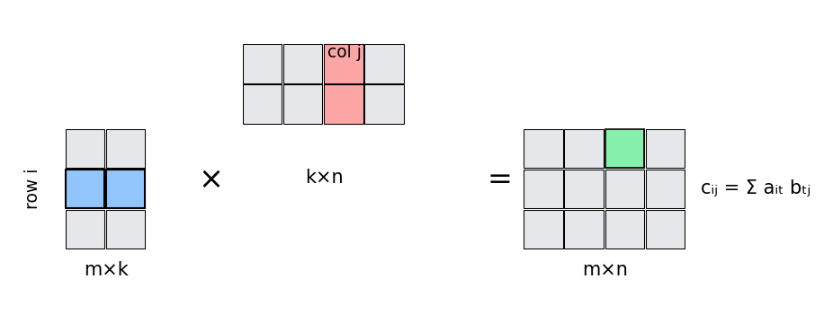

# 矩阵的运算：加法、减法、乘法与转置 【6】

Matrix Operations

## 讲解

* **加减法**：同形状矩阵，逐分量：(A ± B)ᵢⱼ = aᵢⱼ ± bᵢⱼ。
* **数乘**：(cA)ᵢⱼ = c·aᵢⱼ。
* **乘法**：A 为 m×k，B 为 k×n，则乘积 C = A·B 为 m×n，其中

  > cᵢⱼ = Σₜ aᵢₜ · bₜⱼ

  ——即 A 的第 i 行与 B 的第 j 列的点积。内侧维度必须相同（k = k）；结果取外侧维度
  （m × n）。**不可交换**：一般 AB ≠ BA——几何上"先旋转再缩放" ≠ "先缩放再旋转"。
  但有结合律：(AB)C = A(BC)。
* **转置**：(Aᵀ)ᵢⱼ = aⱼᵢ——沿主对角线翻转。法则：(Aᵀ)ᵀ = A，(A + B)ᵀ = Aᵀ + Bᵀ，
  以及 **(AB)ᵀ = BᵀAᵀ**——注意顺序颠倒，这是本章被用错最多的恒等式。



**复合视角**：A·B 是复合映射"先做 B，再做 A"的矩阵。矩阵乘法就是写成算术的函数复合
——这解释了它为什么必须满足结合律（复合天然满足）而不必交换。

**代价**：朴素的 m×k 乘 k×n 是 O(mkn)；n×n 矩阵为 O(n³)。Strassen 类方法存在，但这
个层次很少需要。**结合律关乎速度**：B, C 是向量时 A(BC) 只要 O(n²)，而 (AB)C 要
O(n³)——从便宜的一侧加括号！

**明星应用——矩阵快速幂**：线性递推 Fₙ₊₁ = aFₙ + bFₙ₋₁ 可改写成矩阵幂；配合快速幂
只需 O(log n) 次矩阵乘法——凡是要求 n 高达 10¹⁸ 的线性递推，这是标准工具。

## 例题

**例 1.** [[1,2],[3,4]] + [[5,6],[7,8]] = [[6,8],[10,12]]。

**例 2.** [[1,2],[3,4]] · [[5,6],[7,8]] =
[[1·5+2·7, 1·6+2·8], [3·5+4·7, 3·6+4·8]] = [[19, 22], [43, 50]]。
交换顺序：[[5,6],[7,8]]·[[1,2],[3,4]] = [[23, 34], [31, 46]]——不一样！

**例 3.** 矩阵幂求 Fibonacci：

```
[ F(n+1) ]   [1 1] ⁿ   [ F(1) ]
[ F(n)   ] = [1 0]   · [ F(0) ]
```

**例 4（C++）.** 2×2 矩阵乘法与快速幂求 Fibonacci：

```cpp
using Mat = array<array<long long, 2>, 2>;
Mat mul(Mat A, Mat B, long long P) {
    Mat C{};
    for (int i = 0; i < 2; i++)
        for (int j = 0; j < 2; j++)
            for (int t = 0; t < 2; t++)
                C[i][j] = (C[i][j] + A[i][t] * B[t][j]) % P;
    return C;
}
// 矩阵快速幂：与 qpow 相同的二进制幂，只是把乘法换成 mul()
```

F₁₀ 只需 O(log 10) 次矩阵乘法——对比 O(n) 的迭代。

**例 5.** 验证 (AB)ᵀ：A = [[1,2],[3,4]]，B 同上：
(AB)ᵀ = [[19,43],[22,50]] = BᵀAᵀ = [[5,7],[6,8]]·[[1,3],[2,4]] ✓。

**例 6（慢动作——老老实实算一个元素）.** 手算 [[1,2],[3,4]]·[[5,6],[7,8]] 的 c₁₂：
把手指放在 A 的第 1 行——[1, 2]——顺着 B 的第 2 列——[6, 8]——向下滑。边滑边乘：
1·6 = 6，2·8 = 16；相加：22。矩阵乘法说到底就是这个动作重复 m×n 次。行和列的长度
*必须*相同——这就是为什么内侧维度必须相等。

## 练习

1. 计算 [[2,0],[1,3]] · [[1,1],[0,2]]，以及交换顺序后的乘积。
   *（答案：[[2,2],[1,7]]；[[3,3],[2,6]]。）*
2. 设 A = [[1,2,3]]（1×3），B = [[4],[5],[6]]（3×1）。计算 AB 和 BA——形状分别
   是？*（答案：AB = [32]（1×1）；BA 是 3×3 = [[4,8,12],[5,10,15],[6,12,18]]。
   同样的数，完全不同的形状。）*
3. 自选 2×2 例子验证 (A + B)ᵀ = Aᵀ + Bᵀ。
4. 用例 3 的矩阵幂手算第 5 个 Fibonacci 数（F₁ = 1, F₂ = 1）。*（答案：F₅ = 5。）*
5. A 为 m×k、B 为 p×n 时，AB 何时存在？AB 和 BA 何时都存在？
   *（答案：k = p；k = p 且 m = n。）*
6. 矩阵 X(2×3)、Y(3×4)、Z(4×1)：比较 (XY)Z 与 X(YZ) 的代价。
   *（答案：2·3·4 + 2·4·1 = 32 对 3·4·1 + 2·3·1 = 18——结合律就是白捡的速度。）*
7. 写程序：矩阵快速幂计算第 n 个 Fibonacci 数模 10⁹+7，n ≤ 10¹⁸。
8.（挑战）图中任意两点间长度为 L 的路径数等于 A^L 的元素（A 为邻接矩阵）。写程序：
   O(n³ log L) 计算从 s 到 t 长度为 L 的路径数，模 998244353。
