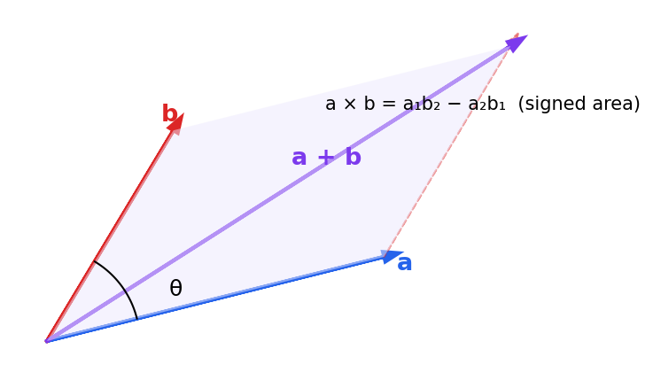

# 向量的运算 【6】

Vector Operations

## 讲解

设向量 a = (a₁, …, aₙ)、b = (b₁, …, bₙ)，标量 λ：

* **加减**：逐分量进行，(a ± b)ᵢ = aᵢ ± bᵢ——几何上是平行四边形（或首尾相接）法则。
* **数乘**：(λa)ᵢ = λ·aᵢ——把向量伸缩 |λ| 倍，λ < 0 时反向。
* **数量积（点积）**：a·b = Σ aᵢbᵢ = |a||b|cos θ。两个定义，同一个量：代数形式 O(n)
  可算；几何形式揭示夹角。
* **模**：|a| = √(a·a) = √(Σ aᵢ²)——向量的长度。
* **叉积（2D 标量形式）**：a × b = a₁b₂ − a₂b₁——a 与 b 张成的平行四边形的*有向*
  面积；符号编码方向（为正 ⇔ 从 a 逆时针转到 b）。



**关键关系：**

* a ⊥ b ⇔ a·b = 0。（不需要开方——垂直判定在整数运算下是精确的！）
* cos θ = a·b / (|a||b|)。
* a ∥ b ⇔ a × b = 0（2D）。
* |a × b| = |a||b|·sin θ——平行四边形面积；三角形面积取其一半。

**叉积的符号为什么重要**：从 A 走向 B，点 C 在你的*左侧*当且仅当
(B − A) × (C − A) > 0。这个原语——**定向判定**——驱动凸包（Graham 扫描、单调链）、
线段相交、点在多边形内判定。它在整数运算下精确，因此坐标为整数时可以完全避开浮点陷
阱（注意溢出：坐标到 10⁹ 时乘积需要 64 位）。

**在计算几何中**，点积和叉积是原子操作：定向判定、用**鞋带公式** ½|Σ pᵢ × pᵢ₊₁|
求多边形面积、点到直线距离、凸包。

## 例题

**例 1.** a = (1, 2, 3)，b = (4, 0, −1)：a + b = (5, 2, 2)，a·b = 4 + 0 − 3 = 1，
|a| = √14。

**例 2.** 垂直判定：(3, 4)·(−4, 3) = −12 + 12 = 0 → 垂直。

**例 3.** 顶点 (0,0), (4,0), (1,3) 的三角形的有向面积：
½ |(4, 0) × (1, 3)| = ½ |4·3 − 0·1| = 6。

**例 4.** 定向：(0,0) → (2,1) → (1,3) 是左转吗？
(2,1) × ((1,3)−(2,1)) = (2,1) × (−1,2) = 2·2 − 1·(−1) = 5 > 0 → 逆时针。

**例 5.** 投影：a = (3, 4) 在 b = (1, 0) 方向上的分量是 a·b/|b| = 3——光垂直于 b
照射时的影长。

**例 6（C++）.** 几何工具箱：

```cpp
double dot(double x1, double y1, double x2, double y2) {
    return x1 * x2 + y1 * y2;
}
double cross(double x1, double y1, double x2, double y2) {
    return x1 * y2 - y1 * x2;
}
```

## 练习

1. a = (2, −1, 3)，b = (1, 4, 0)。计算 a + b、3a − 2b、a·b、|a|、|b|。
   *（答案：(3, 3, 3)；(4, −11, 9)；−2；√14；√17。）*
2. 求 (1, 1) 与 (0, 1) 的夹角。*（答案：cos θ = 1/√2 → 45°。）*
3. 求 λ 使 (λ, 2) ⊥ (3, −1)。*（答案：3λ − 2 = 0 → λ = 2/3。）*
4. 求由 (3, 1) 和 (2, 5) 张成的平行四边形面积。*（答案：|2·5 − 1·2| = 13。）*
5. 用鞋带公式求多边形 (0,0), (2,0), (2,2), (0,2) 的面积。*（答案：4。）*
6. 点 A(0,0), B(3,0), C(2,2)：C 在有向直线 AB 的左侧吗？
   *（答案：(3,0) × (2,2) = 6 > 0 → 是。）*
7. 线段 (0,0)–(4,4) 与 (0,4)–(4,0) 相交吗？用两次定向判定。
   *（答案：相交——每条线段的两端点分别位于另一条所在直线的两侧。）*
8. 写程序：按顺序读入凸多边形的 n 个顶点，用鞋带公式 ½ |Σ (xᵢyᵢ₊₁ − xᵢ₊₁yᵢ)|
   输出面积。
9.（挑战）由 a·b = |a||b|cos θ 推导柯西-施瓦茨不等式 |a·b| ≤ |a||b|。
